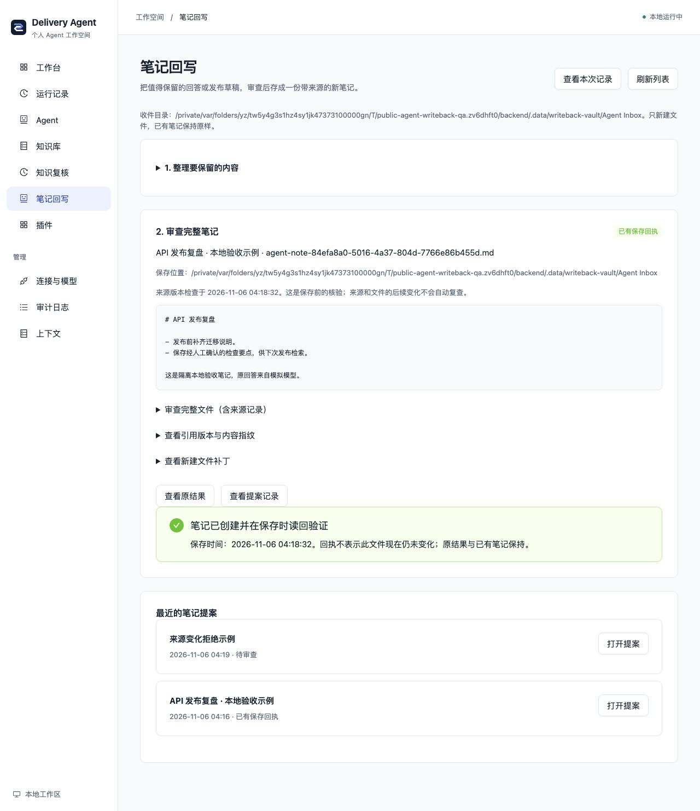

# 审查后把结果保存为知识笔记

`knowledge.writeback` 是独立的可选插件。它把带真实引用的成功知识回答或发布草稿转成新笔记提案，由你编辑、审查和明确确认，再核验原引用版本并新建文件。回写不需要模型；生成原回答仍使用你明确配置的模型。

## 用本地样例开始

在仓库根目录准备一个独立的虚构资料副本：

```sh
mkdir -p backend/.data/writeback-vault/Agent\ Inbox
cp -R backend/examples/knowledge-vault/. backend/.data/writeback-vault/
AGENT_PLUGINS_FILE=examples/plugins.knowledge-writeback.yaml bun run setup:local
```

已初始化时使用 `bun run local`。样例组合有八插件、四 Agent，包含三种模型提供者、Markdown 来源、知识回答、知识工作台、引用复核与回写。默认个人工作台仍为十四插件、九 Agent，不会隐式获得写入目录。

打开终端给出的前端地址。在“连接与模型”中填写自己的模型，或使用已运行的本机 Ollama；保存后重启。先在“知识库”产生一个带引用的成功回答，再打开“笔记回写”。模型内容并非已确认事实，需要自行核对。

1. 选择最近成功的知识回答或发布草稿。没有实际可核验知识引用、旧格式、其他来源或资料不足的结果不能保存。
2. 修改笔记标题和 Markdown 正文，点击“生成新笔记提案”。正文最多 64 KiB，提案只写入应用状态，不在笔记目录创建文件。
3. 审查正文、完整文件、原引用与收件目录。可以下载新文件补丁供审查；它不是自动执行的任意补丁。
4. 明确勾选确认并点击“确认新建笔记”。系统重新核验原运行证据、所引用文档版本和目录身份；变化、缺失或无法核验时拒绝新建。
5. 查看保存回执。收件目录处于所选 Vault 时，知识库下一次检索会沿原同步流程读取新笔记；原结果和已有笔记保持原样。

## 接入自己的 Obsidian / Markdown

复制样例配置到 `backend/examples/knowledge-writeback.local.yaml`，把读取根目录和收件目录改成自己明确选择的位置，例如：

```yaml
- module: ../src/knowledge/markdown/plugin.ts
  config:
    root: '/home/example/My Vault'
    sourceId: personal-vault
    vaultName: My Vault
- module: ../src/knowledge/writeback/plugin.ts
  config:
    outputRoot: '/home/example/My Vault/Agent Inbox'
```

保留样例中的回答和界面等其他插件，先自行创建收件目录，再用该配置启动。`outputRoot` 必须是已存在的普通目录，末级不能是符号链接。文件名由服务固定为 `agent-note-<提案 UUID>.md`，不使用正文/标题拼接路径；用户不能通过页面选择其他路径或覆盖目标。

该目录可位于 Vault 外，但不会因此自动加入当前检索范围。排除目录、隐藏目录或超出来源限制的文件仍遵守原读取规则。新建文件权限为 0600，包含来源运行、原产物指纹、引用路径/版本和 `semanticSupport=not_verified`。这是保存依据，不是对结论正确性或用户身份的认证。

## 网页和混合来源

来源与写回模块必须匹配，同一个 Host 只安装一个 `knowledge.writeback`：

| 原知识来源 | 回写模块（相对 backend/examples） |
| --- | --- |
| Markdown / Obsidian / 资料库的 Markdown 来源 | ../src/knowledge/writeback/plugin.ts |
| knowledge.web | ../src/knowledge/writeback/webPlugin.ts |
| knowledge.mixed | ../src/knowledge/writeback/mixedPlugin.ts |

网页版本复核会访问已配置的公开来源；不会把原网页转换为可写远端系统。混合版本检查共用路由与来源预算，不接收新的 URL 或目录。原稿使用的来源身份必须与当前装配吻合。

## 中断、重复确认和冲突

- 提案固定完整文件与目标目录的内容指纹；修改正文必须重新生成并审查，不能把旧确认挪到新内容。
- `draft → approved → saved`：确认内容先持久记录，再通过私有暂存与排他发布新建完整文件，读回验证后保存回执。已有文件、符号/硬链接和内容不符都会拒绝，不使用覆盖性改名。
- 同一提案重复确认只创建一份文件。已保存文件被移动、删除或修改时，重复操作不会静默重新创建或覆盖。
- 若显示文件已创建但回执未保存，先核对收件目录，再在“最近的笔记提案”打开**同一提案**重试。服务会核对已创建内容，只恢复回执；不要新建另一个提案当作重试。
- 取消或崩溃可能留下已确认提案或隐藏暂存文件，不会自动按文件年龄删除。保存回执描述当次验证，不持续监控文件之后的状态。
- 来源核验是当次读取的版本快照，不是跨来源/目标文件的原子事务，也不判断用户编辑后的结论是否受引用支持。

只支持可信本机 POSIX 文件系统和单后端；当前没有应用登录/RBAC。已有笔记的替换、追加和自动批准尚未实现；此次只交付新笔记分支。原只读来源插件没有获得写文件入口。

实现、数据和验证地图见 [功能卡](../backend/src/knowledge/writeback/FEATURE.md)，底层文件发布依据见 [Node 文件 API](https://nodejs.org/api/fs.html)。

## 本次验证记录

2026-11-06 从干净归档首次启动，以虚构规则和本地 OpenAI 协议模拟服务生成一次 RAG 回答，然后关闭模拟服务、清空模型配置并重启。原回答 Run 为 `afe4b4ab-d986-4dee-8882-c144f0ef2fc4`；新笔记提案为 `84efa8a0-5016-4a37-804d-7766e86b455d`，重启后仍可重新打开并明确确认，笔记数由零变一。保存后检索 Run `3e581641-9989-4676-971d-d6f9e7bafe07` 找到该新笔记。

再对同一原回答生成提案并改变虚构来源，确认 Run `194de7d4-05ae-4a03-a3b3-78f494fb2835` 明确失败，笔记仍只有一份。原来源随后恢复，原回答及已保存文件保留；桌面和 375px 界面、重开提案及补丁下载已验证。回写期间 modelConfigured=false；模拟模型只调用一次用于生成原回答，未验证真实模型质量。


