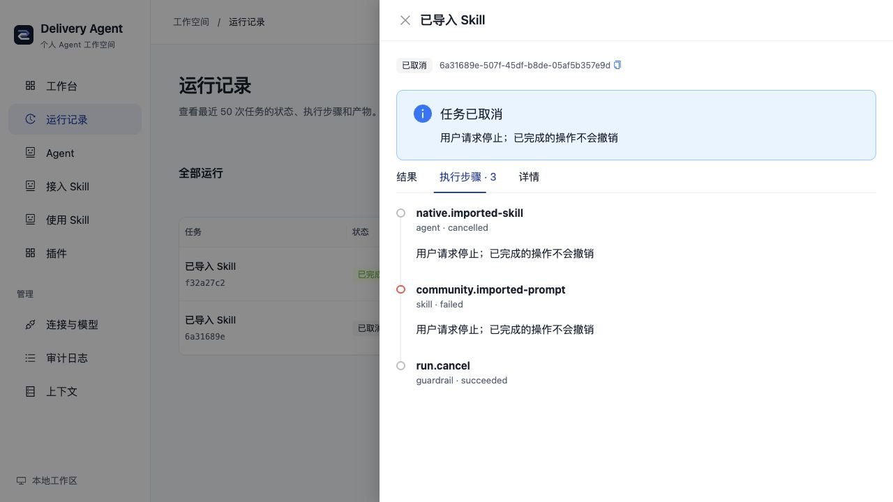

# 本机任务运行与停止

启动：仓库根目录运行 `bun run local`；首次安装用 `bun run setup:local`。无需服务器或 Docker。

1. 从首页、知识库、研究助手、发布准备或已安装的 Skill 文本页发起任务。服务先持久记录真实 Run ID，再返回启动回执；详情会持续刷新。
2. 关闭抽屉或切换页面不会停止任务。到“运行记录”打开最近任务，查看结果、步骤与子任务。
3. 详情显示“请求停止”时可停止该手动根任务。请求沿 Agent、Skill、Tool 和模型的现有取消信号传播；暂停任务也可取消。
4. 取消后查看保留的执行记录。已完成的文件操作、外部调用或此前投递不会撤销；已经保存的产物仍可查看。取消后的任务不能继续。

只有当前本机默认工作区/机器人、来源明确的手动根运行可停止。子任务由父任务管理，历史缺少来源的记录只读。最多同时执行四个本机手动根任务，新异步启动超额会拒绝，没有后台排队；等待人工输入的任务不占活跃槽位。

网络响应丢失时，界面以相同 UUID 和参数自动重试一次，复用原 Run。仍未取得回执会提示先检查运行记录。相同 UUID 不接受不同参数。服务重启不会自动重放任务，未完成记录按既有 `PROCESS_RESTARTED` 标记失败；暂停/已完成记录保留。

停止为协作取消：宿主停止等待并拒绝迟到成功，无法强制结束忽略信号的原生插件代码，也不保证上游模型立即停止计费。模型、Skill、Tool 可能有更早的自身超时，具体失败原因保留在步骤中。

原同步 `/api/workspace/runs` 和 SDK 不变；内联发现/导出、验收、配方、后续动作等仍使用完成后返回的流程。本批只新增本机运行控制，不新增业务 Agent 或插件。

开发接口与验证见[工作台功能卡](../backend/src/platform/workspace/FEATURE.md)。
