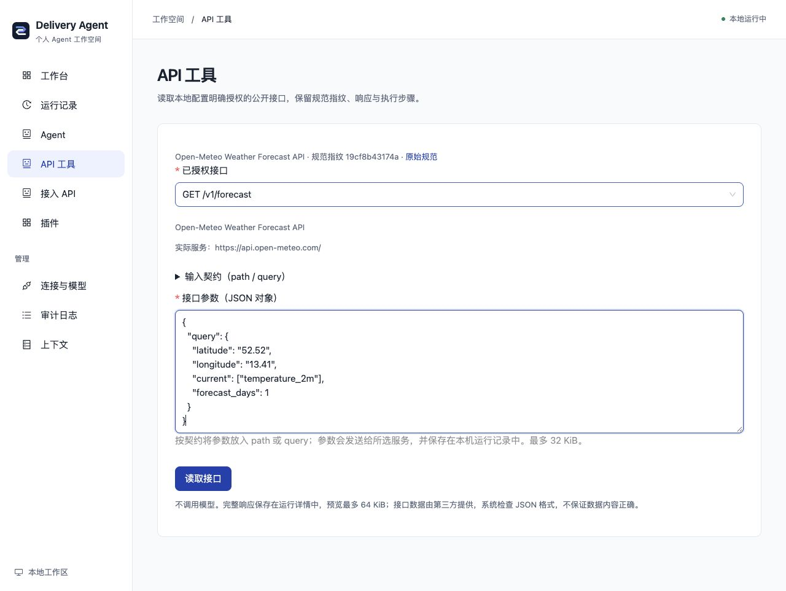

# 从公开 API 到可追踪工具

有些 GitHub 项目只有 REST API 和 OpenAPI 文档，可以直接通过本项目的两个独立插件接入。先读取规范，再审查接口和服务地址，下载固定契约配置后运行。整个流程无需模型或服务器部署。

## 本地开启接入助手

首次在仓库根目录运行：

```sh
AGENT_PLUGINS_FILE=examples/plugins.openapi.yaml bun run setup:local
```

已安装依赖和初始化数据库时，改用 `bun run local`。打开终端显示的前端地址，进入“接入 API”。这是显式的一插件/一 Agent 组合；默认个人工作台仍为十四插件、九 Agent。配置文件中的路径相对 `backend/`。

填写公开 HTTPS 的 OpenAPI 3.0/3.1 JSON 或 YAML 原始文件链接与本地标识。GitHub 使用固定提交的 raw 链接；网页形式的仓库链接不是规范文件。发现过程只读取文档，显示可用接口、参数、服务器与不支持原因，不调用列出的接口，也不执行仓库代码。

## 用 Open-Meteo 复现

[Open-Meteo](https://github.com/open-meteo/open-meteo) 提供天气预测接口，接入表单预填的是以下固定版本：

```text
https://raw.githubusercontent.com/open-meteo/open-meteo/ecd65b64d966224046aaebbcda33a216f0ebd731/openapi/forecast.yml
```

1. 读取目录，查看 `GET /v1/forecast` 的契约，选择公开的 `https://api.open-meteo.com/`。`customer-api` 是另一服务，不能当作匿名示例使用。
2. 页面会提示省略可选 `apikey`；当前匿名模式不生成这个输入字段。审查实际用途和服务器后，勾选读取授权，页面默认勾选保留个人工作台，生成并下载 `openapi-open-meteo.personal.local.yaml`。
3. 将文件放入 `backend/examples/`，停止本次服务，在根目录重新启动：

```sh
AGENT_PLUGINS_FILE=examples/openapi-open-meteo.personal.local.yaml bun run local
```

个人模式声明 base: personal，在重启时按本机设置组合个人知识、研究、资料库、配方与模型，再追加两项 OpenAPI 插件；标准基底为十六插件十一 Agent。取消保留时仍下载原 openapi-open-meteo.local.yaml，保持两插件两 Agent 独立组合；启动时使用下载的实际文件名。未传或 false 的 API 请求保持独立模式，true 显式选择个人基底。不合并其他自定义附加插件或团队组合，重复 ID 不覆盖。

进入“API 工具”，选择接口并填写以下固定公开地点示例（柏林，非用户定位）：

```json
{
  "query": {
    "latitude": "52.52",
    "longitude": "13.41",
    "current": ["temperature_2m"],
    "forecast_days": 1
  }
}
```

该版本规范的经纬度类型是字符串，不做隐式类型转换。输入额外字段或数值经纬度会在请求前失败；请按实际展示的契约填写。

运行详情保留 Agent、路由 Tool、实际 GET Tool 三个步骤、来源规范指纹、请求地址、接收时间、完整 JSON 和响应指纹。模型调用为零；一次成功运行的工具计数为二。第三方数据不在仓库中打包。天气数据来自 [Open-Meteo](https://open-meteo.com/)，依 [CC BY 4.0](https://creativecommons.org/licenses/by/4.0/) 标注；调用需遵守上游[使用条款](https://open-meteo.com/en/terms)，此示例不授予商业服务权限。

## 支持范围

| 范围 | 当前行为 |
| --- | --- |
| 文档 | OpenAPI 3.0/3.1 JSON/YAML，1 MiB；禁止 YAML 别名；最多 200 路径/接口，目录 512 KiB |
| 引用 | 当前文档 components 的 schemas/parameters/responses，最多 16 跳；不抓取远程引用 |
| 方法与网络 | 经用户审查的匿名公开 HTTPS GET，默认端口；全部 DNS 地址必须公网，固定 IP 与原 Host/TLS；不跟随重定向，15 秒、1 MiB 响应 |
| 参数 | 每接口最多 40 个；path/simple 标量，query/form 标量或一层基础数组（最多 100 项）；类型、枚举、基本范围、已支持字符串格式；整数限安全范围，int32 保留原范围 |
| 查询序列化 | explode=true 数组重复键，false 用逗号分隔且拒绝含逗号元素；空数组在前者省略，在后者生成空值 |
| 路径参数 | 非空安全标识符，不允许 `/`、编码斜线、`.` 或 `..`；不支持任意路径拼接 |
| 未支持 | Swagger 2、认证、Header/Cookie、正文、可空/对象/嵌套数组/正则/组合 Schema、回调、服务器变量、私网与写入方法；显示原因并不可选 |
| 凭据参数 | 必填常见凭据参数拒绝；可选常见凭据省略并显示警告，不开放 Secret 输入 |
| 输出 | 成功 HTTP 与有效 UTF-8 JSON；完整原始结果保存在本机，文本预览最多 64 KiB；不完整验证上游输出 Schema，不证明数据正确 |

GET 方法本身不能证明没有副作用，需核对接口实际用途。参数会发送给所选服务，也会保存在本机运行记录中。

## 配置与插件边界

- `openapi.setup` / `native.openapi-inspector` / `openapi.spec.inspect`：目录发现、原记录绑定导出和接入页面。
- `connector.openapi` / `native.openapi-runner` / `openapi.tools.run`：固定 GET 工具、通用运行页面和结果记录。
- 导出请求仅提交成功发现的 Run ID、接口 key、服务器选择、明确审查及可选 includePersonalWorkspace 布尔值。服务端先核对默认 workspace/bot 与成功根能力，再从该次目录生成配置；不接收客户端 Schema 或模块路径。
- 配置固定服务器、路径、参数及来源 SHA，不自动加载后续新增接口。更改授权需重新发现并审查。内容指纹不是上游服务版本或语义保证。
- 下载不改变当前 Host。用户保存并重启后生效；切换组合保留旧记录，插件移除后入口和工具一起释放。*.local.yaml 被 Git 忽略。

实现和验证地图见 [OpenAPI 功能卡](../backend/src/connectors/openapi/FEATURE.md)，规范依据见 [OpenAPI 3.0](https://spec.openapis.org/oas/v3.0.3.html) 与 [3.1](https://spec.openapis.org/oas/v3.1.0.html)。MCP/标准 Skill 接入继续使用各自适配器，不把任意 GitHub 仓库视作可执行插件。

## 本次验证记录

2026-11-06 从干净归档执行根目录首次启动，再用界面下载的配置重启：发现 Run `3ffa02f1-f12c-4dfd-b0c1-3c8971b2ffab`；真实 GET Run `416dcf7c-51e1-4488-bb23-7dc047cfeedd`，成功 HTTP、325 字节 JSON、三个步骤、模型零次、工具两次。规范 SHA-256 为 `19cf8b43174a67d1964772e566fa7d438bb4d0a0d810a75a1f07a2c71d42a066`。错误参数 Run `5fdb7d6a-02ce-49e7-8e0c-b5e2b9967edb` 在实际 GET 前失败。切换组合保留发现历史；375px 运行表单宽度无横向溢出。数据会随服务与时间变化，不用该次数值作为业务准确性基准。

后端 678 通过 / 1 个真实 TAPD 测试跳过；前端 25 通过，类型、lint 和构建通过，保留已有 163 个 lint 警告及大分包提示。新边界由 openApiConnector.test.ts 的六项专项测试覆盖。



## 在研究助手中使用

启用对应读取运行器并保留个人工作台后，可在研究页选择当前授权工具、核对实际服务和固定参数，再明确允许本次研究调用。最多三份固定请求，不允许模型改写参数；暂停后继续保持原确认，服务/授权/契约变化须新建任务。实际读取保留独立子任务及原共享预算，确认记录不算资料。详见[研究流程](PERSONAL_RESEARCH.md#让已接入工具参与研究)。
