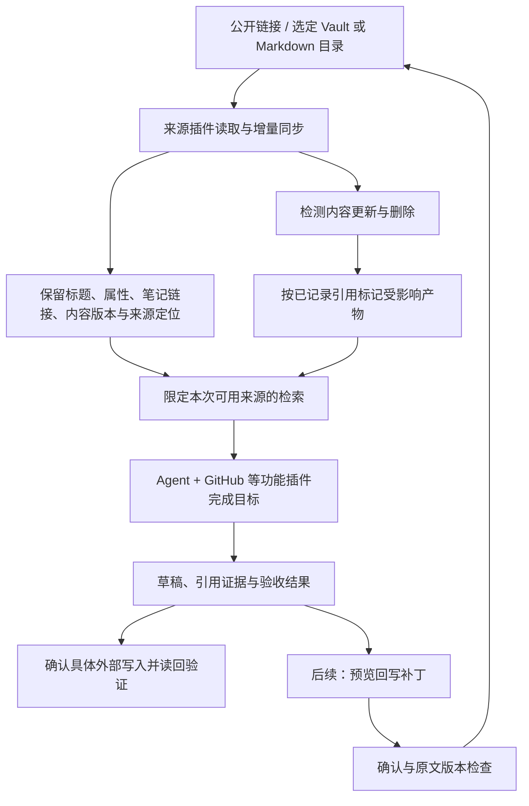

# 个人知识库：让自己的知识参与 Agent 工作

状态：设计提案，部分实现。日期：2026-11-05。属于[产品方向](PROJECT_DIRECTION.md)的首版核心场景。当前已实现只读 Markdown/Obsidian 与公开单页网页来源、版本/笔记链接关系、进程内同步、关键词检索和可选 RAG 回答，见[实际使用指南](PERSONAL_KNOWLEDGE.md)。RAG 核验引用身份和引文存在，尚未自动证明结论语义；专项测试使用本地模拟模型。只读[发布准备 CLI](RELEASE_PREPARATION.md)已结合仓库事实和个人规则生成可复核草稿，生成测试仍用本地模拟模型。现可通过[本地状态与引用复核](KNOWLEDGE_IMPACT.md)检查指定历史 Run 的实际知识文档版本；本机工作台已提供来源配置、检索/回答与显式引用复核，见[界面设计](AGENT_WORKSPACE_DESIGN.md)；跨来源联合/向量检索、专门的发布界面、外部写入、全局自动监控仍未实现；本文后续目标不等于当前接口。

## 产品定位与取舍

用户连接自己的链接、笔记和项目资料，选择本次任务可以使用的范围，Agent 据此生成报告、发布草稿或行动建议。每个产物可以回到引用的原文和版本，知识更新后可以找出直接受影响的产物。

首批使用者是已经使用 Obsidian/Markdown、同时维护软件项目的开发者。先证明一个人愿意每周使用，再扩展团队共享。项目保留任务、站会、报告等功能插件，不要求每位使用者安装全部功能。

导入文档、RAG 问答、引用和自动同步已有成熟实现，例如 [Open WebUI Knowledge](https://docs.openwebui.com/features/workspace/knowledge/) 与 [AnythingLLM 文档同步](https://docs.anythingllm.com/beta-preview/active-features/live-document-sync)。本项目的差异假设是把个人知识的来源、版本与 Agent 实际产物连接起来；需要用重复使用和结果质量验证，不宣称行业首创。

首版围绕“带着已有知识完成发布准备”打通接入、检索、生成、验收和变更提醒。通用知识聊天保留为检查检索效果的入口，不单独扩展成另一个聊天产品。

## 用户流程

1. 添加一个公开网页链接，或选择 Obsidian Vault/Markdown 的指定目录。
2. 查看将读取哪些文件、忽略哪些内容、哪些文件暂不支持；预览后建立索引。
3. 选择“本周发布准备”，指定仓库和允许使用的笔记目录。
4. 获得草稿、阻塞项与来源引用；点击引用查看原文段落和版本，可在 Obsidian 打开本地笔记。
5. 信息缺失或规则冲突时看到“待确认”以及对应依据，补充后继续。
6. 决定是否执行具体外部写入，确认目标与内容后执行并读回核验。
7. 修改发布规则并同步后，相关草稿被标记为“依据已更新”，可选择重新生成。

后续可以将确认的复盘、决策或研究结论保存回指定笔记。回写先展示补丁，确认后检查原文版本并写入；不在首版直接编辑整座 Vault。

## 接入范围

| 来源 | 首版方式 | 清晰边界 |
| --- | --- | --- |
| 公开网页链接 | 输入单页 URL，提取正文，保留抓取时间、内容版本和原始 URL | 首版不自动遍历全站；登录态、付费墙、动态交互失败时明确说明 |
| Markdown 文件夹 | 本机目录或部署端只读挂载，选择目录和排除项后同步 | 浏览器中的本机路径不能被远端服务器直接读取；远端部署需要挂载副本或上传文件 |
| Obsidian Vault | 复用 Markdown 文件读取，增加内部链接、别名、标签、属性与原文打开链接 | 不要求安装 Obsidian 社区插件；不依赖非官方 Sync 接口；不运行 Vault 中的脚本 |
| Git 文档、Notion、飞书、已有 RAG/MCP 服务 | 后续来源插件分别适配接口、授权和同步语义 | 不承诺仅凭一个私有链接就能获取内容；复用明确、受授权的 API |
| PDF、图片和扫描件 | 后续解析插件贡献文本与位置引用 | 首版未解析的附件列为未支持，不能显示为已经纳入知识 |

[Obsidian 官方说明](https://obsidian.md/help/data-storage)确认 Vault 使用 Markdown 纯文本文件。[URI 协议](https://obsidian.md/help/Extending%2BObsidian/Obsidian%2BURI)可打开笔记，但不是远程读取知识库的接口。浏览器不能从 `obsidian://` 自动获得整份本地知识库。

## Obsidian 需要处理好的地方

- 按标题层级保留段落；读取 YAML 属性、标签和别名，不把它们丢在纯文本碎片里。
- 识别 [Wikilink 和 Markdown 内部链接](https://obsidian.md/help/links)，支持引用到标题，并保留展示名称。相同笔记名无法唯一定位时显示歧义，不静默选一份。
- 首版保留嵌入链接与附件关系；附件正文未解析、块引用未支持或链接失效时明确标注。跨笔记扩展限制深度与数量，处理循环，不能把整座 Vault 都塞进上下文。
- 默认排除 `.obsidian`、`.git`、回收站、隐藏文件和用户排除项，展示最终读取清单。自定义配置目录由用户显式排除；范围外的符号链接不跟随。
- 新增、修改、删除与移动都能重新同步。首版可将重命名视作旧路径删除和新路径新增，不承诺自动识别全部文件迁移。
- 引用返回来源、相对路径、标题/段落定位、内容版本与读取时间。打开 Obsidian 原文展示当前内容；原文已改变时保留本次运行所用版本的标识，不能把当前内容冒充历史依据。

属性与附件的格式依据见 [Obsidian Properties](https://obsidian.md/help/properties) 和 [Attachments](https://obsidian.md/help/attachments)。Canvas、Bases、Dataview 等扩展语义不纳入第一版兼容承诺。

## 每个能力仍然是插件

继续使用现有 `FeaturePlugin` 和 Cordis 生命周期。下面覆盖已实现来源与后续职责；来源目前各自维护内存索引，复用排序与证据协议。独立索引、联合检索和回写仍属目标边界，不是当前 SDK 已有的字段。

| 插件职责 | 负责什么 | 不负责什么 |
| --- | --- | --- |
| Markdown/Obsidian 来源插件 | 在授权目录读取、保留链接和定位、枚举变更与删除 | 选择业务任务、擅自扩大读取范围 |
| 网页来源插件 | 获取授权 URL、提取正文、保留来源与抓取状态 | 绕过登录权限、无限抓取站点 |
| 知识索引与检索插件 | 文档/版本管理、分段、检索、返回可引用片段 | 直接执行外部业务动作 |
| 向量化或重排插件 | 按需要提供检索实现 | 拥有原始资料或覆盖访问控制 |
| 发布准备/报告插件 | 结合仓库事实和检索证据产生业务结果 | 复制来源适配与索引实现 |
| 后续知识回写插件 | 生成补丁、确认、版本冲突检查与写入验证 | 静默覆写原文或接受文档中的授权指令 |

先实现 Markdown/Obsidian 与单页网页两个来源插件。关键词与语义检索按评测结果组合，首版不新建图数据库；普通链接记录已经能支持来源跳转与有限关联检索。现有外部知识库若能提供检索及可验证引用，可通过适配器接入，不强制二次索引。

最小共享信息包括来源 ID、所属使用者/范围、文档路径或 URL、标题、内容哈希/版本、片段定位、链接关系、同步状态和删除标记。连接器不得自行决定把私有资料发给哪个群或外部服务。

## 三个可验证的亮点

### 个人知识真正影响执行

演示 Vault 中的《发布规则》要求 API 变更必须提供迁移说明。GitHub 样例中有一个缺迁移说明的 PR。Agent 生成发布草稿时，应引用该规则并列为阻塞；不能只给一份通用发布模板。

知识事实、个人偏好与当前外部事实分别标明来源。冲突显示双方依据，让用户选择适用规则；不单凭修改时间就认定某个版本更权威。知识中的文字是资料，不是宿主授权。

### 知识变更可以追到产物

每个生成产物记录实际引用的来源、文档版本和片段。同步发现来源更新或删除时，通过引用关系标记相应产物待复核；原产物和运行证据保留，重新生成产生新版本。

首版只覆盖已记录的直接引用关系。没有记录引用的语义影响不宣称能全部发现；不自动重新执行外部写入。改动一个未使用的笔记不应使所有报告一起过期。

### 使用越久，重复工作越少

后续把已验收的运行保存成用户确认的 Skill/配方，并将有价值的结果提议为笔记补丁。下次复用时重新检查来源版本和执行范围。复用的是经过确认的流程，不把模型生成内容自动认定为个人知识事实。

首版先验证前两个亮点，第三个按路线图后置；平台级插件验收契约仍贯穿来源和执行插件。

## 数据与访问边界

索引是原知识的派生副本，原目录和网页仍是事实来源。来源断开后停止新读取；删除索引和删除原文是两个独立动作，界面明确区分。源文档删除后必须从后续检索排除，保留的历史产物另按可见性和留存策略处理。

个人资料默认仅用于本人选定的任务。项目任务、群聊回复、导出产物都需要显式允许的来源范围。权限过滤在检索与原文读取两处执行，并传播到产物、日志和缓存；不能先召回所有私有片段再让模型决定哪些可以泄露。

“本地索引”不等于“数据不会出机”。模型或向量化服务使用云端时，相关片段可能发送到该服务；连接时显示处理端与数据去向。本地处理模式需要索引、模型、向量化和解析链路都可本地运行，并通过网络行为核验后才能作离线承诺。

网页接入在请求和重定向时校验目标、DNS 解析、网络边界与预算；默认不访问本机、内网和云元数据端点。当前网页来源在自身有界网络实现中执行检查；未来连接器需保持同等边界。源文档、文件名和网页中的指令不能授予执行权限。

当前代码仍使用默认 workspace，缺少应用登录/RBAC。上述个人隔离、共享和云处理提示属于必须实现并验证的条件，不能作为现有产品能力对外承诺。先在可信本机环境验证选定样例；有真实私人资料或多人访问前补齐对应边界。

## 分批实现与验收

| 节点 | 最小交付 | 验收证据 |
| --- | --- | --- |
| K1：来源可用 | 只读 Markdown/Obsidian 和公开单页 URL；读取范围预览；同步增删改；原文定位 | 离线样例覆盖链接、别名、属性、重复文件名、循环与越界；网页用受控测试源验证错误、重定向与大小限制 |
| K2：任务使用知识 | 限定来源检索与引用；发布草稿采用个人规则 | 固定资料集检验找得到、引用支持结论、找不到时说明缺失；与不接入个人资料的同题结果比较 |
| K3：变更影响 | 记录来源版本到产物的引用；来源变化后标记待复核 | 修改已引用/未引用文档、删除、移动、同步失败；确认标记范围正确、旧证据保留、无真实外部重写 |
| K4：受控复用 | 回写补丁和已验收运行转配方 | 确认前不写入；确认后原文被并发修改则报冲突；重复提交不重复写入；复用时重验知识与权限 |

金标准资料集使用虚构个人笔记，不复制真实 Vault。功能实现时在主 Owner 目录新增 `FEATURE.md` 并加入功能索引，与代码和测试同提交；本设计文档不替代功能卡。

对外评估记录首次有效产物耗时、引用正确率、规则采用情况、知识同步遗漏、变更标记准确性、人工修改量和第二周复用情况。只有实测后才报告收益；未支持格式、未获取内容和未验证结论始终可见。
