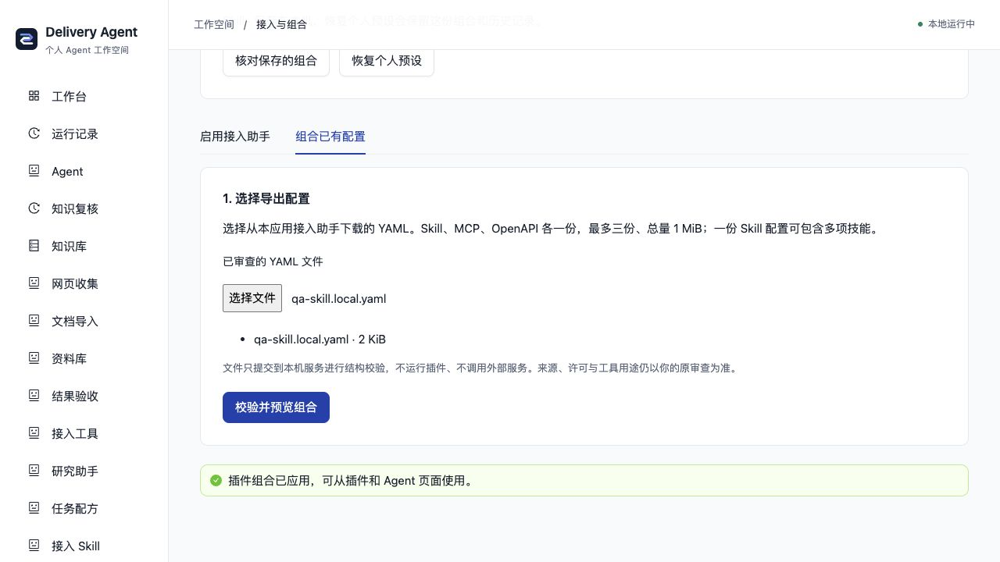

# 把已审查的插件放到同一个工作台

个人默认工作台的「插件」页右上角有「接入与组合」。它把本应用下载的 Skill、MCP、OpenAPI YAML 转成一个配置，保留个人知识库、研究、资料库和任务配方。

## 首次启用接入助手

1. 用根目录 `bun run local` 启动，打开「插件 → 接入与组合 → 启用接入助手」，勾选 GitHub Skill 或 OpenAPI；MCP 发现助手已包含在个人预设中。
2. 点击「保存并应用」。后端自动重载，前端地址保持。完成后点击页面里的「接入 GitHub Skill」或「接入 OpenAPI」即可填写链接并审查；取消勾选并保存可以停用助手。

不需要下载助手 YAML 或切换终端。运行中的任务不会被这一步打断；忙碌时保留选择，任务结束后再次保存应用。手动独立启动后端时，按钮为「保存助手选择」，仍需手动重启。选择保存在本机私有配置中，重新打开页面会恢复勾选。

此步骤只启用发现助手，尚未运行第三方 Skill 或 API。标准示例基底加两助手为十七插件十一 Agent，个人知识和历史保留。审查之后的实际能力仍按下面的组合流程启用。

使用显式 `AGENT_PLUGINS_FILE` 时以你的文件为准，页面保留「生成助手配置」；默认个人页也可展开「导出配置（高级）」。需要导出时，核对 YAML，下载 plugins.setup.personal.local.yaml 到 backend 根目录，再按页面命令显式启动；不会自动合并或覆盖当前自定义组合。助手文件只供发现入口，不应作为能力文件上传到组合页。

## 组合已审查的能力

1. 从对应接入助手审查来源、内容/许可或工具用途，下载 YAML。Skill 可先在同一份配置中加入最多八项。
2. 打开「插件 → 接入与组合 → 组合已有配置」，选择 Skill、MCP、OpenAPI 各一份，最多三份、总量 1 MiB。支持原独立导出和勾选保留个人工作台的导出。
3. 点击「校验并预览组合」，检查来源指纹、工具范围和完整 YAML。重复种类、不完整配置、未知模块、修改后的 Skill/许可及授权不一致会报错。
4. 核对来源、许可与读取授权后勾选确认，点击「保存并应用组合」。使用根目录启动器时，后端空闲重载；页面确认新实例和相同配置版本后显示已应用。
5. 打开「使用 Skill」「运行工具」或「读取 API」使用实际能力。个人知识来源、模型和 GitHub 连接沿用本机设置，已有运行记录保留。



组合会替换上一份保存的组合，不自动叠加已有自定义插件。接入助手随组合选择，恢复个人预设后才可调整原助手偏好。标准示例知识加全部三类为二十一插件、十四 Agent；额外 GitHub/混合来源会增加数量。

页面顶部的「恢复个人预设」会停用组合，保留原文件和历史；之后可点「核对并启用」重新审查启用。旧页面不能覆盖新版本，遇到冲突需重新预览。忙碌时保存的内容保持待应用，任务结束后重新核对应用；独立启动后端时需手动重启。

预览和下载不会改变当前工作台，只有明确保存才写入数据目录中的私有 `plugin-profile.json`（0600、本机明文，已由 Git 忽略）。更换文件会清除旧预览。校验和保存不调用模型或外部服务；应用时 MCP 才连接所选服务。启动时会重新校验原始导出文件。

## 高级：显式文件与启动恢复

展开「下载与启动恢复（高级）」可下载 `plugins.combined.personal.local.yaml`，保存到仓库的 **backend/** 根目录。它的路径已经统一，不要放到 examples/。停止原本地服务，在根目录启动：

```bash
AGENT_PLUGINS_FILE=plugins.combined.personal.local.yaml bun run local
```

显式 `AGENT_PLUGINS_FILE` 始终优先；此时保存的组合暂不生效，页面不能保存或启停它，也不会改写你的显式文件。

如果保存的组合导致启动失败（例如所选 MCP 服务不可用），启动器会退出，不自动回滚。停止服务后在根目录执行：

```bash
bun run plugins:reset
bun run local
```

命令停用保存的组合，保留内容与历史。若原来设置了显式 `AGENT_PLUGINS_FILE`，需先取消它才会使用个人预设。损坏或权限不正确的文件只报错，不自动删除。

## 支持范围

- Skill 保留原始内容、许可、来源/内容 SHA 与单份/集合配置形态，因此旧 Skill ID 不因组合改变。运行仍限于指令文本，无工具、脚本或资源自动接入。
- MCP 仅支持接入页导出的匿名公开 HTTPS，保留所选读取工具；运行器和连接授权必须完全一致。个人基底已有的 MCP 接入助手只装配一次。
- OpenAPI 保留一个服务的固定 GET 契约、服务器与原始规范指纹，不重新发现接口或增加权限。
- 任意原生插件、认证/stdio MCP、多个同类文件、团队/当前自定义组合不在此界面合并。原生插件仍按[作者规范](PLUGIN_AUTHORING.md)自行审查配置。

结构校验不证明来源真实性、许可适用性、服务行为或回答质量。请保留各接入助手的审查记录；不要把来源说明当作额外授权。完整实现边界见[功能卡](../backend/src/connectors/profile-workbench/FEATURE.md)。
