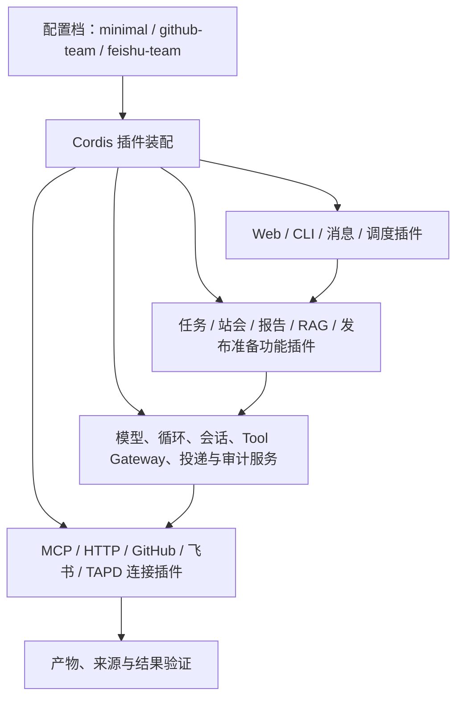

# 产品方向：可以验收的 Agent 插件工作台

状态：设计提案。日期：2026-11-05。本文的目标能力尚未全部实现，当前事实见功能卡和代码。

## 1. 最终呈现什么项目

保留 AI Delivery Ops Agent 名称。面向维护 GitHub 项目、需要团队自动化的小型研发团队，提供可自部署的 Agent 插件工作台：把开源能力接进来，验证它能完成什么，再组合为可以持续使用的交付流程。

用户首先看到项目、插件和运行结果。开发者可以查看插件 SDK、接入已有 MCP/HTTP 服务，或为一个外部仓库提交适配器。现有飞书、TAPD、站会、日报、周报、看板和新闻能力分别保留为插件。

首批需求假设是：维护者愿意为发布准备、项目周报和项目知识检索投入配置时间。此假设需要外部试用验证；现阶段不宣称存在用户增长或生产采用数据。

## 2. 成熟路线与三处改进

框架复用成熟实现：Cordis 负责插件依赖和生命周期，现有 Agent Runtime 负责执行契约；MCP 接入通用工具，HTTP 接入已有独立服务。已有 Agent、Tool、Skill、领域服务与 Outbox 契约逐步迁移，避免一次性替换后丢失行为。

三处改进构成产品假设，并非声称行业首创：

| 改进 | 用户可见行为 | 怎样证明有用 |
| --- | --- | --- |
| 仓库到插件的接入助手 | 给出仓库地址，识别已有 MCP、OpenAPI、HTTP 或 CLI 入口，产出可审查的适配包；已有标准接口直接复用 | 与手工接入比较耗时；记录支持、部分支持和失败，人工补写时间也计入 |
| 插件自带验收契约 | 插件声明成功条件、权限和样例；安装前及版本升级时运行检查，执行后保存实际结果凭证 | 故意引入字段变更、超时、重复回调和假成功，验证系统能阻止或准确标记 |
| 成功运行变成配方 | 从已验收的运行提取步骤、参数和结果要求；用户确认后保存，下一次先试运行再执行 | 重复目标的配置时间和模型调用量下降，成功率保持；失败运行不能直接晋升配方 |

首版实现前两项。运行转配方排在其后，复用现有 Skill，而不引入另一种自动化语言。

### 接入助手的边界

首版优先支持已有 MCP 或明确 HTTP/OpenAPI 接口的项目。CLI 适配随后在受限执行容器内支持；任意 Python/JavaScript 库和大型交互式应用需要人工适配。

仓库分析只生成候选适配包。生成代码、依赖安装脚本、仓库 README 中的指令都不能自动获得宿主权限。固定源版本、检查许可证、隔离验收并审查权限后，才允许启用。

已经提供 MCP 的仓库直接走标准接入路径。接入助手不为它重新生成一套服务器。

### 验收契约的边界

Schema 检查参数形状；验收契约检查该能力的可观测结果。例如发布草稿每个条目必须关联真实 PR，文档转换必须保留样例里的关键标题，写入完成后必须能读回对应外部记录。

每份验收结果必须说明范围、源版本、运行环境、测试样例和时间。通过样例只能证明该范围内的行为。语义质量需要人工或单独评测；模型自评不能替代确定性检查。

## 3. 一条能展示完整价值的演示

用户目标：“根据本周合并的 PR、未关闭问题和项目发布规则，准备发布说明，列出阻塞项。”

演示必须包含：接入一个真实的外部开源能力、成功生成产物、证据不足时标为待确认、一次限流重试，以及写入确认和读回验证。离线样例明确标注为演示数据；模型生成效果与离线回放分别展示。

“文档转换 → 项目知识检索”可以作为第二个演示，接入已有转换项目后生成带来源引用的回答。选择具体第三方实现前核实其入口、许可证和运行限制。

## 4. 用户界面

首版控制台围绕三个工作区组织：

| 工作区 | 用户完成的事情 |
| --- | --- |
| 项目与目标 | 绑定仓库，选择发布准备或项目周报，查看产物、引用、阻塞项和待确认动作 |
| 插件 | 浏览已安装能力、接入仓库或服务、配置凭据引用、查看权限及验收状态、启停插件 |
| 运行记录 | 查看计划、工具调用、来源证据、费用与耗时、失败原因、外部凭证；恢复人工等待或运行离线回放 |

保留现有业务页面，通过插件贡献入口逐步接入。普通用户界面展示业务结果；技术追踪进入运行详情。

前期插件目录使用仓库内受审查的索引。先让外部开发者完成一次真实贡献，再决定是否建设独立市场。

## 5. 每个功能都是插件

“功能插件”是拥有业务目标、配置与验收方式的独立能力包。一个插件可以贡献 Agent、Tool、Skill、触发器和页面；这些是实现零件，不要求一个包只能有一个 Agent。

| 类别 | 示例 | 职责 |
| --- | --- | --- |
| 业务插件 | 任务、站会、日报、周报、发布准备、知识检索、新闻 | 提供用户目标与业务规则 |
| 连接插件 | GitHub、飞书、TAPD、MCP、HTTP | 读取外部事实或执行明确动作 |
| 运行服务插件 | 模型、执行循环、会话存储、工具治理、可靠投递、审计 | 提供可替换基础服务 |
| 界面与触发插件 | Web、CLI、消息入口、调度 | 把同一能力暴露给不同入口 |

“全部插件化”的完成条件包括基础服务和页面/调度贡献。仅把内置 Agent 的注册代码移到另一个文件，不算完成。

配置档只选择组合，不复制实现。`minimal` 不要求飞书或 TAPD 凭据；`github-team` 提供公开项目入口；`feishu-team` 复用已迁移的团队功能。

## 6. 插件规范草案

统一规范覆盖两层：Cordis 原生插件的模块约定，以及跨进程能力的声明和适配。使用相同框架不等于直接兼容全部 DeepSeek Harness 插件；其 `ctx` 服务依赖需要逐项映射。

| 规范项 | 必须明确的内容 |
| --- | --- |
| 身份 | 协议版本、插件 ID、SemVer、作者、许可证、源码地址和固定版本 |
| 接口 | `apply(ctx, config)`，声明服务依赖；远程插件另声明 MCP/HTTP 入口 |
| 配置 | 配置 Schema、默认值、必填项和 Secret 引用；包中不包含真实凭据 |
| 能力 | Agent Manifest、Tool 输入输出、Skill、触发器和页面贡献 |
| 权限 | 数据范围、网络主机、读写动作、文件挂载、超时与资源预算 |
| 验收 | 成功条件、输入样例、预期可观测结果、失败/重试/取消场景和版本兼容检查 |
| 生命周期 | 装配、依赖就绪、启动失败清理、停止与资源释放；数据迁移显式声明 |
| 外部写入 | 目标和内容预览、确认绑定的参数摘要、幂等键、结果读回和未知结果处理 |
| 用户说明 | README、安装步骤、权限说明、已知限制及功能卡 |

原生插件属于受信任宿主代码，其权限声明本身不能沙箱化 JavaScript。未信任的第三方代码优先经受限进程/容器或远程协议调用。运行期权限取插件声明与安装者授权的交集，不能通过 Prompt 扩大。

MCP 工具注解只是提示，不能当作授权证明。远程工具同样经过 Tool Gateway 的身份、范围、预算和确认规则。模型不能关闭这些策略。

首版启停可通过重启装配生效。运行中卸载需要补齐注册项 disposer、在途调用取消和恢复策略后才能开放，避免残留定时器、连接和孤立会话。

## 7. RAG 与其他 Agent 特性的位置

| 能力 | 实际用途与验收 |
| --- | --- |
| RAG 插件 | 检索项目 SOP、发布规则和文档；验证来源引用、版本、新鲜度、删除传播和访问范围 |
| 多 Agent 委派 | 复合目标确有不同能力边界时委派；验证深度、调用预算、超时与父子 Run |
| Session / Checkpoint | 补充信息和确认动作后继续同一目标；重启不能丢失等待状态 |
| Trace 与评测 | 记录真实执行与结果；回放脱敏样例，对比插件或模型版本，回放不触发真实写入 |
| Skill / 配方 | 保存经过确认的重复流程；引用历史证据和版本，不静默扩大权限 |
| 可靠执行 | 外部投递至少一次尝试，结合幂等与结果核验；不宣称跨系统通用 exactly-once |

向量检索、重排、上下文压缩和独立执行沙箱都通过插件按场景增加。没有验收场景的能力先记录触发条件。

## 8. 分批交付与退出条件

| 阶段 | 交付 | 完成证据 |
| --- | --- | --- |
| A：迁移基线 | 通用业务与可靠性修复、脱敏、公共 CI | 已提交 `cc8a7dc`；本地后端 397 通过 / 1 个真实 TAPD 测试跳过，前端 4 个测试通过；类型、lint、构建及秘密扫描通过。首次远端 CI 发现日志组件被忽略，已补齐源码并通过干净归档构建；最终远端结果另行核对 |
| B：插件化底座 | Cordis 装配、插件规范与样例、配置档；现有功能逐项迁移 | 从配置删除功能即可移除其 Agent、Tool、触发器及页面入口；缺依赖、装配失败、停止清理均有测试；现有业务回归保持 |
| C：可用产品 | GitHub 项目入口、MCP/HTTP 接入助手、插件验收、项目周报和发布准备、RAG 插件 | 全新环境按文档完成首个目标；一个真实外部插件接入并验收；带来源产物、确认写入、限流与恢复可复现 |
| D：复用与试用 | 运行转配方、版本回放、外部贡献流程 | 重复目标可复用；插件升级能发现故意植入的回归；至少一个外部开发者依文档完成插件贡献 |

管理端认证、Secret 管理、项目访问边界和外部写入确认属于对外试用前的条件。当前公开版本缺少应用登录/RBAC，只适合可信网络验证；不能以新增插件接口替代这些条件。

## 9. 获得使用者的路径

先支持一个团队已经拥有的 GitHub 仓库。安装和演示可在本机完成，使用者不需要先申请飞书企业应用或 TAPD 工作区。提供能复制的配置、演示数据、插件模板、失败说明和卸载步骤。

首批验证目标是邀请 3–5 个独立维护者或小团队试用，观察真实接入过程。这是目标，不是现有用户数；邀请和公开发布由维护者发起。

记录以下指标，得到事实后再用于 README 或简历：

- 从安装到首次有效产物的时间，目标不超过 10 分钟；演示回放与真实模型运行分别统计。
- 外部能力的接入总耗时、失败率和人工补写量。
- 成功条件通过率、失败恢复率、重复外部写入次数、每次成功目标的费用和耗时。
- 第二周是否再次使用、每周有效完成的目标数、人工修改比例和节省的手工步骤。
- 外部贡献者能否独立完成插件开发和验收。

若用户只看演示而不重复使用，优先收缩或修正场景。若接入助手持续需要大量手写代码，收缩支持范围并公开边界。

## 10. 技术亮点如何进入简历

可证明的技术叙事是：基于 Cordis 设计插件生命周期和依赖装配，通过 MCP/HTTP 复用外部能力，用结果契约、运行追踪和回放评测控制插件质量，并以 RAG、Checkpoint 和 Outbox 支持实际交付流程。

只有能力上线且有测试证据后才描述为已实现；采用人数、成功率、性能和成本改善必须来自实际数据。

## 11. 调研来源与采用理由

调研日期为 2026-11-05。以下为设计依据，不构成这些项目与本项目兼容的承诺。

| 来源 | 已核对内容与本项目选择 |
| --- | --- |
| [DeepSeek Harness 架构](https://github.com/deepseek-ai/deepseek-harness/blob/fcc0ad462172522aaf5c93a7b2e01f6b9f0b0159/docs/architecture.md) | 基于 Cordis 的插件、服务、事件和可释放注册；采用相同生命周期思路，业务契约逐步适配 |
| [DeepSeek 首个插件](https://github.com/deepseek-ai/deepseek-harness/blob/fcc0ad462172522aaf5c93a7b2e01f6b9f0b0159/docs/user/develop/basic/index.md) | `apply`、服务依赖与效果清理；作为原生插件规范参考 |
| [Deep Agents](https://docs.langchain.com/oss/python/deepagents/overview) | 上下文、委派、技能和人工参与；按实际目标选用能力 |
| [LangGraph Interrupts](https://docs.langchain.com/oss/python/langgraph/interrupts) | 持久化暂停恢复；保持同一会话、明确副作用重放边界 |
| [Anthropic 长任务 Harness](https://www.anthropic.com/research/harness-design-long-running-apps) | 分阶段执行、结构化交接与独立评估；采用具体结果检查而非仅凭模型自评 |
| [Dify 插件](https://docs.dify.ai/en/develop-plugin/getting-started/getting-started-dify-plugin) | 模型、工具、策略、数据源和触发器等成熟扩展分类；插件化本身属于基础能力 |
| [n8n 工具人工确认](https://docs.n8n.io/build/integrate-ai/ai-examples/human-in-the-loop-for-tools) | 针对具体工具暂停并确认；确认应绑定实际动作 |
| [FastMCP](https://github.com/PrefectHQ/fastmcp) | 复用成熟 MCP 工具生态；已有标准接口直接连接 |
| [MCP Tools 规范](https://modelcontextprotocol.io/specification/2025-11-25/server/tools) | 采用标准工具发现和调用；契约验收在协议之上检查结果 |
