# 项目演示与验证证据

2026-11-05 的本地 Alpha 验证快照。运行功能以
[`a2631a2`](https://github.com/KlayPeter/AI-Delivery-Ops-Agent/tree/a2631a2ae6cb486f82d9aada310cef7b6ed5f159)
为基线；仓库配置保护与干净目录回归基线为
[`0d80fe3`](https://github.com/KlayPeter/AI-Delivery-Ops-Agent/tree/0d80fe3f9a69a3e13dba37d4ecaaf2ac23a6e0bd)。
后续实现和未完成项见[路线图](../ROADMAP.md)。

## 项目定位与卖点

面向开发者和个人知识使用者的本地 Agent 插件工作台。把自己的笔记、网页与文档
接入任务，保存结果的来源与执行过程，再独立检查引用变化和插件结果。

- **个人知识进入工作流程**：Markdown/Obsidian、公开网页和应用资料库参与检索、
  可选 RAG 与 GitHub 发布准备；资料仍保留来源、版本和定位。
- **旧结果可以复核**：按历史 Run 实际引用检查来源变化、缺失和不可访问，
  保存独立评估，保留原结果。
- **开源能力按协议接入**：标准 Skill、MCP stdio/HTTPS、HTTP Agent 与原生插件
  共用宿主执行链路；插件可声明自己的结果规则。

这些是当前产品的组合取舍。实际节省时间、使用频率和采用人数仍需真实用户验证。

## 可以复现的演示

### 无账号体验个人知识

1. 按[本地运行](LOCAL_DEVELOPMENT.md)启动两个开发进程，示例凭据留空。
2. 进入「知识库」，点击「API 迁移说明」，再点击「检索原文」。
3. 结果应引用内置虚构笔记 `Release.md` 的第 6–9 行，运行成功；生成引用回答
   需要另配模型，原文检索可直接使用。

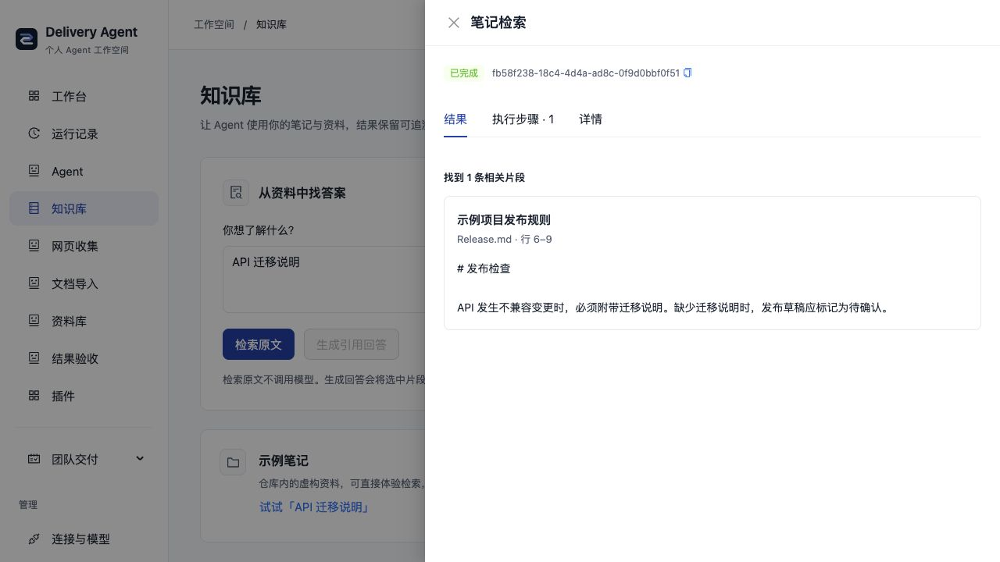

### 个人默认与按需团队

2026-11-05 验证时 HTTP 默认九个个人插件、八个 Agent，首页直接选择可用的笔记检索；
无需先配置模型。默认导航不含团队交付和定时团队配置，团队业务 API/手动任务
未装配。原团队组合仍可按[本地指南](LOCAL_DEVELOPMENT.md#按需启用团队功能)
显式选择，不自动叠加个人组合。

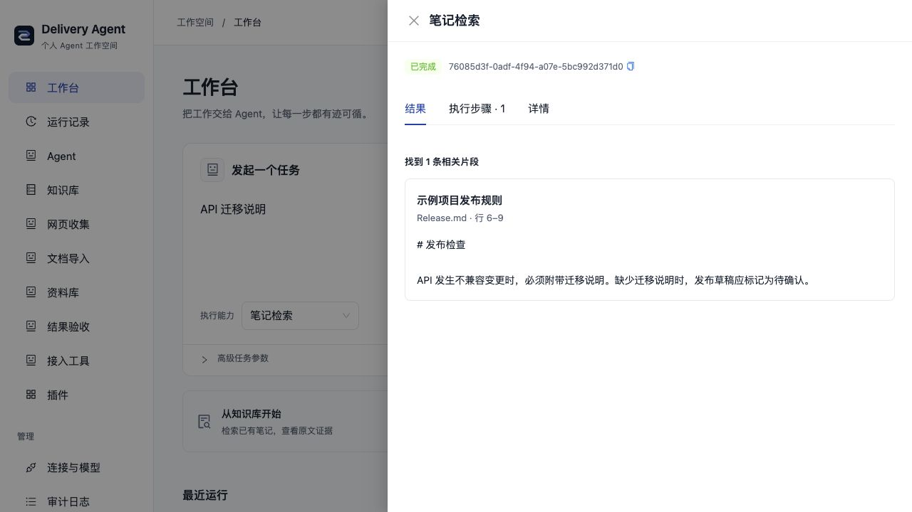

实际对同一本地数据库执行个人 → 团队 → 个人切换：个人组合为 9 插件/8 Agent，
团队组合为 9 插件/7 Agent/9 项手动任务；原 4 条运行保留，新增检索结果在两种
组合下均可读取。个人组合的站会、看板与周报接口返回 404。失效能力链接禁用
执行并解释原因，不静默改派；飞书字段仍可填写，页面给出团队组合启用方法。
375px 首页无页面横向溢出，导航不出现团队分区，能力选择器有可访问名称。

该批验证：后端 **611 通过、1 项真实 TAPD 跳过**，前端 **20 通过**，类型、
lint 与构建通过（163 项既有警告和大包提示保留）。预览保留原数据、复用已安装
依赖，未重新执行干净安装；测试见 [装配与历史保留](../backend/test/workspaceComposition.test.ts)
及 [导航与默认能力](../frontend/src/pages/workspace/pages.test.mjs)。

### 个人研究：模型与专业子任务

2026-11-06 增加 personal.research 后，个人默认为 **10 插件/9 Agent**，
明确配置 GitHub 后为 **12 插件/10 Agent**。上节 9/8 是上一批切换验证的历史快照。
原主预览仍未配置模型、无需飞书，保留原 5 条运行。

按[研究助手指南](PERSONAL_RESEARCH.md)配置模型后，在「研究助手」提问。
本轮使用独立数据库、本机 OpenAI 兼容模拟端点、真实 SDK 和专业子 Agent，
实际通过表单完成笔记检索 → 引用回答 → 研究稿，保留两份子运行与原文行号。
父详情有 6 个步骤（Agent、两次委派和三次模型步骤），能打开各子任务。
这是协议与执行链路验证，截图明确标记“本机模拟模型演示”，不代表真实模型研究效果。

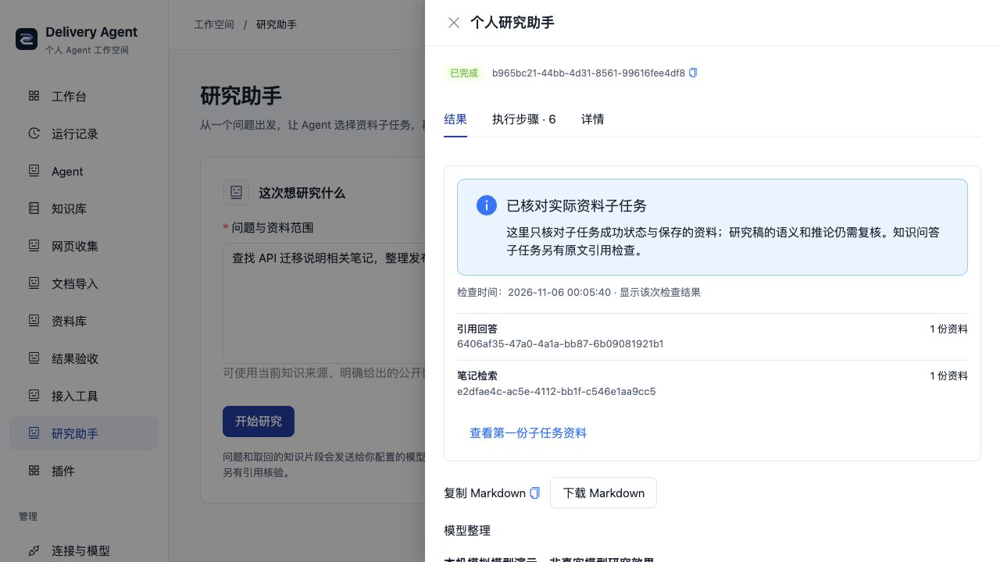

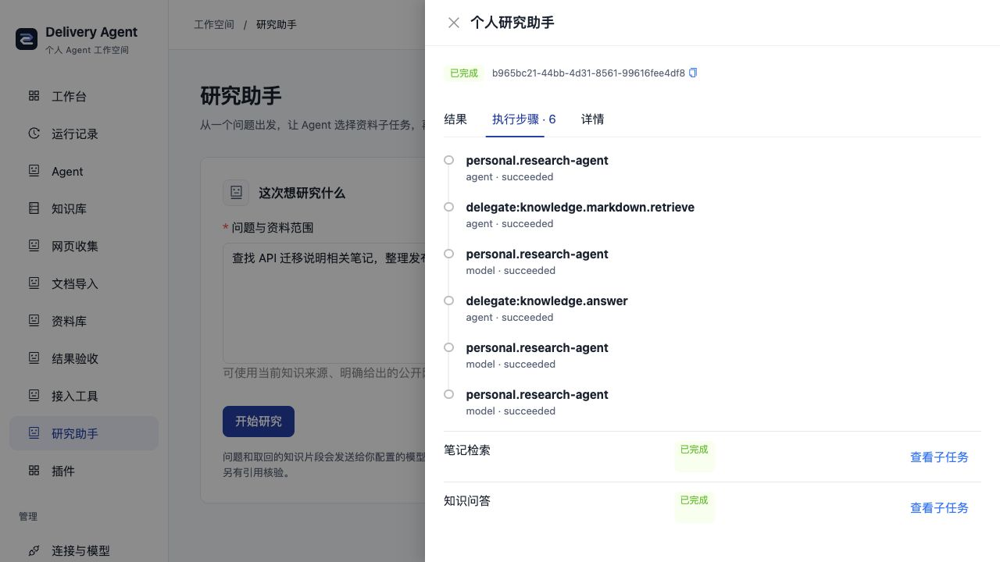

另一次表单任务暂停提问，补充后沿用原 Run 完成；当前结果隐藏旧问题，
原始详情保留历史。375px 表单与结果详情无横向溢出，多份资料引用锚点唯一。
未配置模型的主预览禁用发起研究，并提供连接/检索入口。

该批后端 **624 通过、1 项真实 TAPD 跳过**；研究专项 13 项覆盖实际 SDK、
复合委派、引用拒绝、部分失败警告、未结束子任务、个人 Scope、空稿、暂停继续、
持久委派预算与角色选择器。前端类型/lint/构建通过，保留 163 项既有警告与包体提示；
未调用真实付费模型，预览复用已安装依赖。完整边界见[功能卡](../backend/src/agents/personal-research/FEATURE.md)。

### 已完成任务转为可复用配方

2026-11-06 的配方批次将默认组合增加为 **11 插件/9 Agent**，GitHub 组合为
**13 插件/10 Agent**。上节 10/9 是研究批次快照；配方是确定性控制面插件，
实际执行复用既有 Agent，不增加一个空壳 Agent。

在真实本机工作台完成示例笔记检索，经成功结果入口带入原参数、命名并保存，
刷新及实际后端进程重启后配方仍在。再次审查后连续两次使用相同参数，生成不同的成功运行；
手机上将本次 limit 从 5 改为 3 后再运行，详情显示“本次参数已修改”，原配方
仍为 5。每条新运行都可回到最初的来源结果，原 5 条预览历史保留。
本轮使用实际 Native 检索，未调用模型或第三方服务。

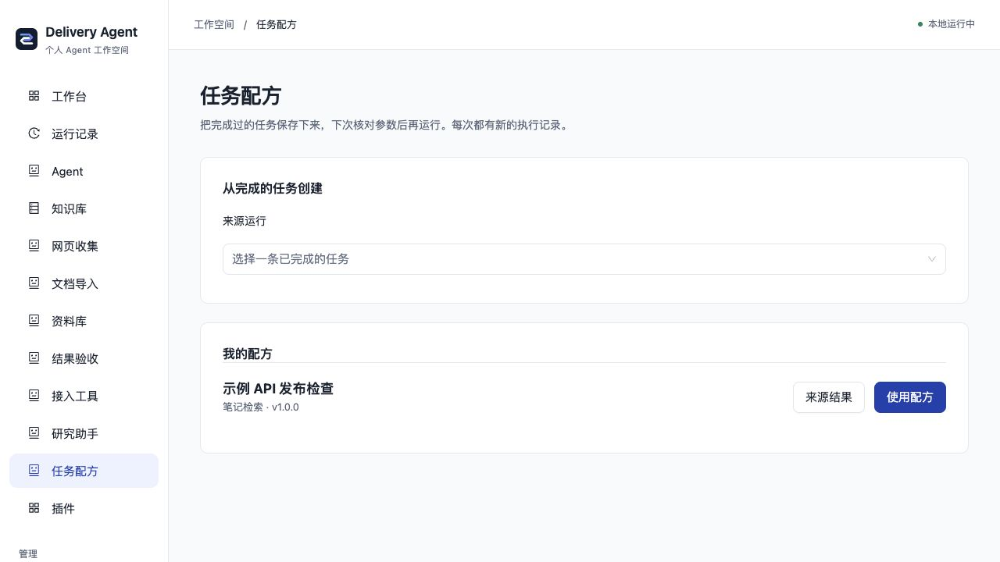

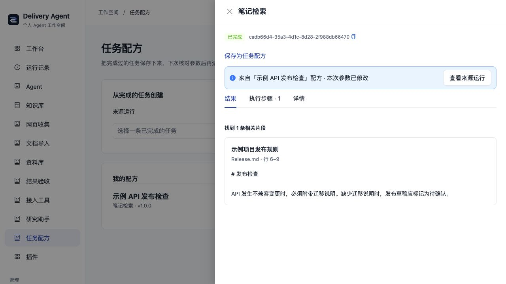

375px 列表和结果详情均无横向溢出。自动测试另外覆盖输入指纹不符、旧凭证/多轮
拒绝、版本变化、预检查后替换实际执行版本、重复/冲突 UUID、跨范围、流式超限、
插件移除/恢复、回执保存失败与初始化就绪边界。最小示例通过真实模块加载器装配。
保存只承诺可追溯参数复用，不复制历史模型轨迹或冻结完整环境；详见
[配方指南](TASK_RECIPES.md)与[功能卡](../backend/src/recipes/FEATURE.md)。

该批后端 **633 通过、1 项真实 TAPD 跳过**，前端 **22 通过**；类型、lint 与
构建通过（保留 163 项既有警告和包体提示）。本地预览复用已安装依赖，
没有重新验证干净安装或真实模型效果。

### 模型提供者插件与无密钥本机接口

2026-11-06 的模型批次把 OpenAI、Gemini、Ollama 分成三个无独立 Agent 的插件。
当前默认 **14 插件/9 Agent**，GitHub 组合 **16/10**，团队 SDK **12/7**；
前面的数字是对应批次的历史快照。主预览重启后，原 11 条运行仍可读取，未配置真实模型。

真实 AI SDK 与可控本机 HTTP 服务验证了无密钥 RAG/CLI、研究委派和子任务资料索引。
独立子进程同时设置全局大小写代理变量及显式云代理，本机请求只到固定回环目标，
不携带保留的云端密钥。提供者释放、失败回滚、第三方插件执行、重定向、压缩、
请求/响应 4 MiB 和及时取消均有回归；连接 API 保存后重建配置生效，移除提供者后配置状态关闭。

浏览器验证选择 Ollama 隐藏 Key、默认本机地址、缺少模型名的字段提示，375px 页面
宽度与内容宽度均为 375px。以下截图是未保存的配置演示，未实际连接 Ollama；
验收后刷新恢复原空模型配置。完整步骤见[本地指南](LOCAL_DEVELOPMENT.md#使用本机-ollama)。

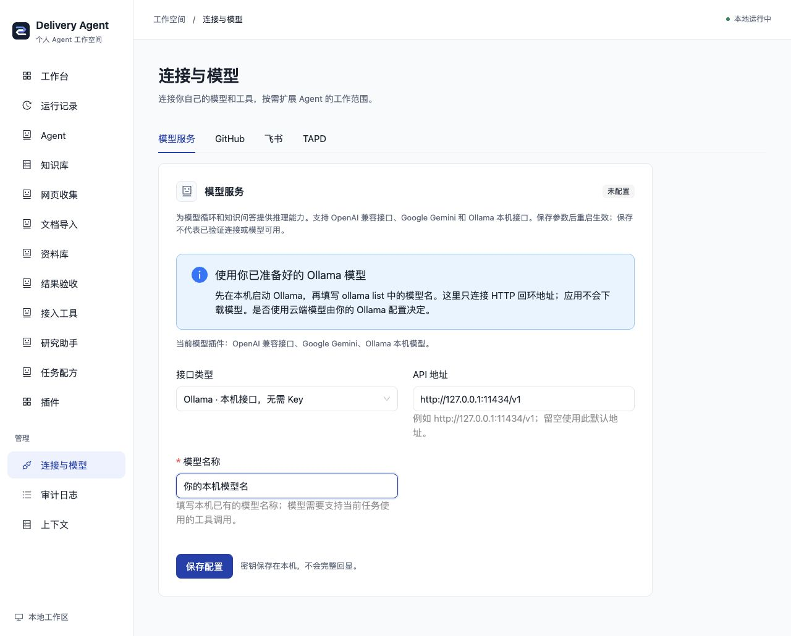

本机没有安装 Ollama 或模型，因此只验证协议与执行链路，不代表真实推理质量、
硬件适配或完全离线。该批后端 **648 通过、1 项真实 TAPD 跳过**，前端 **22 通过**；类型、lint 与构建通过，保留 163 项既有 lint 警告与包体提示。是否使用云端模型取决于用户的 Ollama 配置。旧团队 LLMAdapter
诊断入口未迁移，当前插件模型端口用于 Agent/RAG/研究/发布；详见[功能卡](../backend/src/platform/models/FEATURE.md)。

### 笔记和公开网页共同参与任务

2026-11-06 新增独立 knowledge.mixed。在隔离本地数据库中，先完成示例笔记检索，
通过表单选择混合来源、填写虚构示例目录和固定版本公开 Harness README，保存并实际重启。
重启后为 **16 插件/11 Agent**，原单源运行仍能打开；普通默认保持 **14/9**。

在知识库检索“API plugin”，当次返回 4 条片段，包含笔记与网页，各有原文路径、
行号、来源类型、独立引用及版本。四个步骤是 Native Agent、混合路由、笔记 Tool、
网页 Tool，均成功；实际 3 次 Tool 调用、0 次模型调用。网页读取仍使用原公开网络边界，
本地笔记没有回写，未运行远端仓库代码。

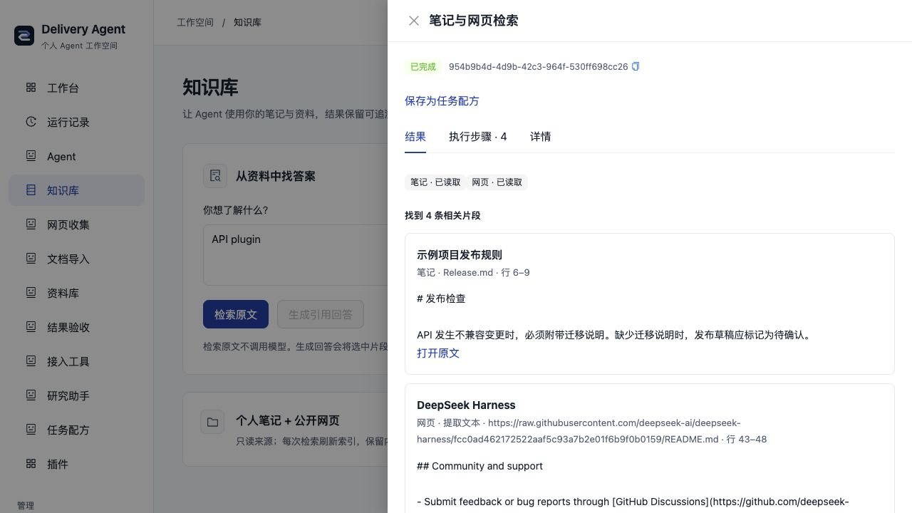

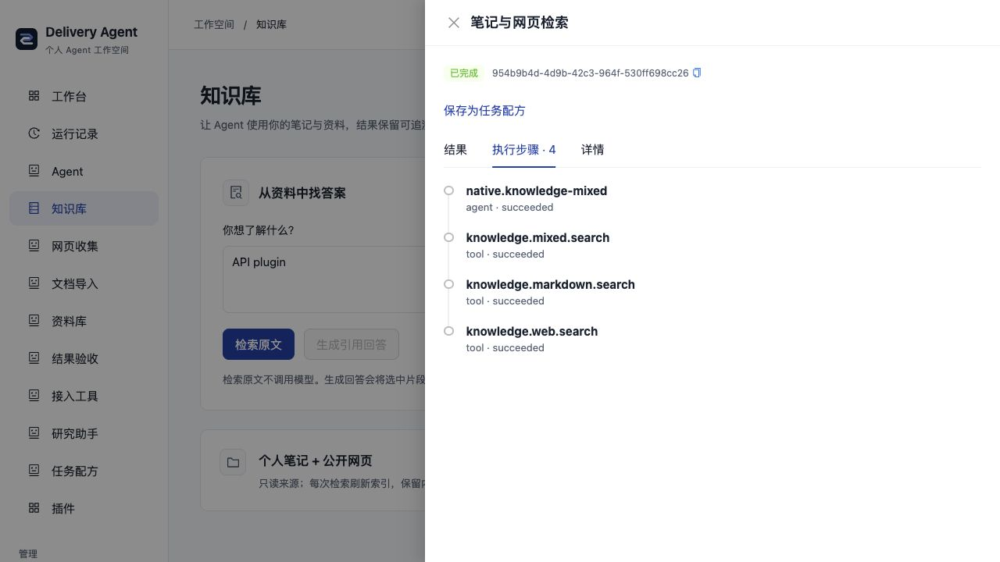

375px 配置抽屉与结果页的页面宽度/内容宽度均为 375px，目录和 URL 可填写，
长来源链接换行；临时视口已恢复。浏览器只验证真实检索，RAG/研究模型链路使用本机协议
服务和真实 SDK 验证，未验证付费或真实本机模型质量。

混合专项覆盖跨源引用、部分/完全失败、修改/删除/不可访问、Scope、共享预算、
研究子任务与发布收集；既有单源回归保留。该批后端 **659 通过、1 TAPD 跳过**，
前端 **22 通过**，类型/lint/构建通过（既有 163 条 lint 警告与包体提示保留）。
使用及边界见[个人知识指南](PERSONAL_KNOWLEDGE.md#同时使用笔记和公开网页)与
[功能卡](../backend/src/knowledge/mixed/FEATURE.md)。这是交错合并的关键词检索，
不宣称向量检索、同一原子快照或模型语义证明；原有 CLI 仍为单源。

### 在线开源工具进入执行记录

1. 完成本地数据库初始化后，在 backend 执行：

   ```sh
   AGENT_PLUGINS_FILE=examples/plugins.context7-http.yaml bun run dev
   ```

2. 启动前端，进入「开发文档」，输入
   `React useEffect cleanup function for a window event listener`。
3. 返回当次 Context7 检索正文与 React 文档来源；运行详情中 Agent 和 Tool
   两个步骤均成功。该次实测为 1 次工具调用、0 次模型调用。

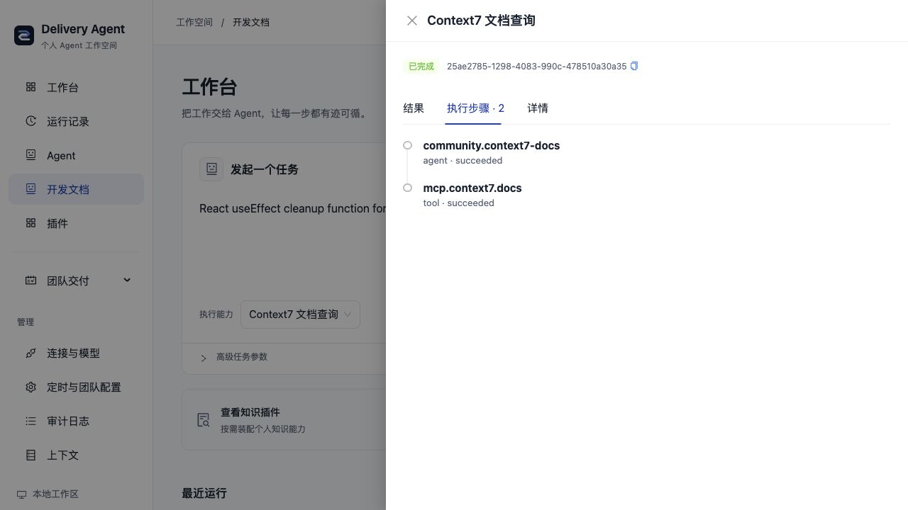

该配置选择 MCP、Context7 及三个模型提供者；直接文档查询不调用模型。查询发送给 Context7，匿名可用性及限额由上游
决定；配置、凭据引用和固定地址边界见[MCP 指南](MCP_TOOLS.md)。

### 从服务地址接入通用工具

默认「接入工具」发现官方 Context7 的匿名 HTTPS 工具目录，展开契约并只勾选
query-docs，明确审查读取授权后下载配置。将下载的 local.yaml 放入
backend/examples，按页面命令重启；在「运行工具」提交：

```json
{"libraryId":"/websites/react_dev","query":"React useEffect cleanup function example","language":"TypeScript"}
```

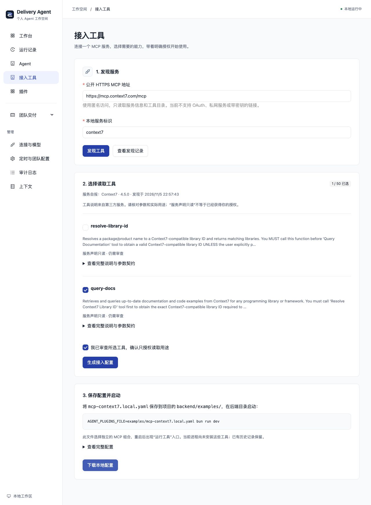

实际使用页面下载的配置重启后，三插件/两 Agent 组合返回了 React 来源正文；
同一运行内 Agent、授权路由和 MCP Tool 三步成功，2 次工具调用、0 次模型调用。
375px 接入表单和详情均无页面横向溢出。发现阶段只读取元数据，不调用目录内工具；
没有自动安装或更改当前 Host。认证服务仍需手工可信配置；详见 [MCP 指南](MCP_TOOLS.md)。

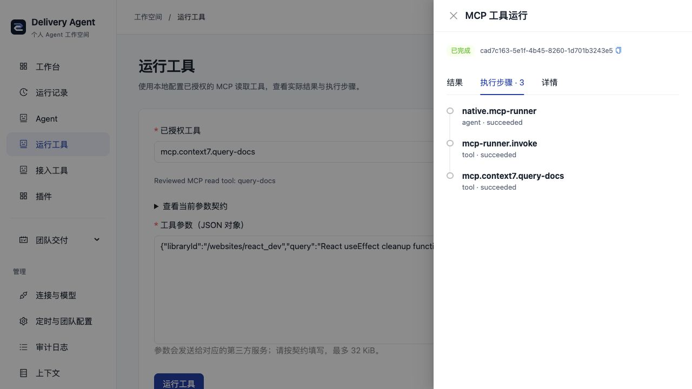

该批增加的 [MCP 接入测试](../backend/test/mcpWorkbench.test.ts)用真实 TCP/SDK
验证配置加载与执行、未授权/参数/Scope/共享预算拒绝、取消和清理。
该批工作区后端回归 **608 通过、1 项真实 TAPD 跳过**，前端 **18 通过**；
类型、lint 与构建通过，仍保留 163 项既有 lint 警告和大包提示。本轮浏览器预览
复用已安装依赖；下方干净安装记录对应原基线，不宣称重新覆盖依赖安装。

### 资料收集、知识复核与结果验收

- 按[文档导入指南](DOCUMENT_IMPORT.md)安装 MarkItDown，转换自己的可公开样例，
  核对正文与来源指纹，明确收录后到「资料库」检索；个人 Vault 保持只读。
- 使用自己的模型生成带引用回答后，修改选定来源，再按
  [知识变更复核](KNOWLEDGE_IMPACT.md)检查旧结果。
- 在「结果验收」选择网页收集或文档转换规则及原运行，可再选基准记录，
  查看结构断言与执行版本。缺少历史凭证显示无法验证，结构通过不代表语义正确。

## 证据地图

| 要证明的能力 | 可核对证据 | 当前范围 |
| --- | --- | --- |
| 通用架构与修复迁移 | [迁移提交 cc8a7dc](https://github.com/KlayPeter/AI-Delivery-Ops-Agent/commit/cc8a7dc)；现有源工程的 49 个平台 TypeScript 路径在公开版均存在，公开版共有 63 个 | 路径覆盖配合回归验证；原工程的待提交实验未当作已迁移能力 |
| Cordis 插件依赖与清理 | [插件规范](PLUGIN_AUTHORING.md)、[插件运行时](../backend/src/platform/plugins/FEATURE.md)、[生命周期测试](../backend/test/pluginRuntime.test.ts) | 独立功能装配、缺依赖/失败回滚/停止清理；基础服务仍有宿主耦合 |
| Tool/Skill、委派与恢复 | [Agent 平台](../backend/src/platform/FEATURE.md)、[委派测试](../backend/test/agentDelegation.test.ts)、[会话测试](../backend/test/sessionRuntime.test.ts) | Scope、预算、父子 Run、人工继续、超时与父中止；原生代码不提供强杀沙箱 |
| 用户审查的任务配方 | [配方测试](../backend/test/runRecipes.test.ts)、[候选参数测试](../frontend/src/runInputs.test.mjs)与上面的实际界面 | 单次成功来源/参数/版本核验、正常 Runtime 新执行与来源关联；不提供多轮上下文或历史环境回放 |
| 研究编排与资料门槛 | [研究测试](../backend/test/personalResearch.test.ts)、上面的本机模拟模型截图 | 真 SDK/子任务/引用、阶段继续与持久委派上限；无真实模型质量或采用验证 |
| RAG 与个人来源 | [Markdown 测试](../backend/test/knowledgeMarkdown.test.ts)、[网页测试](../backend/test/knowledgeWeb.test.ts)、[回答测试](../backend/test/knowledgeAnswer.test.ts) | 关键词检索与可选模型，引用 ID/精确原文核验；模型集成测试使用本地模拟服务 |
| 知识变化影响 | [复核测试](../backend/test/knowledgeImpact.test.ts) | 显式检查实际引用；保留原结果，无全局自动通知 |
| 开源工具与 Skill | [社区说明](COMMUNITY_PLUGINS.md)、[HTTP MCP 测试](../backend/test/mcpHttp.test.ts)、[Context7 测试](../backend/test/context7Plugin.test.ts) | Context7 与标准 Skill 实际接入；MarkItDown 真实格式转换；任意仓库仍需适配 |
| 插件结果契约 | [规则与版本测试](../backend/test/pluginChecks.test.ts) | 同一规则检查保存的产物/步骤，发现植入回归；不重放历史环境或判断语义 |
| 本地启动与连接表单 | [工作台测试](../backend/test/workspace.test.ts)、上面的浏览器截图 | 当前个人默认 11 插件/9 Agent；历史干净安装基线为 17/14；本机私有配置，重启生效 |

## 本次验证结果

- 在独立目录导出已提交源码，分别执行 Bun/pnpm 锁定安装，未借用原工作区的
  node_modules；Prisma 初始化、类型、测试与前端构建通过。
- 后端 **602 通过、1 项真实 TAPD 集成测试跳过**；前端 **17 通过**。
  lint 为 0 错误、163 项既有警告；构建保留大于 500 KiB 的包体提示。
- 转换器虚拟环境另行创建并安装所选格式依赖，实际使用 Python **3.14.7** 与
  MarkItDown **0.1.9**。CI 使用 Python 3.13；其他环境按
  [贡献指南](../CONTRIBUTING.md)复现。
- 新数据库、空凭据启动后就绪，所需飞书连接为 0；通过实际页面检索到示例原文。
- 功能基线的 Git 历史扫描覆盖 167 个提交，Gitleaks 无发现。跟踪文件检查未发现
  `.env`、数据库、日志或开发机绝对路径；本机 `.local.yaml` 由实际 Git 回归验证。
- [0d80fe3 的公开 CI](https://github.com/KlayPeter/AI-Delivery-Ops-Agent/actions/runs/42044702770)
  后端、前端与密钥检查通过；CI 不连接或部署服务器。

以上是指定源码、样例与环境的验证记录；没有把测试数当作使用人数或性能提升。

## 可用于简历的描述

按本人实际参与范围取用：

- 迁移并重构 TypeScript/Bun Agent 系统，基于 Cordis 建立功能插件装配、依赖与
  生命周期，统一 Native、Model Loop、HTTP Agent，以及受 Scope/预算约束的
  Tool、Skill、委派、Checkpoint 和 Outbox。
- 实现个人 Markdown/Obsidian 与网页知识链路，结合可选 RAG、来源版本和精确引文
  核验，支持历史结果的知识变更复核及独立资料收集、转换和资料库插件。
- 接入标准 Agent Skills 与 MCP stdio/Streamable HTTP，设计版本化插件结果规则与
  执行凭证；用真实协议、转换器、故障用例和公开 CI 验证调用与恢复边界。

没有实际数据时，保留采用人数、成功率、节省费用和性能提升数字为空。

## 根目录首次运行验证

从仅含待提交文件的 Git 归档启动，未带 .env、数据库或 node_modules。macOS/Bun 1.3.13/pnpm 10.33.2 下执行 `bun run setup:local`，实际完成两个锁定安装、Prisma 生成、安全建库及前后端启动；依赖下载使用本机缓存，不作为冷启动耗时指标。

浏览器无模型检索“API 迁移说明”，成功记录 e136117a-ab09-422e-9c80-7c2a5021b4c2，展示 Release.md 行 6–9 的原文。再次 setup 保留原 .env，生成数据库备份并保留该 Run；随后 `bun run local` 启动新的动态 API 端口，浏览器仍可打开原运行和引用。三个后端端口实际不同，前端均连接本次端口；Ctrl+C 后本次两个监听端口关闭。

本批后端 667 通过、1 项真实 TAPD 跳过；前端 22 通过，类型、lint 与构建通过。生命周期专项覆盖错误会话、旧 API 配置、后端失败、前端失败、安装前置步骤中断、重复中断、后代清理和 700ms 收尾；Windows 兼容路径及真实模型效果未验证。

## 仍需完成与验证

完整的基础服务插件化、认证 MCP/HTTP Agent 接入助手、知识回写补丁与历史环境
回放仍在路线图中。应用登录、多人项目权限和具体外部写入确认尚未提供；当前使用
范围是本机工作台。真实模型质量、外部维护者独立接入和重复使用价值尚未验证。

试用反馈可提交到[项目 Issues](https://github.com/KlayPeter/AI-Delivery-Ops-Agent/issues)：
首次完成任务的步骤与耗时、产物是否需要修改、是否愿意再次使用、失败发生在哪一步。
反馈使用可公开样例即可，无需上传个人笔记或凭据。
