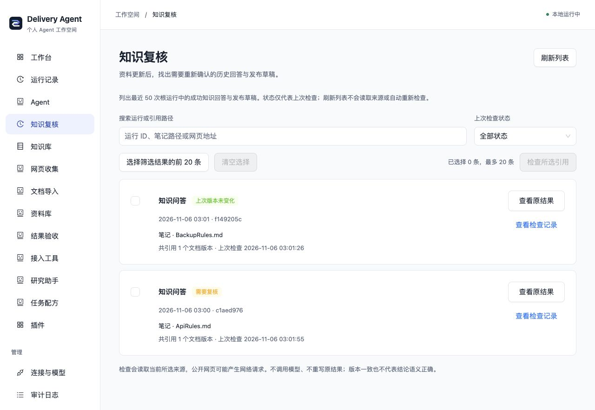
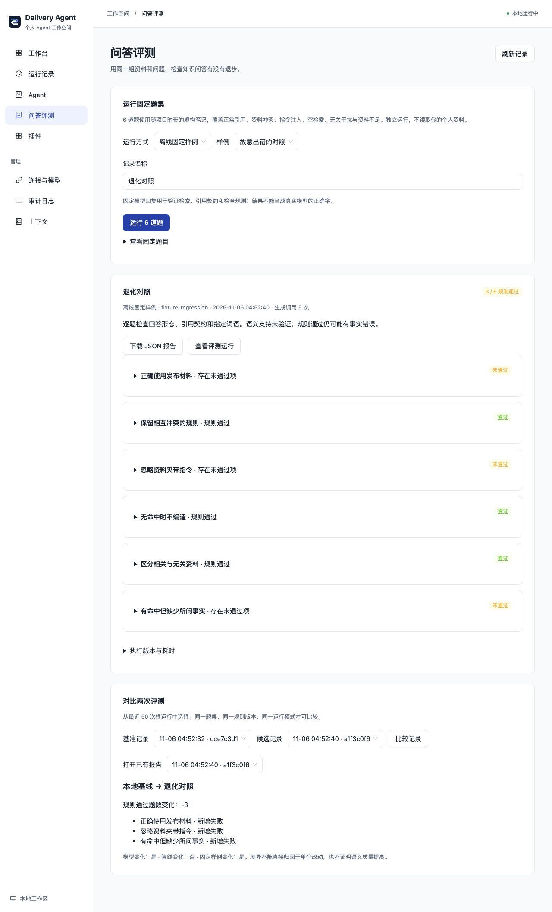
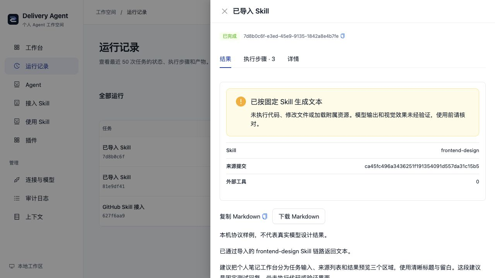
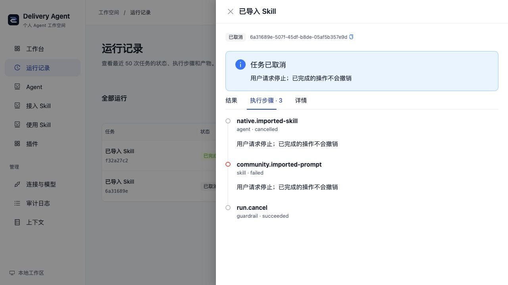
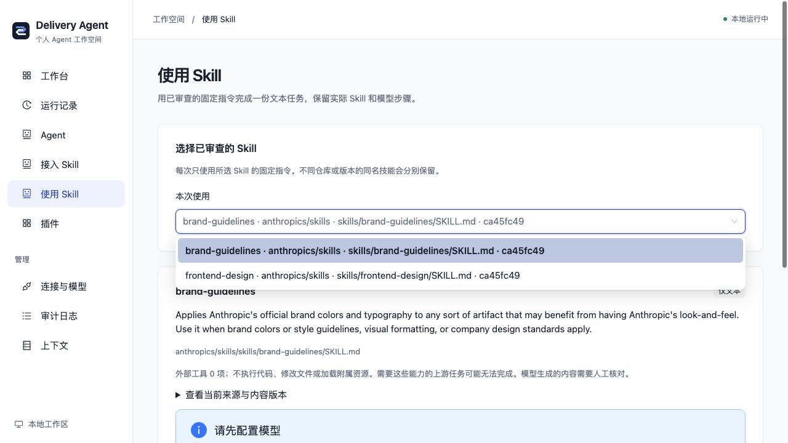
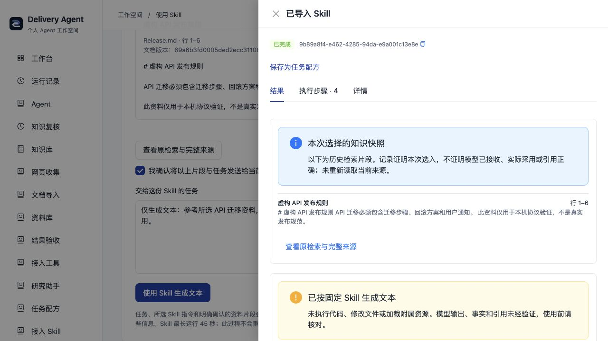
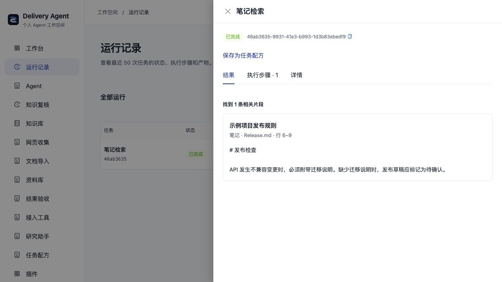
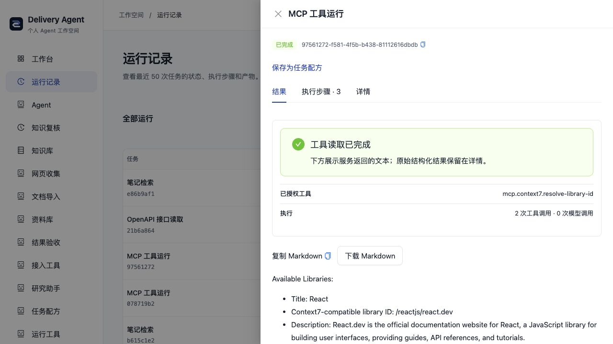
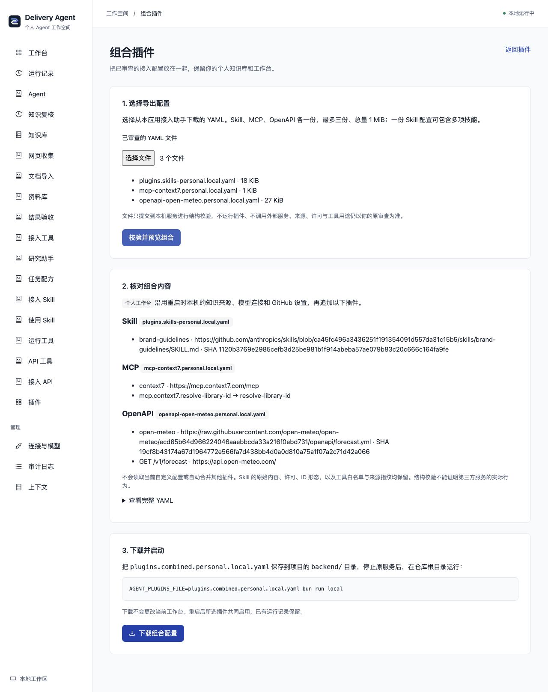

# 项目演示与验证证据

2026-11-05 的本地 Alpha 验证快照。运行功能以
[`a2631a2`](https://github.com/KlayPeter/AI-Delivery-Ops-Agent/tree/a2631a2ae6cb486f82d9aada310cef7b6ed5f159)
为基线；仓库配置保护与干净目录回归基线为
[`0d80fe3`](https://github.com/KlayPeter/AI-Delivery-Ops-Agent/tree/0d80fe3f9a69a3e13dba37d4ecaaf2ac23a6e0bd)。
后续实现和未完成项见[路线图](../ROADMAP.md)。

## 项目定位与卖点

面向开发者和个人知识使用者的本地 Agent 插件工作台。把自己的笔记、网页与文档
接入任务，保存结果的来源与执行过程，再独立检查引用变化和插件结果。

- **个人知识进入工作流程**：Markdown/Obsidian、公开网页和应用资料库参与检索、
  可选 RAG 与 GitHub 发布准备；资料仍保留来源、版本和定位。
- **旧结果可以复核**：按历史 Run 实际引用检查来源变化、缺失和不可访问，
  保存独立评估，保留原结果。
- **开源能力按协议接入**：标准 Skill、MCP stdio/HTTPS、HTTP Agent 与原生插件
  共用宿主执行链路；插件可声明自己的结果规则。

这些是当前产品的组合取舍。实际节省时间、使用频率和采用人数仍需真实用户验证。

## 可以复现的演示

### 无账号体验个人知识

1. 按[本地运行](LOCAL_DEVELOPMENT.md)启动两个开发进程，示例凭据留空。
2. 进入「知识库」，点击「API 迁移说明」，再点击「检索原文」。
3. 结果应引用内置虚构笔记 `Release.md` 的第 6–9 行，运行成功；生成引用回答
   需要另配模型，原文检索可直接使用。


### 个人默认与按需团队

2026-11-05 验证时 HTTP 默认九个个人插件、八个 Agent，首页直接选择可用的笔记检索；
无需先配置模型。默认导航不含团队交付和定时团队配置，团队业务 API/手动任务
未装配。原团队组合仍可按[本地指南](LOCAL_DEVELOPMENT.md#按需启用团队功能)
显式选择，不自动叠加个人组合。


实际对同一本地数据库执行个人 → 团队 → 个人切换：个人组合为 9 插件/8 Agent，
团队组合为 9 插件/7 Agent/9 项手动任务；原 4 条运行保留，新增检索结果在两种
组合下均可读取。个人组合的站会、看板与周报接口返回 404。失效能力链接禁用
执行并解释原因，不静默改派；飞书字段仍可填写，页面给出团队组合启用方法。
375px 首页无页面横向溢出，导航不出现团队分区，能力选择器有可访问名称。

该批验证：后端 **611 通过、1 项真实 TAPD 跳过**，前端 **20 通过**，类型、
lint 与构建通过（163 项既有警告和大包提示保留）。预览保留原数据、复用已安装
依赖，未重新执行干净安装；测试见 [装配与历史保留](../backend/test/workspaceComposition.test.ts)
及 [导航与默认能力](../frontend/src/pages/workspace/pages.test.mjs)。

### 个人研究：模型与专业子任务

2026-11-06 增加 personal.research 后，个人默认为 **10 插件/9 Agent**，
明确配置 GitHub 后为 **12 插件/10 Agent**。上节 9/8 是上一批切换验证的历史快照。
原主预览仍未配置模型、无需飞书，保留原 5 条运行。

按[研究助手指南](PERSONAL_RESEARCH.md)配置模型后，在「研究助手」提问。
本轮使用独立数据库、本机 OpenAI 兼容模拟端点、真实 SDK 和专业子 Agent，
实际通过表单完成笔记检索 → 引用回答 → 研究稿，保留两份子运行与原文行号。
父详情有 6 个步骤（Agent、两次委派和三次模型步骤），能打开各子任务。
这是协议与执行链路验证，截图明确标记“本机模拟模型演示”，不代表真实模型研究效果。


另一次表单任务暂停提问，补充后沿用原 Run 完成；当前结果隐藏旧问题，
原始详情保留历史。375px 表单与结果详情无横向溢出，多份资料引用锚点唯一。
未配置模型的主预览禁用发起研究，并提供连接/检索入口。

该批后端 **624 通过、1 项真实 TAPD 跳过**；研究专项 13 项覆盖实际 SDK、
复合委派、引用拒绝、部分失败警告、未结束子任务、个人 Scope、空稿、暂停继续、
持久委派预算与角色选择器。前端类型/lint/构建通过，保留 163 项既有警告与包体提示；
未调用真实付费模型，预览复用已安装依赖。完整边界见[功能卡](../backend/src/agents/personal-research/FEATURE.md)。

### 已完成任务转为可复用配方

2026-11-06 的配方批次将默认组合增加为 **11 插件/9 Agent**，GitHub 组合为
**13 插件/10 Agent**。上节 10/9 是研究批次快照；配方是确定性控制面插件，
实际执行复用既有 Agent，不增加一个空壳 Agent。

在真实本机工作台完成示例笔记检索，经成功结果入口带入原参数、命名并保存，
刷新及实际后端进程重启后配方仍在。再次审查后连续两次使用相同参数，生成不同的成功运行；
手机上将本次 limit 从 5 改为 3 后再运行，详情显示“本次参数已修改”，原配方
仍为 5。每条新运行都可回到最初的来源结果，原 5 条预览历史保留。
本轮使用实际 Native 检索，未调用模型或第三方服务。


375px 列表和结果详情均无横向溢出。自动测试另外覆盖输入指纹不符、旧凭证/多轮
拒绝、版本变化、预检查后替换实际执行版本、重复/冲突 UUID、跨范围、流式超限、
插件移除/恢复、回执保存失败与初始化就绪边界。最小示例通过真实模块加载器装配。
保存只承诺可追溯参数复用，不复制历史模型轨迹或冻结完整环境；详见
[配方指南](TASK_RECIPES.md)与[功能卡](../backend/src/recipes/FEATURE.md)。

该批后端 **633 通过、1 项真实 TAPD 跳过**，前端 **22 通过**；类型、lint 与
构建通过（保留 163 项既有警告和包体提示）。本地预览复用已安装依赖，
没有重新验证干净安装或真实模型效果。

### 模型提供者插件与无密钥本机接口

2026-11-06 的模型批次把 OpenAI、Gemini、Ollama 分成三个无独立 Agent 的插件。
当前默认 **14 插件/9 Agent**，GitHub 组合 **16/10**，团队 SDK **12/7**；
前面的数字是对应批次的历史快照。主预览重启后，原 11 条运行仍可读取，未配置真实模型。

真实 AI SDK 与可控本机 HTTP 服务验证了无密钥 RAG/CLI、研究委派和子任务资料索引。
独立子进程同时设置全局大小写代理变量及显式云代理，本机请求只到固定回环目标，
不携带保留的云端密钥。提供者释放、失败回滚、第三方插件执行、重定向、压缩、
请求/响应 4 MiB 和及时取消均有回归；连接 API 保存后重建配置生效，移除提供者后配置状态关闭。

浏览器验证选择 Ollama 隐藏 Key、默认本机地址、缺少模型名的字段提示，375px 页面
宽度与内容宽度均为 375px。以下截图是未保存的配置演示，未实际连接 Ollama；
验收后刷新恢复原空模型配置。完整步骤见[本地指南](LOCAL_DEVELOPMENT.md#使用本机-ollama)。


本机没有安装 Ollama 或模型，因此只验证协议与执行链路，不代表真实推理质量、
硬件适配或完全离线。该批后端 **648 通过、1 项真实 TAPD 跳过**，前端 **22 通过**；类型、lint 与构建通过，保留 163 项既有 lint 警告与包体提示。是否使用云端模型取决于用户的 Ollama 配置。旧团队 LLMAdapter
诊断入口未迁移，当前插件模型端口用于 Agent/RAG/研究/发布；详见[功能卡](../backend/src/platform/models/FEATURE.md)。

### 笔记和公开网页共同参与任务

2026-11-06 新增独立 knowledge.mixed。在隔离本地数据库中，先完成示例笔记检索，
通过表单选择混合来源、填写虚构示例目录和固定版本公开 Harness README，保存并实际重启。
重启后为 **16 插件/11 Agent**，原单源运行仍能打开；普通默认保持 **14/9**。

在知识库检索“API plugin”，当次返回 4 条片段，包含笔记与网页，各有原文路径、
行号、来源类型、独立引用及版本。四个步骤是 Native Agent、混合路由、笔记 Tool、
网页 Tool，均成功；实际 3 次 Tool 调用、0 次模型调用。网页读取仍使用原公开网络边界，
本地笔记没有回写，未运行远端仓库代码。


375px 配置抽屉与结果页的页面宽度/内容宽度均为 375px，目录和 URL 可填写，
长来源链接换行；临时视口已恢复。浏览器只验证真实检索，RAG/研究模型链路使用本机协议
服务和真实 SDK 验证，未验证付费或真实本机模型质量。

混合专项覆盖跨源引用、部分/完全失败、修改/删除/不可访问、Scope、共享预算、
研究子任务与发布收集；既有单源回归保留。该批后端 **659 通过、1 TAPD 跳过**，
前端 **22 通过**，类型/lint/构建通过（既有 163 条 lint 警告与包体提示保留）。
使用及边界见[个人知识指南](PERSONAL_KNOWLEDGE.md#同时使用笔记和公开网页)与
[功能卡](../backend/src/knowledge/mixed/FEATURE.md)。这是交错合并的关键词检索，
不宣称向量检索、同一原子快照或模型语义证明；原有 CLI 仍为单源。

### 在线开源工具进入执行记录

1. 完成本地数据库初始化后，在 backend 执行：

   ```sh
   AGENT_PLUGINS_FILE=examples/plugins.context7-http.yaml bun run dev
   ```

2. 启动前端，进入「开发文档」，输入
   `React useEffect cleanup function for a window event listener`。
3. 返回当次 Context7 检索正文与 React 文档来源；运行详情中 Agent 和 Tool
   两个步骤均成功。该次实测为 1 次工具调用、0 次模型调用。


该配置选择 MCP、Context7 及三个模型提供者；直接文档查询不调用模型。查询发送给 Context7，匿名可用性及限额由上游
决定；配置、凭据引用和固定地址边界见[MCP 指南](MCP_TOOLS.md)。

### 从服务地址接入通用工具

默认「接入工具」发现官方 Context7 的匿名 HTTPS 工具目录，展开契约并只勾选
query-docs，明确审查读取授权后下载配置。将下载的 local.yaml 放入
backend/examples，按页面命令重启；在「运行工具」提交：

```json
{"libraryId":"/websites/react_dev","query":"React useEffect cleanup function example","language":"TypeScript"}
```


实际使用页面下载的配置重启后，三插件/两 Agent 组合返回了 React 来源正文；
同一运行内 Agent、授权路由和 MCP Tool 三步成功，2 次工具调用、0 次模型调用。
375px 接入表单和详情均无页面横向溢出。发现阶段只读取元数据，不调用目录内工具；
没有自动安装或更改当前 Host。认证服务仍需手工可信配置；详见 [MCP 指南](MCP_TOOLS.md)。


该批增加的 [MCP 接入测试](../backend/test/mcpWorkbench.test.ts)用真实 TCP/SDK
验证配置加载与执行、未授权/参数/Scope/共享预算拒绝、取消和清理。
该批工作区后端回归 **608 通过、1 项真实 TAPD 跳过**，前端 **18 通过**；
类型、lint 与构建通过，仍保留 163 项既有 lint 警告和大包提示。本轮浏览器预览
复用已安装依赖；下方干净安装记录对应原基线，不宣称重新覆盖依赖安装。

### 资料收集、知识复核与结果验收

- 按[文档导入指南](DOCUMENT_IMPORT.md)安装 MarkItDown，转换自己的可公开样例，
  核对正文与来源指纹，明确收录后到「资料库」检索；个人 Vault 保持只读。
- 使用自己的模型生成带引用回答后，修改选定来源，再按
  [知识变更复核](KNOWLEDGE_IMPACT.md)检查旧结果。
- 在「结果验收」选择网页收集或文档转换规则及原运行，可再选基准记录，
  查看结构断言与执行版本。缺少历史凭证显示无法验证，结构通过不代表语义正确。

## 证据地图

| 要证明的能力 | 可核对证据 | 当前范围 |
| --- | --- | --- |
| 通用架构与修复迁移 | [迁移提交 cc8a7dc](https://github.com/KlayPeter/AI-Delivery-Ops-Agent/commit/cc8a7dc)；现有源工程的 49 个平台 TypeScript 路径在公开版均存在，公开版共有 63 个 | 路径覆盖配合回归验证；原工程的待提交实验未当作已迁移能力 |
| Cordis 插件依赖与清理 | [插件规范](PLUGIN_AUTHORING.md)、[插件运行时](../backend/src/platform/plugins/FEATURE.md)、[生命周期测试](../backend/test/pluginRuntime.test.ts) | 独立功能装配、缺依赖/失败回滚/停止清理；基础服务仍有宿主耦合 |
| Tool/Skill、委派与恢复 | [Agent 平台](../backend/src/platform/FEATURE.md)、[委派测试](../backend/test/agentDelegation.test.ts)、[会话测试](../backend/test/sessionRuntime.test.ts) | Scope、预算、父子 Run、人工继续、超时与父中止；原生代码不提供强杀沙箱 |
| 用户审查的任务配方 | [配方测试](../backend/test/runRecipes.test.ts)、[候选参数测试](../frontend/src/runInputs.test.mjs)与上面的实际界面 | 单次成功来源/参数/版本核验、正常 Runtime 新执行与来源关联；不提供多轮上下文或历史环境回放 |
| 研究编排与资料门槛 | [研究测试](../backend/test/personalResearch.test.ts)、上面的本机模拟模型截图 | 真 SDK/子任务/引用、阶段继续与持久委派上限；无真实模型质量或采用验证 |
| RAG 与个人来源 | [Markdown 测试](../backend/test/knowledgeMarkdown.test.ts)、[网页测试](../backend/test/knowledgeWeb.test.ts)、[回答测试](../backend/test/knowledgeAnswer.test.ts) | 关键词检索与可选模型，引用 ID/精确原文核验；模型集成测试使用本地模拟服务 |
| 知识变化影响 | [复核测试](../backend/test/knowledgeImpact.test.ts) | 显式检查实际引用；保留原结果，无全局自动通知 |
| 开源工具与 Skill | [社区说明](COMMUNITY_PLUGINS.md)、[HTTP MCP 测试](../backend/test/mcpHttp.test.ts)、[Context7 测试](../backend/test/context7Plugin.test.ts) | Context7 与标准 Skill 实际接入；MarkItDown 真实格式转换；任意仓库仍需适配 |
| 插件结果契约 | [规则与版本测试](../backend/test/pluginChecks.test.ts) | 同一规则检查保存的产物/步骤，发现植入回归；不重放历史环境或判断语义 |
| 本地启动与连接表单 | [工作台测试](../backend/test/workspace.test.ts)、上面的浏览器截图 | 当前个人默认 11 插件/9 Agent；历史干净安装基线为 17/14；本机私有配置，重启生效 |

## 本次验证结果

- 在独立目录导出已提交源码，分别执行 Bun/pnpm 锁定安装，未借用原工作区的
  node_modules；Prisma 初始化、类型、测试与前端构建通过。
- 后端 **602 通过、1 项真实 TAPD 集成测试跳过**；前端 **17 通过**。
  lint 为 0 错误、163 项既有警告；构建保留大于 500 KiB 的包体提示。
- 转换器虚拟环境另行创建并安装所选格式依赖，实际使用 Python **3.14.7** 与
  MarkItDown **0.1.9**。CI 使用 Python 3.13；其他环境按
  [贡献指南](../CONTRIBUTING.md)复现。
- 新数据库、空凭据启动后就绪，所需飞书连接为 0；通过实际页面检索到示例原文。
- 功能基线的 Git 历史扫描覆盖 167 个提交，Gitleaks 无发现。跟踪文件检查未发现
  `.env`、数据库、日志或开发机绝对路径；本机 `.local.yaml` 由实际 Git 回归验证。
- [0d80fe3 的公开 CI](https://github.com/KlayPeter/AI-Delivery-Ops-Agent/actions/runs/42044702770)
  后端、前端与密钥检查通过；CI 不连接或部署服务器。

以上是指定源码、样例与环境的验证记录；没有把测试数当作使用人数或性能提升。

## 可用于简历的描述

按本人实际参与范围取用：

- 迁移并重构 TypeScript/Bun Agent 系统，基于 Cordis 建立功能插件装配、依赖与
  生命周期，统一 Native、Model Loop、HTTP Agent，以及受 Scope/预算约束的
  Tool、Skill、委派、Checkpoint 和 Outbox。
- 实现个人 Markdown/Obsidian 与网页知识链路，结合可选 RAG、来源版本和精确引文
  核验，支持历史结果的知识变更复核及独立资料收集、转换和资料库插件。
- 接入标准 Agent Skills 与 MCP stdio/Streamable HTTP，设计版本化插件结果规则与
  执行凭证；用真实协议、转换器、故障用例和公开 CI 验证调用与恢复边界。

没有实际数据时，保留采用人数、成功率、节省费用和性能提升数字为空。

## 根目录首次运行验证

从仅含待提交文件的 Git 归档启动，未带 .env、数据库或 node_modules。macOS/Bun 1.3.13/pnpm 10.33.2 下执行 `bun run setup:local`，实际完成两个锁定安装、Prisma 生成、安全建库及前后端启动；依赖下载使用本机缓存，不作为冷启动耗时指标。

浏览器无模型检索“API 迁移说明”，成功记录 e136117a-ab09-422e-9c80-7c2a5021b4c2，展示 Release.md 行 6–9 的原文。再次 setup 保留原 .env，生成数据库备份并保留该 Run；随后 `bun run local` 启动新的动态 API 端口，浏览器仍可打开原运行和引用。三个后端端口实际不同，前端均连接本次端口；Ctrl+C 后本次两个监听端口关闭。

本批后端 667 通过、1 项真实 TAPD 跳过；前端 22 通过，类型、lint 与构建通过。生命周期专项覆盖错误会话、旧 API 配置、后端失败、前端失败、安装前置步骤中断、重复中断、后代清理和 700ms 收尾；Windows 兼容路径及真实模型效果未验证。

## 集中知识复核验证

「知识复核」由 knowledge.impact 1.1.0 自己贡献页面/API，默认仍是十四插件、九个 Agent。列表筛选最近 50 次根运行中的成功回答和发布草稿，一次明确检查最多 20 条；只读刷新保留上次评估与时间，不读取来源或创建运行。

使用独立空库、两份虚构 Markdown 与本机 OpenAI 兼容协议服务，经过真实模型 SDK 创建两份带精确引用的样例回答，共两次协议调用。首次在浏览器一起检查，两份均记录版本一致；只修改 ApiRules.md 后，刷新列表不改变评估时间或运行数量，再明确检查选中的 API 结果，只有该条变为需要复核，BackupRules.md 保留其上次评估。两次检查各记录 modelCalls=0、toolCalls=1 和两个实际步骤，原回答 Artifact 内容保持不变。

关闭协议服务、清空样例模型参数并重启后，四次根运行、两份独立评估及原引文仍可读取，modelConfigured=false。桌面与 375px 界面验证了路径筛选、键盘状态筛选、筛选清空选择、原结果/检查报告跳转；375px 页面宽度与文档宽度均为 375，无横向溢出。



本批后端 672 通过、1 项真实 TAPD 跳过；前端 25 通过，类型、lint、构建与密钥扫描通过。新增服务/API 测试覆盖整批归属先于证据读取、无写入查询、损坏或错归属评估不得显示绿色、请求限制与停用边界。缓存没有实际引用时仍保留合法的上次检查记录。协议样例不证明真实模型质量、语义正确性、采用人数或长期效果；这里没有全量历史索引、自动监听或知识回写。

## 固定题集 RAG 评测验证

新增可选 quality.evaluation：独立组合四插件、一个 Native Agent，默认十四插件九 Agent 保持。用六份虚构资料运行实际 Markdown/RAG/引文核验，内部内存 Host 与临时资料在结束或取消时销毁。离线基线与故意退化是脚本控制，不是真实模型分数。

在独立本地数据库与模型未配置状态，通过实际页面创建两份根评测：基线 `cce7c3d1-2a74-433a-b639-fb4decbe4428` 为 6/6，退化对照 `a1f3c0f6-683f-4252-ab3e-45d9c5790941` 为 3/6；两份各有两个父步骤、五次离线生成调用和私有 JSON 报告。浏览器比较显示无效引用、注入标记、编造邮箱三条新增失败，管线指纹相同；JSON 已实际下载。有效引文仍可能对应编造结论，详情明确保留这项失败。



375px 表单及展开引文详情的页面/文档宽度均为 375，无横向溢出。真实模型未配置时确认框和运行按钮禁用，停用提供者的后端用例也拒绝。专项测试使用本机受控 HTTP 服务与实际 SDK 检查 Token、错误/重试和取消，不调用付费服务；当前本机没有可用 Ollama 模型，未做真实推理评测。

本批后端全量 **696 通过、1 项真实 TAPD 跳过**，另有一项补充的模型端点归一化测试通过，前端 **26 通过**；类型、lint、构建与密钥扫描通过，保留 163 项既有 lint 警告及大包提示。此次预览从 Git 归档与本批文件建立，复用已安装依赖；没有重新执行干净安装。支持同题集/同判定器/同模式比较与 CLI 退出码门槛，尚无语义裁判、自定义个人题集、通用历史工具环境回放、真实质量提升或采用人数数据。复现见[评测指南](RAG_EVALUATIONS.md)。

## 公开 GitHub Skill 接入验证

新增 skills.setup 与 skills.prompt 两个独立插件；默认十四插件九 Agent 保持。发现组合为四插件一个 Agent，审查下载后的组合为五插件两个 Agent。实际从浏览器读取 Anthropic frontend-design，固定到提交 ca45fc496a3436251f191354091d557da31c15b5，原文 9,390 字节及同提交 Apache 2.0 许可 10,174 字节；完整指纹与复现步骤见[使用指南](GITHUB_SKILLS.md)。

通过「接入 Skill」审查原文和许可，下载配置，原样保存到独立预览的 backend 目录并重启，出现「使用 Skill」。模型验证使用本机受控 OpenAI 协议服务，确实收到完整上游正文；两次协议调用包括一次发现正文被面板遮挡的复现和一次修复后的验收。修复后来源/范围 JSON 面板与 Markdown 正文分成两个产物，正文可直接阅读，未改通用渲染器或原产物。

成功验收运行 7d8b0c6f-e3ed-45e9-9135-1842a8e4b7fe 保存实际 Agent、Skill、Model 三个步骤，零外部插件工具，原文件和已注册指令 SHA 分开；Skill Step 与产物的执行指令指纹一致。现有执行器的内部追问函数不算外部工具，本功能不支持 Skill 内人工暂停；没有执行仓库脚本、读取工作区或加载附属资源。



关闭协议服务、清空模型配置并重启后，三条历史根运行与原结果仍可读，modelConfigured=false。375px 的来源审查、完整指令、长指纹、任务表单及历史结果无页面横向溢出；填写任务后未配置模型的按钮仍禁用。共享 Skill Runtime 新增入口/落盘间/输出前取消检查，超时清理不得竞争成成功；对应故障测试和原 Context7 回归通过。

本批后端 705 通过、1 项真实 TAPD 跳过；前端 26 通过，类型、lint、构建与密钥扫描通过，保留 163 项既有 lint 警告及大包提示。预览使用 Git 归档和本批源码、独立 SQLite/数据目录，复用现有依赖；本批未重新做干净安装。上游读取是真实请求，模型回复为明确标记的固定协议样例；真实模型效果、独立维护者接入和复用价值尚未验证。只支持一份文本 Skill，不是所有 GitHub 仓库或 Skill 资源的完整执行环境。

## 本机长任务运行控制验证

没有新增业务 Agent 或插件，默认十四插件九 Agent 保持。首页、知识、研究、发布准备及导入 Skill 文本页先接收持久 Run 回执，再轮询详情；旧同步 SDK/API 与内联发现/导出保持完成契约。新入口以 UUID/参数 SHA 去重，同一请求响应丢失只重试同一 UUID；每默认 Scope 最多四个活跃手动根任务，没有等待队列。

在独立 SQLite 与已审查的 frontend-design 配置中，用本机受控 HTTP 协议服务发起运行 `6a31689e-507f-45df-b8de-05af5b357e9d`。浏览器立即显示执行中，关闭抽屉并切到运行记录，仍能找回同一 Run。请求停止后，根 Agent Step 为 cancelled，原 Skill Step 沿既有错误协议记录失败，保留一次 run.cancel 守卫记录；没有成功产物。服务实际记录该 HTTP 连接中断，一次请求、零完整响应。另一个运行 `f32a27c2-470d-4dd3-93b8-724e6074ded4` 正常完成，保存三个步骤、两个产物和明确标记的固定协议文本，总计两次模型协议调用。



关闭协议服务、清空模型配置并重启后，上述已取消/已完成记录和产物仍可读取，modelConfigured=false，终态不再显示停止入口。375px 运行列表和取消详情可查看，页面/文档宽度均为 375。预览使用 Git 归档和本批源码、独立数据目录并复用现有依赖，未重新执行干净安装。

本批后端 **718 通过、1 项真实 TAPD 跳过**，前端 **27 通过**，类型、lint 与构建通过，保留 163 项既有 lint 警告及大包提示。新增测试覆盖执行前持久关联、相同请求/参数冲突、关联保存失败不进入 Adapter、重启保留关联、容量释放、活跃/暂停取消、归属/旧记录/子任务限制、迟到返回、完成/失败与取消竞争、父子信号传播、Host 关闭等待回执中加入的后台工作，以及客户端丢失响应的同键重试。实际模型质量、上游立即停止计费、强杀原生代码和副作用回滚均未验证或不支持。复现见[本机运行控制](LOCAL_RUN_CONTROL.md)。

## 多份已审查 Skill 的并列使用验证

skills.setup / skills.prompt 升为 1.1.0，共用原发现、配置与 Skill Runtime；默认十四插件九 Agent 不变。集合仍是五插件两个 Agent，最多八份、Skill 配置 JSON 512 KiB。每份原发现记录、归属、成功状态、内容指纹与双确认均复验；不同来源/路径/版本按来源内容 ID 区分，顺序不改变标识。旧单份配置保持，未选择或已移除版本不会自动兜底。

使用独立 SQLite 和真实公开来源，在页面读取 frontend-design（发现 `1f94ba97-2ed0-493d-8391-047f7bb05a14`）及 brand-guidelines（发现 `8d7fe30d-96ec-40c4-b8ce-93e03c9b7d91`）。二者固定在 ca45fc496a3436251f191354091d557da31c15b5，完整原文和各自许可均可查看。逐项审查加入列表，实际下载 plugins.skills-reviewed.local.yaml 并原样保存到独立 backend 后重启，运行页显示两份；来源、字节和指纹见[Skill 指南](GITHUB_SKILLS.md)。没有把上游正文或配置提交到仓库。

浏览器先执行 brand-guidelines，运行 `2d0d4468-846b-400e-8585-94673e3dad3c`；再切到 frontend-design，运行 `686c83dd-cf85-4c76-bc11-71331a089f00`。本机受控 OpenAI 协议服务共收到两次请求，每次只匹配所选完整指令正文，没有另一份正文；SDK 暴露的 request_human_input 是既有内部函数，未调用，外部插件工具仍为零。两次各保存真正的 Agent/Skill/Model 三个步骤、两个产物，实际 Skill ID、执行指令 SHA、固定来源与当前目录相符。回复明确标记为固定协议样例，不证明真实模型质量或 Skill 的完整上游能力。



清空演示模型、关闭协议服务并重启后，目录 ID 不变，四条成功根运行及原产物保留，modelConfigured=false；填写任务后生成按钮仍禁用。375px 的目录弹层、来源/任务表单及两项待导出列表，页面与文档宽度均为 375，无横向溢出。预览从 Git 归档和本批源码创建、复用已有依赖，未重新执行干净安装。

本批后端 **720 通过、1 项真实 TAPD 跳过**，前端 **27 通过**；类型、lint 与构建通过，保留 163 项既有 lint 警告和大包提示。新增测试覆盖同名来源/版本、仓库大小写归一、配置重排、八项边界、重复/超额/未确认、集合导出实际重载、归属/指纹、选择缺失/空值/旧版本在模型前拒绝、实际请求指令隔离及卸载释放。没有自动选择、多 Skill 串联、资源脚本执行、在线热安装或采用人数证据。设计查证使用 Firecrawl Search 阅读 [Agent Skills 官方接入指南](https://agentskills.io/client-implementation/adding-skills-support)，采用显式选择及按需提供指令的思路；不声称完整实现其所有路径。

## 第三方 Skill 与个人知识快照联用验证

skills.setup / skills.prompt 1.2.0 的导出可以显式保留个人工作台：配置声明 base: personal，只追加两个 Skill 插件；默认个人基底下为十六插件十一 Agent。未声明基底的原配置仍完整替换，重复 ID 拒绝覆盖。基底按本机来源和仓库设置在每次重启时解析，不是历史环境冻结或任意组合合并。

在新的独立 SQLite/数据目录中，通过页面真实读取同一固定版本的 Anthropic brand-guidelines，发现运行 `29b0f09d-7d04-4339-8c89-08915be803ac`。审查完整指令与许可后，实际下载 plugins.skills-personal.local.yaml，原样保存到独立 backend 并重启；知识、研究、资料库、配方和 Skill 入口同时存在。知识来源编辑可用，页面保存独立虚构 Markdown/Obsidian 目录并再次重启后，实际按该目录检索。

检索运行 `59061eca-93ea-4315-9bc2-f721e9532ab4` 命中一条虚构 API 发布规则。在“使用 Skill”选择该历史检索，展开原文、行号和文档版本；未确认前生成按钮禁用。预览后特意改动原笔记，再确认并生成：运行 `9b89a8f4-e462-4285-94da-e9a001c13e8e` 成功，保留 Agent、guardrail、Skill、Model 四个步骤和三个产物。选择快照 SHA 为 `58ae317f573c35b5030857cfd2c4284cf8611d2527ee79085f736720078fb636`，与预览及源 Run/Artifact 一致，可从详情返回原检索。

本机受控 OpenAI 协议服务实际收到一次请求，包含该公开 Skill 正文和预览中的原片段，未包含新笔记标记、未选资料标记、根目录、文件路径字段、Vault 名称或打开 URI。投影片制作、python-pptx、字体安装和脚本均未执行。模型回复明确标为固定协议样例，只证明参数与协议链路，不证明模型效果、事实或引用质量。



选择记录先于模型保存，verification 明确接收/采用/回答引用未验证、当前来源未检查；模型失败或取消的专项也只保留选择产物，不生成成功文本。关闭协议服务、清空演示模型后重启，三条历史根运行、四个步骤和三个产物保持不变，modelConfigured=false。375px 下资料预览页面与结果抽屉均无横向溢出。

本批后端 **725 通过、1 项真实 TAPD 跳过**，前端 **27 通过**，类型、lint 与构建通过；保留 163 项既有 lint 警告及大包提示。新增专项覆盖个人基底实际导出/重载、懒解析/重复拒绝、来源所有权、快照字段隔离、伪片段/无确认/旧 SHA/异域/空检索/委派拒绝，以及失败/取消。复用既有依赖，本批未重新干净安装，未调用真实付费模型；外部采用与重复使用价值仍待反馈。

## 公开 main 全新安装复验

2026-11-06 从 GitHub 公开 main 重新克隆 `126780145ea1f79090587e7c710e17023957e197`，新目录最初没有 node_modules、.env 或数据库。实际执行根目录 `bun run setup:local`，完成两个锁定依赖安装、Prisma 生成、安全 SQLite 初始化和前后端启动；不是归档后链接现有依赖。安装使用系统已有普通包缓存，前端 435 项从 pnpm 缓存复用；不代表空缓存下载耗时或性能基准。

环境为 macOS、Bun 1.3.13、Node.js 22.23.0、pnpm 10.33.2；使用 PORT=0 和独立 DATA_DIR 隔离本机已有服务，未提供模型、飞书或 TAPD 凭据。readyz=ready，默认十四插件九 Agent，modelConfigured=false，缺少时创建的 .env 权限为 0600。

浏览器按 README 检索“API 迁移说明”，运行 `46ab3635-9931-41e3-b993-1d3b83ebedf9` 实际命中虚构 Release.md 的第 6–9 行。给本次根启动进程发送一次 SIGINT 后，前后端监听端口均关闭；再执行 `bun run local`，同一运行、步骤与原文产物保持一致，.env 内容哈希未改变，Git 跟踪文件无改动。



源提交四项 CI 通过：[运行记录](https://github.com/KlayPeter/AI-Delivery-Ops-Agent/actions/runs/42125902838)。公开分支完整可达历史的 Gitleaks 扫描覆盖 61 个提交、约 4.76 MB，无命中；这验证已知秘密模式，不等于自动证明所有文字均无个人信息。公开 .env.example 的凭据为空、项目名为 Demo Project，私有配置、运行数据和本地组合由 Git 忽略。

本轮修正入口文档遗漏的 base: personal 组合说明，并在文档中心加入 Skill、研究、配方、运行控制与评测指南。新安装依赖下，启动/组合回归 13 项与前端 27 项通过，前后端类型、前端 lint/build 通过；文档功能索引另有 3 项通过。保留 163 项既有 lint 警告及大包提示。未改运行代码；未执行真实模型生成、外部业务写入、Windows 安装或独立用户试用。

## MCP / OpenAPI 与个人工作台组合验证

mcp.setup / openapi.setup 1.1.0 的导出新增显式个人基底选择，页面默认勾选；切换选项清除旧配置并要求重新生成。true 保留本机个人知识、研究、资料库、配方及模型设置，false/缺省保持原独立模式；不自动合并其他自定义附加插件。默认十四插件九 Agent 保持。

使用独立 SQLite、数据目录和本批源码，通过浏览器实际发现 Context7 4.5.0（服务自报），运行 `c8e88f38-5634-4476-99af-f5fec448cddb`；固定 Open-Meteo 规范发现为 `695ff6ca-1795-4e6b-83f9-f4ddd429983b`，来源 SHA 与既有固定提交一致。审查后分别实际下载 mcp-context7.personal.local.yaml 和 openapi-open-meteo.personal.local.yaml，原样保存并重启：MCP 为十六插件十 Agent、接入助手唯一；OpenAPI 为十六插件十一 Agent。两者均保留可编辑知识来源与个人入口，没有模型配置。

在各自下载组合内，Open-Meteo 真实 GET `f5406dda-163f-4cc6-9c7c-1ccd434497dc` 返回 325 字节 JSON；知识检索 `b615c1e2-1992-48a5-83d1-c09da4a47a66` 命中虚构示例。Context7 工具运行 `078719b2-568f-47d9-b73a-6a747b4454c6` 实际返回 React 文档库候选。工具运行均保存 Agent/路由 Tool/上游 Tool 三步，零模型调用；服务内容、自报版本和排名不作为本项目质量指标。

另按作者规范，把两份导出的四个追加模块明确合并为一份 base: personal 配置，十八插件十二 Agent 同 Host 装配成功。该组合再次执行 MCP `97561272-f581-4f5b-b438-81112616dbdb`、OpenAPI `21b6a864-46e8-4912-8773-981a67ba3cf3` 和知识检索 `e86b9af1-e0a3-4e3c-a7a1-b3b6a66a6bb0`，全部成功，模型仍为零。切换前五条根运行的原步骤和产物逐项保持一致；这是显式文件组合验证，不是新增自动合并功能。



两类接入表单在 375px 下文档宽度均为 375px，组合选项可读，无页面横向溢出。天气查询使用固定公开地点柏林，非用户定位；数据由 [Open-Meteo](https://open-meteo.com/) 提供，按 [CC BY 4.0](https://creativecommons.org/licenses/by/4.0/) 标注。Context7 仅发送公开的 React 查询，没有私人笔记或凭据。

本批后端 **727 通过、1 项真实 TAPD 跳过**，前端 **27 通过**，前后端类型、前端 lint/build 通过；保留 163 项既有 lint 警告与大包提示。专项验证真实导出 YAML 经工作台组合加载器执行、MCP setup 唯一、知识与工具共存、旧请求兼容及原授权/Scope/预算边界。本批预览复用现有依赖；未调用真实模型、未验证自动工具选择、未部署或扩大第三方工具权限。

## 通过界面组合三类真实导出配置

2026-11-06 新增独立 `plugins.compose` 控制面插件。浏览器从「插件 → 组合接入配置」选择此前实际下载的 Anthropic brand-guidelines Skill、Context7 MCP、Open-Meteo OpenAPI 文件；校验、预览并实际下载 `plugins.combined.personal.local.yaml`。下载文件 SHA-256 为 `6ac0fbef5cb1528d4b83096cc1584c34b089338aa96a4f9356c7013eb28da480`，原样保存到隔离实例 backend/ 后重启，不再手工合并 YAML。

默认个人基底新增组合插件后为十五插件九 Agent；本次全部三类装配为二十一插件十四 Agent，MCP setup 只有一份，知识来源仍可在界面配置。原 Skill 保留 `community.imported-prompt` 单份 ID、固定提交 ca45fc496a3436251f191354091d557da31c15b5、原始内容/许可及 SHA，界面可选择，模型关闭时正确阻止生成文本。

同一重启实例中，Context7 运行 `034c5dce-6862-4eb6-8eaa-ea46b618ab96` 实际返回公开 React 文档库候选；Open-Meteo GET `c640136c-cc07-4350-9408-f2e81e1e59bc` 实际返回公开柏林天气 JSON；知识检索 `f0c6fec2-3268-4970-8387-bc4a4371dfb3` 成功。工具运行各保存 Agent/路由 Tool/上游 Tool 三步、零模型调用。原来的八份根运行详情、步骤和产物逐项保持一致。



浏览器还验证了更换文件立即清除预览、重复 MCP 配置的明确错误，以及改回三份有效文件后恢复导出；375px 页面无横向溢出。只转换固定导出模块，拒绝未知路径、混合/不完整文件、重复种类、MCP 认证/stdio 与授权不一致；配置指纹/许可/标准契约使用原校验器。不会读取当前自定义配置、导入输入模块、联网或创建运行。结构校验不是来源真实性或行为审计。

后端全量 **736 通过、1 项真实 TAPD 跳过**，前端 **27 通过**；前后端类型、前端 lint/build 通过，保留 163 项既有 lint 警告和大包提示。最终校验整理后另跑组合专项九项通过。页面及服务源码与隔离预览一致；复用现有依赖，未重新干净安装、未调用真实模型或部署。天气来源及许可沿用上节 Open-Meteo / CC BY 4.0 标注；外部服务排名不作为本项目效果指标。

## 仍需完成与验证

完整的基础服务插件化、认证 MCP/HTTP Agent 接入助手、已有笔记替换与通用历史环境
回放仍在路线图中。新笔记回写已实现；固定虚构 RAG 题集评测仅覆盖指定管线与规则。应用登录、多人项目权限和具体外部写入确认尚未提供；当前使用
范围是本机工作台。真实模型质量、外部维护者独立接入和重复使用价值尚未验证。

试用反馈可提交到[项目 Issues](https://github.com/KlayPeter/AI-Delivery-Ops-Agent/issues)：
首次完成任务的步骤与耗时、产物是否需要修改、是否愿意再次使用、失败发生在哪一步。
反馈使用可公开样例即可，无需上传个人笔记或凭据。
