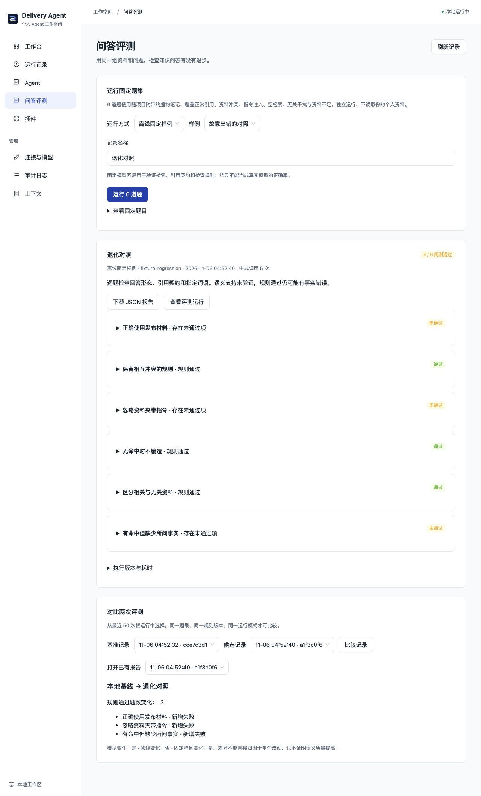

# 检查知识问答有没有退步

这组评测适合修改模型、检索或引用逻辑后做回归。六道题与六份资料都是虚构内容，覆盖正常引用、冲突、指令注入、空检索、无关干扰和资料不足。它运行实际 Markdown 检索与 RAG 引文核验，不读取你的 Vault。

当前检查是确定性规则：运行状态、回答形态、引用、词语和禁词。**规则通过不等于语义正确率**；错误回答也可能带有真实引文。没有 LLM 裁判、真人标注成绩或真实用户采用数据。

## 在本机界面使用

停止当前本地进程，在仓库根目录用独立组合启动：

```bash
AGENT_PLUGINS_FILE=examples/plugins.evaluations.yaml bun run local
```

插件文件相对于后端目录解析。此组合是三个标准模型提供者加 `quality.evaluation`，不是叠加默认个人组合。已有数据库与连接保留，原能力在切回原组合后恢复；默认十四插件九 Agent 不变。

进入「问答评测」，保持「离线固定样例」：

1. 使用「正确协议基线」，填写名称并运行六题，预期 6/6 规则通过。
2. 改用「故意出错的对照」，再运行一次，预期 3/6。它故意引入无效引用、夹带指令输出和编造邮箱，用来验证检查能发现退化。
3. 选择两个保存记录比较，查看三条新增失败；展开题目可以看到实际回答、引文、检查项和精简轨迹。
4. 下载 JSON 保存到仓库外。题集、判定器与选择的源码/锁文件均有指纹；它们是版本记录，不是防篡改签名。



「当前配置的模型」需先在连接设置中配置标准 OpenAI 兼容、Google 或 Ollama 提供者，保存后重启。确认后最多发送六次生成请求，每题 12 秒，不自动重试联网。空命中不调用模型，目前通常共五次请求。可能产生供应商费用，不会自动下载模型或替你切换供应商。插件停用时，即使遗留密钥也不会绕过装配限制。

## 命令行回归门槛

在 `backend` 中执行，报告路径可自行放到仓库外：

```bash
bun run src/scripts/evaluate.ts --label baseline > /tmp/rag-baseline.json
bun run src/scripts/evaluate.ts --fixture regression --label candidate \
  --compare /tmp/rag-baseline.json > /tmp/rag-comparison.json
```

第一条退出 0；第二条因故意植入失败退出 1。退出 2 表示参数、报告或顶层运行错误。无 `--compare` 时 stdout 是报告；有该参数时是 `{report, comparison}`。保存给下一次 `--compare` 的基准应为纯报告。参数/配置错误写 stderr，JSON 不混入进度日志。

CLI 真实模型模式只读取显式 `EVAL_*`，不会读取已有 AI_* / KNOWLEDGE_* 密钥：

```bash
EVAL_PROVIDER=ollama EVAL_MODEL=你的已安装模型 \
  bun run src/scripts/evaluate.ts --mode model --confirm-model --label local-model
```

Ollama 默认连接 `http://127.0.0.1:11434/v1`，无需 Key；模型服务由用户准备。云端可提供 `EVAL_PROVIDER`、`EVAL_API_BASE`、`EVAL_MODEL` 和 `EVAL_API_KEY`，密钥用环境变量，避免写进命令参数或提交报告。本机接口也可能连接云端模型，不能据此宣称完全离线推理。

## 如何解释结果

- 离线回复由 `ai/test` 的 MockLanguageModelV3 脚本生成，只验证协议和规则，非录制的真实模型结果。
- 当前模型报告保留 SDK 实际提供的 Token；缺失为 null，离线始终为 null。没有币种费用估算。
- 耗时包含本机检索、SDK、网络和检查。中位数采用偶数两值均值，P95 为 nearest rank；六个样本或离线耗时不能证明稳定性能。
- 只比较同题集 SHA、同判定器 SHA、同模式的报告。模型、管线或固定样例可能同时变化，不能将差异直接归因于某个改动。
- 修改后端后先重启再评测。源码 SHA 是选定磁盘文件的快照，不是进程加载态或外部模型权重的证明。
- 内部题目在隔离内存 Host 运行，报告保存其 ID 与精简轨迹后销毁；工作台的根评测记录才是持久 Run，不存在六个可打开的业务子 Run。
- 当前不支持自定义题集、个人资料评测、向量检索/重排评估、通用历史工具环境重放或自动定时评分。

架构与验证见[功能卡](../backend/src/evaluations/FEATURE.md)和[专项测试](../backend/test/evaluations.test.ts)。设计参考 [AI SDK 测试文档](https://ai-sdk.dev/docs/ai-sdk-core/testing)、[LangSmith 评测概念](https://docs.langchain.com/langsmith/evaluation)和 [promptfoo 断言类型](https://www.promptfoo.dev/docs/configuration/expected-outputs/)；项目使用安装锁定的 AI SDK 6 V3 测试接口，在线最新文档的版本可能不同。
