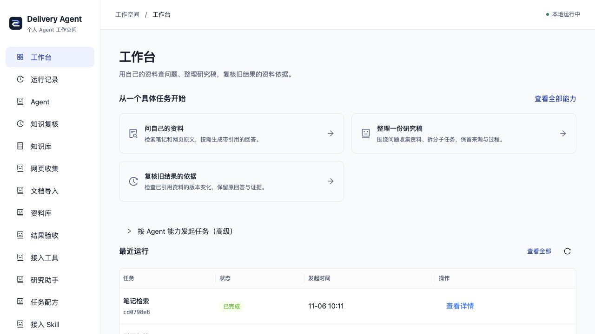
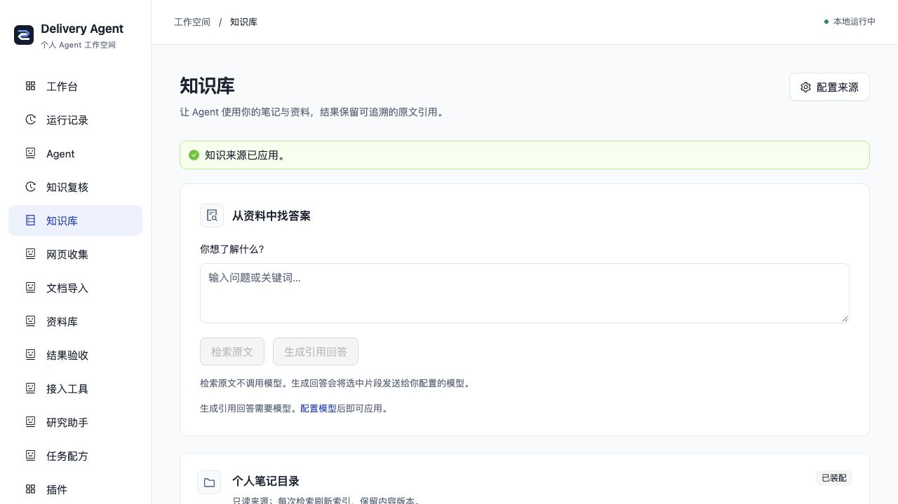
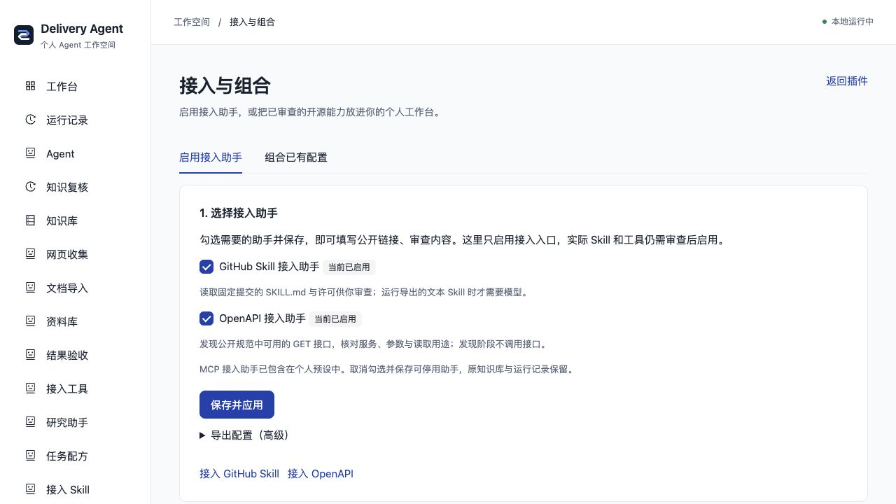
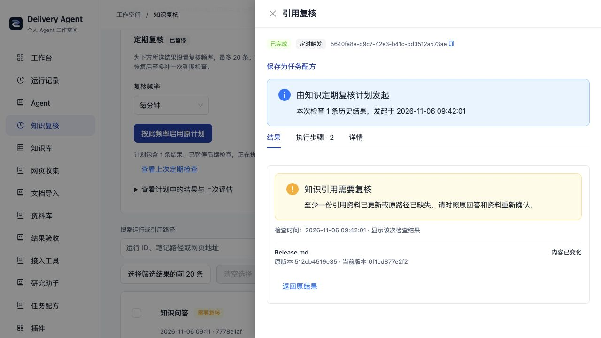

# AI Delivery Ops Agent 使用说明

> 用自己的知识、模型和开源工具完成任务，并看清结果来自哪里、执行了什么、哪些依据需要重新核对。

这是一套**本地运行的 Agent 插件工作台**。你可以先不配任何账号，用示例资料体验检索；需要生成回答和研究稿时，再接入自己的模型。个人知识和任务是当前主线，飞书、TAPD 等团队能力按需启用。

当前为 Alpha 阶段。本说明对应当前代码中的实际能力；可选功能和额外依赖会单独标明。

## 先看它能做什么

| 功能 | 你可以用它做什么 | 使用条件 |
| --- | --- | --- |
| 个人知识库 | 接入 Markdown、Obsidian 文件夹、公开网页或已收录资料，检索原文与行号 | 原文检索无需模型 |
| 引用问答 | 根据检索片段生成回答，保留引用、原文和内容版本；资料不足时明确提示 | 需要自己的模型 |
| 网页与文档收集 | 提取单篇公开网页；把 PDF、DOCX、PPTX、XLSX 等转为 Markdown | 网页收集无需模型；文档转换需 MarkItDown |
| 本地资料库 | 检查采集结果后明确收录，保留来源与指纹，再用于检索和问答 | 无需模型 |
| 研究助手 | 拆分资料子任务，结合知识和已授权工具整理研究稿，查看父子任务与资料索引 | 需要支持所用工具调用的模型 |
| 开源能力接入 | 使用 GitHub 文本 Skill、MCP 工具或 OpenAPI 读取接口扩展能力 | 按来源与工具用途审查后启用 |
| 执行记录 | 查看任务进度、调用步骤、结果和错误；请求停止，或在任务等待补充时继续 | 默认具备 |
| 任务配方 | 从成功运行保存原参数与执行版本，下次核对后复用 | 默认具备 |
| 知识复核 | 检查旧结果实际引用的资料是否变化，保留旧回答和旧证据 | 手动检查默认具备；定期复核是可选插件 |
| 结果验收与问答评测 | 检查结果结构、执行步骤和版本；用可选固定题集比较 RAG 的规则表现 | 评测需额外启用，真实模型模式需配置模型 |
| GitHub 发布准备 | 结合仓库事实和个人规则收集证据，按需生成发布草稿 | 配置仓库；生成草稿需模型 |
| 飞书与 TAPD | 使用任务、站会、报告、同步和多机器人等团队能力 | 额外选择团队插件并填写自己的凭据 |

这里的“可追踪”是指可以查看真实运行与资料证据，不代表模型回答一定正确。

## 最快上手：先完成一次无模型检索

准备好 Bun 1.3.x、Node.js 22 和 pnpm 10。不需要 Docker 或服务器。

首次使用，在终端执行：

```bash
git clone https://github.com/KlayPeter/AI-Delivery-Ops-Agent.git
cd AI-Delivery-Ops-Agent
bun run setup:local
```

已有仓库就进入项目根目录，不必重复克隆。首次命令会安装依赖、准备本地数据库，并一起启动前后端；已有配置会保留。

以后启动只需要：

```bash
bun run local
```

打开终端显示的前端地址，通常是 `http://127.0.0.1:15173/`，以实际输出为准。

1. 在首页点击「问自己的资料」（也可从导航进入「知识库」）。
2. 输入 **API 迁移说明**，点击「检索原文」。
3. 查看命中的示例笔记、原文片段和行号。
4. 在结果详情切换「结果」「执行步骤」「详情」，了解一次任务留下了什么记录。

示例内容是仓库里的虚构资料。这一步不需要模型密钥、飞书或 TAPD。终端按 Ctrl+C 可以一起停止本次服务。

首页按当前装配显示具体任务：资料问答、研究稿和旧依据复核；配置 GitHub 并装配发布能力后，另有发布准备入口。需要直接选择能力或填写 JSON 时，展开「按 Agent 能力发起任务（高级）」。



## 换成自己的资料

进入「知识库 → 配置来源」，选择一种来源，再点击「保存并应用」。

| 来源 | 怎么填 | 适合的情况 |
| --- | --- | --- |
| Markdown / Obsidian 文件夹 | 填写本机目录的绝对路径，可设置排除目录和 Vault 名称 | 已有个人笔记或项目文档 |
| 公开网页链接 | 每行一个公开链接，最多五个 | 阅读指定文档或文章 |
| 笔记 + 公开网页 | 同时填写本机目录与链接 | 把自己的笔记和指定外部资料一起检索 |
| 已收录资料库 | 先在网页收集或文档导入结果中明确收录，再选择资料库 | 逐步积累整理后的资料 |
| 示例笔记 | 直接选择 | 初次体验和排查配置 |

Obsidian 接入的是本机 Vault 文件夹，不需要登录 Obsidian 账号。原笔记保持只读；网页来源读取指定单页，不会自动抓取整个站点。

使用根目录本地启动器时，保存后会自动重新加载后端，页面地址保持不变。当前有任务执行时，设置先保留，任务结束后再应用。如果用独立后端命令启动，页面会提示手动重启。



## 接入模型，开始生成回答

进入「连接与模型 → 模型服务」，填写自己的参数，再保存并应用。

| 模型类型 | 需要填写什么 |
| --- | --- |
| OpenAI 兼容接口，含 DeepSeek | 服务商提供的 API 地址、模型名称和 API Key |
| Google Gemini | 对应的模型名称和 API Key，按表单填写 |
| Ollama 本机接口 | 本机已有的模型名称；默认地址为 `http://127.0.0.1:11434/v1`，无需 Key |

应用不会安装 Ollama 或下载模型。保存并加载参数，只说明配置已经生效；实际服务能否连接、模型能否完成任务，由运行结果确认。

回到「知识库」，输入问题并点击「生成引用回答」。生成时会把选中的资料片段发送给你配置的模型；使用云端模型时，这些片段会发往对应服务。

可以先尝试：

> 根据资料，API 出现不兼容变更时需要准备哪些说明？列出依据和待确认项。

没有配置模型时，「检索原文」仍然可以使用。

## 把网页和文档变成可复用资料

**网页：**进入「网页收集」，填写公开页面链接，执行后查看正文、来源和版本。结果可以复制、下载 Markdown，或明确收录到「资料库」。

**文档：**进入「文档导入」，查看转换器是否可用，再上传支持的文件。转换需要额外安装 MarkItDown，步骤见[文档导入指南](DOCUMENT_IMPORT.md)。

收集和转换结果不会自动写进你的 Obsidian 笔记。你可以先检查内容，再决定是否收录；收录到资料库后可立即检索，也可以把资料库选作知识问答来源。

## 接入开源 Skill 和工具

默认个人工作台中，打开「插件 → 接入与组合 → 启用接入助手」。

1. 勾选 GitHub Skill 或 OpenAPI 助手。
2. 点击「保存并应用」。
3. 完成后，直接点击页面出现的接入链接。

取消勾选并保存，可以停用助手，原知识库和执行历史保留。MCP 发现助手已包含在个人预设中。



三种扩展入口的作用不同：

| 类型 | 提供什么 | 当前范围 |
| --- | --- | --- |
| GitHub Skill | 一套完成任务的方法或指令，例如写作、规划、设计建议 | 审查固定版本的 SKILL.md 与许可；运行指令文本，需要模型 |
| MCP | 可调用的外部工具 | 先发现和选择工具，再按明确授权运行；有 stdio / HTTPS 连接能力 |
| OpenAPI | 按公开接口规范读取数据 | 审查服务和参数，运行已授权的固定 GET 接口 |

**助手启停已经可以直接在页面完成；实际第三方能力仍需要审查并通过配置文件启用。** 普通 GitHub 小项目需要按插件规范适配，不能直接当成任意可执行插件安装。导入的文本 Skill 不会自动获得脚本执行或文件访问权限。

具体步骤见[GitHub Skill](GITHUB_SKILLS.md)、[MCP 工具](MCP_TOOLS.md)、[OpenAPI 接入](OPENAPI_TOOLS.md)和[插件组合](PLUGIN_PROFILES.md)。开发自己的功能可参考[插件作者规范](PLUGIN_AUTHORING.md)。

## 发起研究任务，查看过程并复用结果

配置好模型和所需资料后，可以进入「研究助手」提出目标，例如：

> 根据我已接入的资料，整理这个方案的限制、备选方案和需要补充的信息。

研究助手可以拆分资料子任务，并使用已经接入且按要求确认的工具。结果包含研究稿和实际子任务索引，需要你复核。

任务启动后，可以离开页面，再从「运行记录」找回：

- 查看当前状态、产物、调用步骤和错误。
- 请求停止正在执行的手动根任务；已完成的操作不会撤销。
- 任务等待补充信息时，填写补充内容，继续原运行。
- 成功结果支持保存为「任务配方」，核对原参数与执行版本后复用，产生新的运行记录。

## 资料更新后，复核旧结果

知识回答会保留实际引用和内容版本。你可以从结果详情执行「检查引用变化」，或进入「知识复核」选择历史结果批量检查。

系统会检查引用来源是否变化、缺失或无法读取，并保存独立检查记录；原回答和旧证据继续保留。页面的「刷新状态」读取的是上次检查结果，不会自动重新扫描来源。



需要定期检查时，可按[定期复核指南](KNOWLEDGE_IMPACT.md#定期复核)启用可选插件，选择结果、频率并保存计划。计划只在本地服务运行期间执行，支持暂停和恢复。

资料变了，表示旧结论值得重新核对；这项检查不会自动证明结论错误，也不会自动替你重写答案。

## 可选的开发与团队场景

**发布准备：**在「连接与模型」填写 GitHub 仓库并应用后，进入发布准备页面，结合仓库变化和个人规则收集证据。没有模型时可先收集资料；配置模型后再生成草稿。它不会自动发布版本或发送消息。

**飞书 / TAPD：**可以填写自己的应用与项目凭据。任务、站会、报告、同步和多机器人能力需要额外选择对应团队插件；具体见[本地运行说明](LOCAL_DEVELOPMENT.md#按需启用团队功能)。

**结果检查：**「结果验收」检查插件声明的结构和执行规则；可选问答评测用固定虚构题集比较规则表现。这些结果不等同于答案语义正确性的证明。

## 当前使用边界

- 知识检索目前以关键词检索为主，已经具备基于检索片段生成回答和引用校验的 RAG 链路。
- 第三方能力的审查后安装流程还在简化；助手开关已经不需要下载 YAML。
- 文档转换需要额外的 MarkItDown 环境；模型和工具服务也需要你自行准备。
- 当前面向本机使用；定时任务需要本地服务保持运行。
- 已有自动化测试和本地流程验收，真实模型的推理质量仍需结合你选择的模型和资料验证。

第一次使用，先完成“示例检索 → 接入自己的资料 → 配置模型生成引用回答”这条路径，再按需要扩展插件，会比较容易理解整个项目。

完整的能力与实现边界见[功能索引](features/README.md)。
