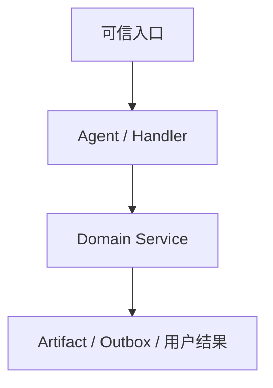

# 功能名称

一句话说明功能为谁解决什么问题。

## 功能定位

说明该功能在系统中的位置、上游输入、下游消费者，以及它为什么需要独立成为一个功能边界。若它对应 Agent，同时说明 Agent 化解决了什么运行问题；若不对应 Agent，说明保留为服务的原因。

## 实现流程图

## 能力边界

### 目标

- 写清功能必须完成的结果。

### 非目标

- 写清本功能刻意不负责的事情，以及由谁负责。

## 核心规则

1. 写清入口优先级、适用条件和拒绝条件。
2. 写清状态转换、数据唯一写入者和幂等口径。
3. 写清外部系统失败、重试和部分成功时的业务结果。
4. 写清 Agent、Tool、Skill、领域服务和控制面的边界。
5. 规则使用可验证的具体表述，避免“合理处理”“确保稳定”等空泛描述。

## 用户能力

- 用户、管理员或外部系统可以执行的操作。

## 入口与触发

| 入口 | 输入 | 输出 |
| --- | --- | --- |
| 消息/API/定时任务 | 输入契约 | 用户结果或 Artifact |

## 运行逻辑

1. 从可信入口接收输入。
2. 路由到 Agent 或领域服务。
3. 保存状态或生成 Artifact。
4. 通过受控投递返回结果。

## Agent、Tool 与服务边界

| 对象 | 职责 | 禁止承担 |
| --- | --- | --- |
| Agent 或服务 | 当前职责 | 明确越界行为 |

## 数据与状态

- 数据对象及其唯一写入者。
- 状态机、幂等键和保存顺序。

## 失败、安全与降级

- 外部系统失败、超时、重复请求和非法输入如何处理。
- 身份、权限、Secret、跨群或跨 Bot 隔离要求。

## 代码地图

### 主要实现

- `path/to/source.ts`：职责。

### 主要测试

- `path/to/test.test.ts`：覆盖内容。

## 变更记录

| 日期 | 变更 | 验证 |
| --- | --- | --- |
| YYYY-MM-DD | 初始化功能文档 | 待补充 |
