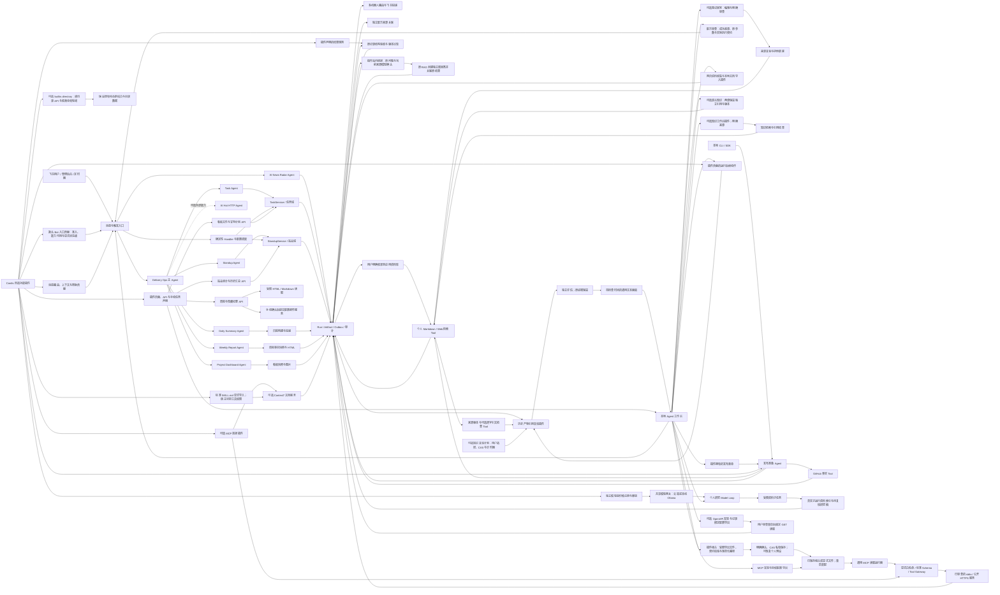

# 系统功能目录

本目录只维护系统功能索引与模板。每张 `FEATURE.md` 下沉到功能代码的主 Owner 目录，记录目标、边界、入口、实现流程、数据、失败场景、代码与测试地图；跨目录实现通过代码地图关联。图示直接写在 Markdown 内，不生成独立图片文件。

HTTP 默认装配个人知识、采集、验收、工具接入、研究、配方及模型提供者插件。下表 active 表示能力可启用，不表示团队能力会自动装配；原团队组合通过 profiles/agents/team.yaml 显式选择。

## 1. 当前功能

| Feature ID | 功能 | 状态 | 运行时 Agent 映射 | 功能文档 |
| --- | --- | --- | --- | --- |
| `knowledge-watch` | 正式本机 schedule 的知识引用复核、旧计划保护与独立运行凭证 | active（显式安装） | 控制面插件，复用 `native.knowledge-impact` | [查看](../../backend/src/knowledge/watch/FEATURE.md) |
| `plugin-profile-composer` | 页面启停接入助手、已审查能力组合的私有保存/应用/恢复 | active | 控制面插件，无独立 Agent | [查看](../../backend/src/connectors/profile-workbench/FEATURE.md) |
| `local-launcher` | 首次初始化、前后端启动、配置应用与本次进程清理 | active | 本地脚本，无独立 Agent | [查看](../../scripts/local/FEATURE.md) |
| `mixed-knowledge` | 笔记与网页并行检索、跨来源引用与独立版本复核 | active | `native.knowledge-mixed` | [查看](../../backend/src/knowledge/mixed/FEATURE.md) |
| `model-providers` | 模型提供者插件、配置诊断与无密钥本机 Ollama | active | 宿主模型端口，无独立 Agent | [查看](../../backend/src/platform/models/FEATURE.md) |
| `github-skill-workbench` | GitHub Skill 审查、个人基底组合与历史知识快照文本任务 | active（显式安装） | `native.skill-inspector` / `native.imported-skill` | [查看](../../backend/src/connectors/skill-workbench/FEATURE.md) |
| `rag-evaluation` | 固定虚构题集、隔离 RAG、当前模型确认与逐题规则对比 | active（显式安装） | `native.rag-evaluation` | [查看](../../backend/src/evaluations/FEATURE.md) |
| `knowledge-note-writeback` | 审查新笔记、来源版本复验、排他创建与回执恢复 | active（显式安装） | `native.knowledge-writeback` | [查看](../../backend/src/knowledge/writeback/FEATURE.md) |
| `run-recipes` | 原参数/版本核验、审查复用与运行来源关联 | active | 控制面插件，无独立 Agent | [查看](../../backend/src/recipes/FEATURE.md) |
| `personal-research-agent` | 模型研究、专业子任务与真实资料完成门槛 | active | `personal.research-agent` | [查看](../../backend/src/agents/personal-research/FEATURE.md) |
| `openapi-workbench` | OpenAPI 发现、原记录绑定配置导出与固定 GET 读取 | active（显式安装） | `native.openapi-inspector` / `native.openapi-runner` | [查看](../../backend/src/connectors/openapi/FEATURE.md) |
| `mcp-workbench` | MCP 工具发现、授权配置导出与通用运行 | active | `native.mcp-inspector` / `native.mcp-runner` | [查看](../../backend/src/connectors/mcp-workbench/FEATURE.md) |
| `plugin-result-checks` | 插件声明规则、结构验收、执行版本与记录对比 | active | `native.plugin-checks` | [查看](../../backend/src/quality/FEATURE.md) |
| `personal-knowledge-library` | 明确收录资料、私有保存、检索与 RAG 来源 | active | `native.knowledge-library` | [查看](../../backend/src/knowledge/library/FEATURE.md) |
| `web-page-capture` | 单篇网页正文、来源版本与 Markdown 导出 | active | `native.web-capture` | [查看](../../backend/src/knowledge/capture/FEATURE.md) |
| `local-document-import` | 本地 PDF/Office 转 Markdown 与原始指纹 | active | `native.document-convert` | [查看](../../backend/src/connectors/markitdown/FEATURE.md) |
| `personal-knowledge-workspace` | 可选知识界面、明确来源与匹配回答 | active | 确定性界面，无独立 Agent | [查看](../../backend/src/knowledge/workspace/FEATURE.md) |
| `local-agent-workspace` | 本地任务发起、运行追踪、知识与连接配置 | active | 控制面，复用现有 Agent | [查看](../../backend/src/platform/workspace/FEATURE.md) |
| `message-routing` | 飞书消息、引用上下文与 AI 兜底 | active | `built-in.delivery-ops-agent` | [查看](../../backend/src/services/messageHandler/FEATURE.md) |
| `task-management` | 任务创建、跟踪、状态流转与 TAPD 同步 | active | `built-in.task-agent` | [查看](../../backend/src/domains/task/FEATURE.md) |
| `standup-management` | 普通/任务型站会、到期提醒、独立统计与汇总 | active | `built-in.standup-agent` | [查看](../../backend/src/domains/standup/FEATURE.md) |
| `daily-summary` | 群聊日报生成、历史补全与投递 | active | `native.daily-summary` | [查看](../../backend/src/agents/native/daily-summary/FEATURE.md) |
| `weekly-report` | 站会、TAPD 与任务变更聚合的可视化周报 | active | `native.weekly-report` | [查看](../../backend/src/domains/weeklyReport/FEATURE.md) |
| `project-visibility` | 项目看板、历史快照与人力甘特图 | active | `native.project-dashboard`；人力甘特图不是 Agent | [查看](../../backend/src/agents/native/project-dashboard/FEATURE.md) |
| `ai-news-radar` | 飞书私聊查询、续页、搜索与多源 AI 信号，可选独立机器人 | active | `native.ai-news-radar` | [查看](../../backend/src/agents/native/ai-news-radar/FEATURE.md) |
| `release-preparation` | 结合仓库事实与个人规则生成发布草稿、引用与待确认项 | active | `native.release-prepare`；显式组合、本地 CLI / Web | [查看](../../backend/src/domains/release/FEATURE.md) |
| `community-developer-docs` | Context7 在线开发文档与标准 Agent Skills 导入 | active（显式安装） | `community.context7-docs` / `community.context7-assistant` | [查看](../../backend/src/connectors/context7/FEATURE.md) |
| `mcp-tool-connector` | 本地 stdio / 公开 HTTPS MCP、显式工具、标准 Schema 与连接生命周期 | active | 无独立业务 Agent；可选读取示例 | [查看](../../backend/src/connectors/mcp/FEATURE.md) |
| `github-project-facts` | GitHub 固定仓库的合并 PR、开放 Issue 与来源覆盖 | active | 无独立 Agent；只读连接 Tool | [查看](../../backend/src/connectors/github/FEATURE.md) |
| `knowledge-change-impact` | 历史引用版本与逐字引文复核、独立批量检查与本地持久化 | active | `native.knowledge-impact`；本地显式检查 | [查看](../../backend/src/knowledge/impact/FEATURE.md) |
| `personal-markdown-knowledge` | 只读 Markdown/Obsidian 同步、笔记链接与版本化关键词检索；本地 CLI | active | `native.knowledge-markdown`；显式安装，默认团队不启用 | [查看](../../backend/src/knowledge/markdown/FEATURE.md) |
| `personal-web-knowledge` | 公开单页 URL 抓取、正文提取、版本化检索与 RAG 组合 | active | `native.knowledge-web`；显式安装 | [查看](../../backend/src/knowledge/web/FEATURE.md) |
| `personal-knowledge-answer` | 个人知识 RAG 回答、原文引用核验与不足表达；本地 CLI | active | `native.knowledge-answer`；显式安装，默认团队不启用 | [查看](../../backend/src/knowledge/answer/FEATURE.md) |
| `meeting-summary` | 会议纪要生成、归档、查看与邮件分发 | dormant | 无 | [查看](../../backend/src/services/messageHandler/meeting-summary/FEATURE.md) |
| `configuration-scheduling` | 群组、成员、通讯录、模块开关与定时任务 | active | 无 | [查看](../../backend/src/core/configuration-scheduling/FEATURE.md) |
| `plugin-runtime` | Cordis 功能插件、消息/群调度/运行动作/Web 贡献、依赖与资源生命周期 | active | 无独立业务 Agent | [查看](../../backend/src/platform/plugins/FEATURE.md) |
| `agent-platform` | Agent、Tool、Skill、会话、外部 Agent 与多机器人控制面 | active | Agent Host 及全部 Agent | [查看](../../backend/src/platform/FEATURE.md) |
| `operations-observability` | 审计日志、上下文、手动触发、Run 与可靠投递 | active | 无独立业务 Agent | [查看](../../backend/src/platform/runtime/FEATURE.md) |

`dormant` 表示代码入口仍存在，但当前默认业务开关或用户导航不启用。不要把 dormant 功能写成已经面向用户稳定开放。

## 2. 当前真实 Agent

| Agent ID | Capability | 类型 | 所属功能 |
| --- | --- | --- | --- |
| `built-in.delivery-ops-agent` | `delivery.ops.orchestrate` | Model Loop 主 Agent | 消息路由、Agent 平台 |
| `built-in.task-agent` | `task.manage` | Model Loop 专业 Agent | 任务管理 |
| `built-in.standup-agent` | `standup.manage` | Model Loop 专业 Agent | 站会管理 |
| `native.daily-summary` | `summary.daily.generate` | Native Agent | 群聊日报 |
| `native.weekly-report` | `summary.weekly.generate` | Native Agent | 项目周报 |
| `native.project-dashboard` | `dashboard.project.generate` | Native Agent | 项目可视化 |
| `native.ai-news-radar` | `knowledge.ai.news.fetch` | Native Agent | AI 热点新闻助手 |
| `native.knowledge-markdown` | `knowledge.markdown.retrieve` | 可选 Native Agent | 个人 Markdown 知识源；显式安装后生效 |
| `native.knowledge-mixed` | `knowledge.mixed.retrieve` | 可选 Native Agent | 明确装配的笔记与网页混合来源 |
| `native.knowledge-web` | `knowledge.web.retrieve` | 可选 Native Agent | 公开网页知识源；显式安装后生效 |
| `personal.research-agent` | `personal.research` | 可选 Model Loop | 个人研究；HTTP 默认装配，需要模型 |
| `native.openapi-inspector` | `openapi.spec.inspect` | 可选 Native Agent | 公开 OpenAPI 接入；显式组合 |
| `native.openapi-runner` | `openapi.tools.run` | 可选 Native Agent | 固定契约 GET 读取；显式组合 |
| `native.mcp-inspector` | `mcp.server.inspect` | 可选 Native Agent | MCP 接入助手；HTTP 默认装配 |
| `native.mcp-runner` | `mcp.tools.run` | 可选 Native Agent | 已配置 MCP 读取工具运行；显式装配 |
| `native.plugin-checks` | `quality.runs.check` | 可选 Native Agent | 插件结果验收；HTTP 默认装配 |
| `native.knowledge-library` | `knowledge.library.manage` | 可选 Native Agent | 明确收录网页/文档与原文检索；HTTP 默认装配 |
| `native.web-capture` | `knowledge.page.capture` | 可选 Native Agent | 单篇网页正文与来源导出；HTTP 默认装配 |
| `native.document-convert` | `knowledge.document.convert` | 可选 Native Agent | 本地文档转换与来源指纹；HTTP 默认装配，需安装引擎 |
| `native.release-prepare` | `release.prepare` | 可选 Native 管线 | 个人知识驱动的只读发布准备 |
| `native.skill-inspector` | `skills.github.inspect` | 可选 Native Agent | GitHub Skill 来源与指令审查；显式安装 |
| `native.imported-skill` | `skills.prompt.run` | 可选 Native 管线 | 经原 Prompt Skill Runtime 生成文本；无外部工具 |
| `native.rag-evaluation` | `quality.rag.evaluate` | 可选 Native 管线 | 六题知识问答规则评测；显式安装 |
| `native.knowledge-writeback` | `knowledge.note.writeback` | 可选 Native Agent | 人工审查后新建知识笔记；显式收件目录 |
| `native.knowledge-impact` | `knowledge.impact.check` | 可选 Native 管线 | 指定历史 Run 的知识引用检查 |
| `native.knowledge-answer` | `knowledge.answer` | 可选 Native RAG 管线 | 个人知识回答；依赖来源插件与显式模型配置 |
| `community.context7-docs` | `docs.context7.lookup` | 可选 Native Agent | Context7 文档查询；无需模型 |
| `community.context7-assistant` | `docs.context7.research` | 可选 Model Loop | 标准 Context7 Skill 文档研究；需模型 |
| `external.ai-hot` | `knowledge.ai.hot.fetch` | 可选 HTTP Agent | Agent 平台；安装后生效 |

系统是 Agent 系统，但不是“每个功能都必须变成 Agent”。任务和站会的 Agent 通过受治理 Tool 复用领域服务；配置、日志和人力甘特图等确定性能力保留为服务或控制面。

## 3. 代码路径到功能文档的映射

修改下列路径时，必须同步修改对应功能文档。一次改动命中多行时，需要更新多份文档。

| 代码路径或对象 | 必须更新的 Feature ID |
| --- | --- |
| `backend/src/platform/workspace/**`、`frontend/src/pages/workspace/**`、`frontend/src/layouts/MainLayout.tsx`、`frontend/src/App.tsx`、`frontend/src/index.css` | `local-agent-workspace`、`operations-observability`；来源/配置契约变化追加对应功能；助手开关追加 `plugin-profile-composer`、`github-skill-workbench`、`openapi-workbench` |
| `backend/src/services/messageHandler/**` | `message-routing`；按 Handler 语义追加对应业务功能 |
| `backend/src/services/taskService.ts`、`backend/src/domains/task/**`、任务 Handler/Tool | `task-management`；涉及甘特图时追加 `project-visibility` |
| `backend/src/services/standupService.ts`、`backend/src/services/standup.ts`、站会 Handler/Tool | `standup-management` |
| 日报 Builder、Renderer、`native/dailySummaryAgent.ts` | `daily-summary` |
| `agents/native/ai-news-radar/**` | `ai-news-radar`；涉及 Bot/Outbox 时追加 `agent-platform`、`operations-observability` |
| `backend/src/domains/release/**`、`backend/src/scripts/release.ts` | `release-preparation` |
| `backend/src/connectors/profile-workbench/**` | `plugin-profile-composer`、`plugin-runtime`、`agent-platform`、`operations-observability`、`local-agent-workspace` |
| `backend/src/connectors/skill-workbench/**` | `github-skill-workbench`、`plugin-runtime`、`agent-platform`、`operations-observability`、`local-agent-workspace` |
| `backend/src/connectors/context7/**` | `community-developer-docs`、`plugin-runtime`、`agent-platform`、`operations-observability` |
| `backend/src/platform/skills/runtime.ts` | `agent-platform`、`plugin-runtime`、`operations-observability`；同步受影响的 Skill 消费者 |
| `backend/src/platform/skills/packageLoader.ts` | `agent-platform`、`plugin-runtime`、`operations-observability`；外部 Skill 变化同步对应接入功能 |
| `backend/src/recipes/**`、`frontend/src/runInputs.*` | `run-recipes`、`plugin-runtime`、`agent-platform`、`operations-observability`、`local-agent-workspace` |
| `backend/src/agents/personal-research/**` | `personal-research-agent`、`agent-platform`、`plugin-runtime`、`operations-observability`、`local-agent-workspace`、`plugin-result-checks` |
| `backend/src/connectors/openapi/**` | `openapi-workbench`、`plugin-runtime`、`agent-platform`、`operations-observability`、`local-agent-workspace` |
| `backend/src/connectors/mcp-workbench/**` | `mcp-workbench`、`plugin-runtime`、`agent-platform`、`operations-observability`、`local-agent-workspace` |
| `backend/src/connectors/mcp/**`、`backend/examples/plugins/mcp-reader.ts` | `mcp-tool-connector`、`plugin-runtime`、`agent-platform`、`operations-observability` |
| `backend/src/platform/agents/schema.ts` | `agent-platform`、`plugin-runtime`、`operations-observability`；使用完整外部 Schema 时追加连接功能 |
| `backend/src/connectors/github/**` | `github-project-facts`；结果协议变化同步使用它的任务功能 |
| `backend/src/evaluations/**`、`backend/src/scripts/evaluate.ts` | `rag-evaluation`、`plugin-runtime`、`agent-platform`、`operations-observability`、`local-agent-workspace`；同步 RAG/模型消费者文档 |
| `backend/src/quality/**`、`backend/src/platform/plugins/checks.ts` | `plugin-result-checks`、`plugin-runtime`、`agent-platform`、`operations-observability`、`local-agent-workspace`；规则变化同步提供者 |
| `backend/src/knowledge/library/**` | `personal-knowledge-library`、`personal-markdown-knowledge`、`personal-knowledge-workspace`、`local-agent-workspace`、`plugin-runtime`、`operations-observability`；来源组合变化同步回答/复核 |
| `backend/src/knowledge/capture/**` | `web-page-capture`、`personal-web-knowledge`、`local-agent-workspace`、`operations-observability` |
| `backend/src/connectors/markitdown/**` | `local-document-import`、`plugin-runtime`、`local-agent-workspace`、`operations-observability` |
| `backend/src/knowledge/workspace/**` | `personal-knowledge-workspace`、`local-agent-workspace`、`plugin-runtime`、`operations-observability` |
| `backend/src/knowledge/mixed/**` | `mixed-knowledge`、`personal-knowledge-answer`、`knowledge-change-impact`、`personal-knowledge-workspace`、`local-agent-workspace`、`plugin-runtime`、`agent-platform`、`operations-observability`；组合变化同步研究/发布 |
| `backend/src/knowledge/writeback/**` | `knowledge-note-writeback`、`plugin-runtime`、`agent-platform`、`operations-observability`、`local-agent-workspace`；同步知识来源文档 |
| `backend/src/knowledge/watch/**` | `knowledge-watch`、`knowledge-change-impact`、`local-agent-workspace`、`plugin-runtime`、`operations-observability` |
| `backend/src/knowledge/impact/**` | `knowledge-change-impact` |
| `backend/src/knowledge/versions.ts` | `knowledge-change-impact`、`personal-markdown-knowledge`、`personal-web-knowledge`；涉及生成证据时追加回答/发布准备 |
| `backend/src/platform/persistence/sqliteStore.ts` | `agent-platform`、`operations-observability`、`knowledge-change-impact`；同步知识/发布 CLI 功能卡 |
| `backend/src/knowledge/markdown/**` | `personal-markdown-knowledge`；影响证据时追加 `personal-knowledge-answer`、`release-preparation`、`knowledge-change-impact` |
| `backend/src/knowledge/web/**` | `personal-web-knowledge`；证据/版本变化追加 `personal-knowledge-answer`、`release-preparation`、`knowledge-change-impact` |
| `backend/src/knowledge/search.ts` | `personal-markdown-knowledge`、`personal-web-knowledge`；查询契约变化追加 `release-preparation` |
| `backend/src/knowledge/scope.ts` | `personal-markdown-knowledge`、`personal-web-knowledge`、`personal-knowledge-answer`、`github-project-facts`、`release-preparation`；版本 Scope 变化追加 `knowledge-change-impact`、`knowledge-watch`、`mixed-knowledge`、`personal-knowledge-library` |
| `backend/src/knowledge/modelConfiguration.ts` | `personal-markdown-knowledge`、`personal-web-knowledge`、`personal-knowledge-answer`、`release-preparation` |
| `backend/src/knowledge/answer/**` | `personal-knowledge-answer`；共享引用/证据协议变化追加 `release-preparation`、`knowledge-change-impact`；Host/Tool 契约变化时追加平台文档 |
| `backend/src/scripts/knowledge.ts` | `personal-markdown-knowledge`、`personal-web-knowledge`、`personal-knowledge-answer`、`knowledge-change-impact` |
| `backend/src/platform/models/**` | `model-providers`、`agent-platform`、`operations-observability`；同步受影响的模型调用功能 |
| `domains/weeklyReport/**`、`native/weeklyReportAgent.ts`、`WeeklyReportHandler.ts`、`WeeklyReportsPage` | `weekly-report` |
| Dashboard Service、Project Dashboard、`native/dashboardAgent.ts`、`native/project-dashboard/**`、`DashboardPage`、`HumanGanttPage`、`frontend/src/dashboardFiles.ts` | `project-visibility` |
| Meeting Summary Handler、`services/messageHandler/meeting-summary/**`、Service、邮件分发、`MeetingSummariesPage` | `meeting-summary` |
| `core/config`、`core/configuration-scheduling/**`、`agents/plugins/directory.ts`、Scheduler、`jobs.ts`、群成员同步、`ConfigPage` | `configuration-scheduling`；同时更新被调度的业务功能 |
| `backend/src/platform/scheduling/**` | `plugin-runtime`、`configuration-scheduling`、`operations-observability`；同步对应业务功能 |
| `backend/src/platform/plugins/web.ts`、`backend/src/platform/workspace/jobsApi.ts`、`frontend/src/pages/DebugPage.tsx` | `plugin-runtime`、`local-agent-workspace`、`operations-observability`、`configuration-scheduling`；同步贡献对应业务 |
| `backend/src/platform/plugins/**`、`backend/src/agents/plugins/**` | `plugin-runtime`、`agent-platform`；同步对应业务功能 |
| `backend/src/platform/agents/**`、`tools/**`、`skills/**`、`bots/**`、Agent 定义 | `agent-platform`；同时更新受影响的业务功能 |
| Outbox、Delivery Worker、Run/Step/Artifact、审计、上下文、Debug/Logs 页面 | `operations-observability`；同时更新产生产物的业务功能 |
| `package.json`、`scripts/local/**` | `local-launcher`、`local-agent-workspace`、`operations-observability` |
| `backend/src/index.ts`、`frontend/src/api.ts` | 根据变更接口所属能力更新对应功能；公共控制面变更追加 `operations-observability` |
| 公共 Store、Prisma Schema、`models/types.ts` | 更新所有使用该数据对象的功能文档 |

## 4. 功能文档同步规则

功能卡和代码共同描述一个功能，必须遵循以下规则：

1. 功能目标、能力边界或核心规则变化时，同一提交更新 Owner 目录中的 `FEATURE.md`。
2. 用户入口、API、消息、定时触发或 Handler 优先级变化时，更新入口表和运行逻辑。
3. Agent、Tool、Skill、领域服务或 Adapter 的关系变化时，更新 Mermaid 和职责边界。
4. 数据归属、状态机、幂等键、投递目标、重试或降级变化时，更新核心规则与数据说明。
5. 新增或移动源码、测试时，更新代码地图；跨目录功能仍只保留一个功能卡 Owner。
6. 文档与代码冲突时，以当前代码和测试为证据修正文档，并在变更记录说明差异。backend/test/featureIndex.test.ts 校验能力表列数、唯一 ID、Owner 链接、功能卡身份和声明数量，避免批量替换破坏索引。

新增功能从 [功能文档模板](FEATURE_TEMPLATE.md) 开始。

## 5. 评估结论

- **推荐在功能代码 Owner 目录使用 `FEATURE.md`，不推荐再放业务型 `AGENTS.md`。** `FEATURE.md` 面向人和 AI 共同解释产品能力；根目录 `AGENTS.md` 统一约束 AI 的修改流程。这样代码与功能事实相邻，又不会让业务说明和开发规则混在一起。
- **系统已经是 Agent 系统。** 它具备 Registry、三类 Adapter、Model Loop、Tool/Skill Runtime、委派、Session/Checkpoint、Run/Artifact、Outbox 和 Bot Binding，不只是“调用一次大模型”的普通业务系统。
- **系统采用混合架构是正确的。** 自主决策和可插拔执行使用 Agent，强一致状态交给 Domain Service，确定性管理和查询保留为服务/控制面。强行把每个页面或函数 Agent 化会增加成本、随机性和数据冲突。
- **当前功能文档覆盖 38 个能力。** 团队 SDK 组合包含 7 个 Agent；HTTP 个人默认十五插件、九个 Agent，包含来源检索、RAG、采集、导入、资料库、验收、MCP 接入、个人研究、任务配方及三个模型提供者。明确配置 GitHub 后为十七插件、十个 Agent；团队组合通过显式文件选择，AI Hot 是可选外部 Agent；会议纪要处于 dormant，其余功能通过 Agent、领域服务和控制面协作完成。
- **下一步维护重点**是保证功能卡与代码同提交更新，并继续把业务写入口收敛到 `TaskService`、`StandupService` 和受治理 Tool；新增机器人优先增加 Binding，新增自治能力再增加 Agent。
