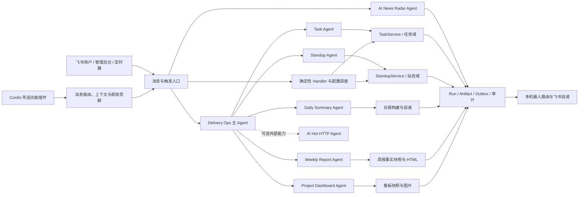

# 系统功能目录

本目录只维护系统功能索引与模板。每张 `FEATURE.md` 下沉到功能代码的主 Owner 目录，记录目标、边界、入口、实现流程、数据、失败场景、代码与测试地图；跨目录实现通过代码地图关联。图示直接写在 Markdown 内，不生成独立图片文件。

## 1. 当前功能

| Feature ID | 功能 | 状态 | 运行时 Agent 映射 | 功能文档 |
| --- | --- | --- | --- | --- |
| `message-routing` | 飞书消息、引用上下文与 AI 兜底 | active | `built-in.delivery-ops-agent` | [查看](../../backend/src/services/messageHandler/FEATURE.md) |
| `task-management` | 任务创建、跟踪、状态流转与 TAPD 同步 | active | `built-in.task-agent` | [查看](../../backend/src/domains/task/FEATURE.md) |
| `standup-management` | 普通/任务型站会、到期提醒、独立统计与汇总 | active | `built-in.standup-agent` | [查看](../../backend/src/domains/standup/FEATURE.md) |
| `daily-summary` | 群聊日报生成、历史补全与投递 | active | `native.daily-summary` | [查看](../../backend/src/agents/native/daily-summary/FEATURE.md) |
| `weekly-report` | 站会、TAPD 与任务变更聚合的可视化周报 | active | `native.weekly-report` | [查看](../../backend/src/domains/weeklyReport/FEATURE.md) |
| `project-visibility` | 项目看板、历史快照与人力甘特图 | active | `native.project-dashboard`；人力甘特图不是 Agent | [查看](../../backend/src/agents/native/project-dashboard/FEATURE.md) |
| `ai-news-radar` | 飞书私聊查询、续页、搜索与多源 AI 信号，可选独立机器人 | active | `native.ai-news-radar` | [查看](../../backend/src/agents/native/ai-news-radar/FEATURE.md) |
| `github-project-facts` | GitHub 固定仓库的合并 PR、开放 Issue 与来源覆盖 | active | 无独立 Agent；只读连接 Tool | [查看](../../backend/src/connectors/github/FEATURE.md) |
| `personal-markdown-knowledge` | 只读 Markdown/Obsidian 同步、笔记链接与版本化关键词检索；本地 CLI | active | `native.knowledge-markdown`；显式安装，默认团队不启用 | [查看](../../backend/src/knowledge/markdown/FEATURE.md) |
| `personal-web-knowledge` | 公开单页 URL 抓取、正文提取、版本化检索与 RAG 组合 | active | `native.knowledge-web`；显式安装 | [查看](../../backend/src/knowledge/web/FEATURE.md) |
| `personal-knowledge-answer` | 个人知识 RAG 回答、原文引用核验与不足表达；本地 CLI | active | `native.knowledge-answer`；显式安装，默认团队不启用 | [查看](../../backend/src/knowledge/answer/FEATURE.md) |
| `meeting-summary` | 会议纪要生成、归档、查看与邮件分发 | dormant | 无 | [查看](../../backend/src/services/messageHandler/meeting-summary/FEATURE.md) |
| `configuration-scheduling` | 群组、成员、通讯录、模块开关与定时任务 | active | 无 | [查看](../../backend/src/core/configuration-scheduling/FEATURE.md) |
| `plugin-runtime` | Cordis 功能插件、消息/群调度贡献、依赖与资源生命周期 | active | 无独立业务 Agent | [查看](../../backend/src/platform/plugins/FEATURE.md) |
| `agent-platform` | Agent、Tool、Skill、会话、外部 Agent 与多机器人控制面 | active | Agent Host 及全部 Agent | [查看](../../backend/src/platform/FEATURE.md) |
| `operations-observability` | 审计日志、上下文、手动触发、Run 与可靠投递 | active | 无独立业务 Agent | [查看](../../backend/src/platform/runtime/FEATURE.md) |

`dormant` 表示代码入口仍存在，但当前默认业务开关或用户导航不启用。不要把 dormant 功能写成已经面向用户稳定开放。

## 2. 当前真实 Agent

| Agent ID | Capability | 类型 | 所属功能 |
| --- | --- | --- | --- |
| `built-in.delivery-ops-agent` | `delivery.ops.orchestrate` | Model Loop 主 Agent | 消息路由、Agent 平台 |
| `built-in.task-agent` | `task.manage` | Model Loop 专业 Agent | 任务管理 |
| `built-in.standup-agent` | `standup.manage` | Model Loop 专业 Agent | 站会管理 |
| `native.daily-summary` | `summary.daily.generate` | Native Agent | 群聊日报 |
| `native.weekly-report` | `summary.weekly.generate` | Native Agent | 项目周报 |
| `native.project-dashboard` | `dashboard.project.generate` | Native Agent | 项目可视化 |
| `native.ai-news-radar` | `knowledge.ai.news.fetch` | Native Agent | AI 热点新闻助手 |
| `native.knowledge-markdown` | `knowledge.markdown.retrieve` | 可选 Native Agent | 个人 Markdown 知识源；显式安装后生效 |
| `native.knowledge-web` | `knowledge.web.retrieve` | 可选 Native Agent | 公开网页知识源；显式安装后生效 |
| `native.knowledge-answer` | `knowledge.answer` | 可选 Native RAG 管线 | 个人知识回答；依赖来源插件与显式模型配置 |
| `external.ai-hot` | `knowledge.ai.hot.fetch` | 可选 HTTP Agent | Agent 平台；安装后生效 |

系统是 Agent 系统，但不是“每个功能都必须变成 Agent”。任务和站会的 Agent 通过受治理 Tool 复用领域服务；配置、日志和人力甘特图等确定性能力保留为服务或控制面。

## 3. 代码路径到功能文档的映射

修改下列路径时，必须同步修改对应功能文档。一次改动命中多行时，需要更新多份文档。

| 代码路径或对象 | 必须更新的 Feature ID |
| --- | --- |
| `backend/src/services/messageHandler/**` | `message-routing`；按 Handler 语义追加对应业务功能 |
| `backend/src/services/taskService.ts`、`backend/src/domains/task/**`、任务 Handler/Tool | `task-management`；涉及甘特图时追加 `project-visibility` |
| `backend/src/services/standupService.ts`、`backend/src/services/standup.ts`、站会 Handler/Tool | `standup-management` |
| 日报 Builder、Renderer、`native/dailySummaryAgent.ts` | `daily-summary` |
| `agents/native/ai-news-radar/**` | `ai-news-radar`；涉及 Bot/Outbox 时追加 `agent-platform`、`operations-observability` |
| `backend/src/connectors/github/**` | `github-project-facts`；结果协议变化同步使用它的任务功能 |
| `backend/src/knowledge/markdown/**` | `personal-markdown-knowledge`；影响回答证据时追加 `personal-knowledge-answer` |
| `backend/src/knowledge/web/**` | `personal-web-knowledge`；回答组合变化追加 `personal-knowledge-answer` |
| `backend/src/knowledge/search.ts`、`backend/src/knowledge/scope.ts` | `personal-markdown-knowledge`、`personal-web-knowledge`、`personal-knowledge-answer` |
| `backend/src/knowledge/answer/**` | `personal-knowledge-answer`；共享 Host/Tool 契约变化时追加平台文档 |
| `backend/src/scripts/knowledge.ts` | `personal-markdown-knowledge`、`personal-web-knowledge`、`personal-knowledge-answer` |
| `backend/src/platform/models/**` | `agent-platform`、`operations-observability`；同步受影响的模型调用功能 |
| `domains/weeklyReport/**`、`native/weeklyReportAgent.ts`、`WeeklyReportHandler.ts` | `weekly-report` |
| Dashboard Service、Project Dashboard、`native/dashboardAgent.ts`、`HumanGanttPage` | `project-visibility` |
| Meeting Summary Handler、Service、邮件分发、`MeetingSummariesPage` | `meeting-summary` |
| `core/config`、Scheduler、`jobs.ts`、群成员同步、`ConfigPage` | `configuration-scheduling`；同时更新被调度的业务功能 |
| `backend/src/platform/scheduling/**` | `plugin-runtime`、`configuration-scheduling`、`operations-observability`；同步对应业务功能 |
| `backend/src/platform/plugins/**`、`backend/src/agents/plugins/**` | `plugin-runtime`、`agent-platform`；同步对应业务功能 |
| `backend/src/platform/agents/**`、`tools/**`、`skills/**`、`bots/**`、Agent 定义 | `agent-platform`；同时更新受影响的业务功能 |
| Outbox、Delivery Worker、Run/Step/Artifact、审计、上下文、Debug/Logs 页面 | `operations-observability`；同时更新产生产物的业务功能 |
| `backend/src/index.ts`、`frontend/src/api.ts` | 根据变更接口所属能力更新对应功能；公共控制面变更追加 `operations-observability` |
| 公共 Store、Prisma Schema、`models/types.ts` | 更新所有使用该数据对象的功能文档 |

## 4. 功能文档同步规则

功能卡和代码共同描述一个功能，必须遵循以下规则：

1. 功能目标、能力边界或核心规则变化时，同一提交更新 Owner 目录中的 `FEATURE.md`。
2. 用户入口、API、消息、定时触发或 Handler 优先级变化时，更新入口表和运行逻辑。
3. Agent、Tool、Skill、领域服务或 Adapter 的关系变化时，更新 Mermaid 和职责边界。
4. 数据归属、状态机、幂等键、投递目标、重试或降级变化时，更新核心规则与数据说明。
5. 新增或移动源码、测试时，更新代码地图；跨目录功能仍只保留一个功能卡 Owner。
6. 文档与代码冲突时，以当前代码和测试为证据修正文档，并在变更记录说明差异。

新增功能从 [功能文档模板](FEATURE_TEMPLATE.md) 开始。

## 5. 评估结论

- **推荐在功能代码 Owner 目录使用 `FEATURE.md`，不推荐再放业务型 `AGENTS.md`。** `FEATURE.md` 面向人和 AI 共同解释产品能力；根目录 `AGENTS.md` 统一约束 AI 的修改流程。这样代码与功能事实相邻，又不会让业务说明和开发规则混在一起。
- **系统已经是 Agent 系统。** 它具备 Registry、三类 Adapter、Model Loop、Tool/Skill Runtime、委派、Session/Checkpoint、Run/Artifact、Outbox 和 Bot Binding，不只是“调用一次大模型”的普通业务系统。
- **系统采用混合架构是正确的。** 自主决策和可插拔执行使用 Agent，强一致状态交给 Domain Service，确定性管理和查询保留为服务/控制面。强行把每个页面或函数 Agent 化会增加成本、随机性和数据冲突。
- **当前功能文档覆盖 16 个能力。** 默认团队组合包含 7 个 Agent；个人 Markdown、公开网页检索与 RAG 回答是三个可选 Native Agent，AI Hot 是可选外部 Agent；会议纪要处于 dormant，其余功能通过 Agent、领域服务和控制面协作完成。
- **下一步维护重点**是保证功能卡与代码同提交更新，并继续把业务写入口收敛到 `TaskService`、`StandupService` 和受治理 Tool；新增机器人优先增加 Binding，新增自治能力再增加 Agent。
