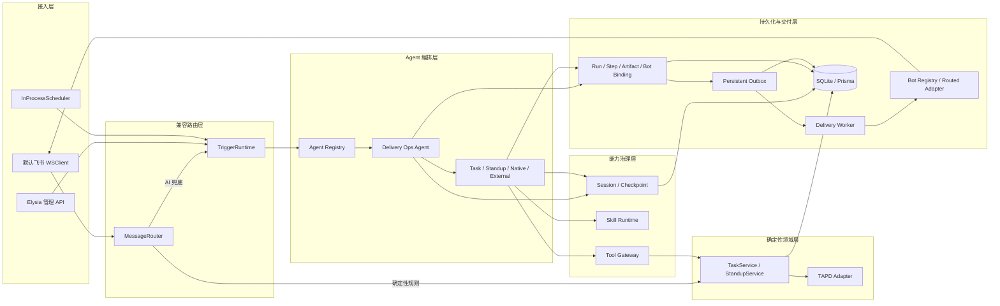

# AI Delivery Ops Agent 系统架构与业务逻辑详解

本文是当前系统的全局地图，内容以 2026 年 7 月完成的 Agent 化代码为准。系统采用“确定性领域服务 + 持久 Agent Host”架构：Task 和 Standup 领域服务拥有业务状态，主 Agent 与专业 Agent 负责理解、规划和编排。

## 1. 系统定位

系统连接飞书、TAPD 和大模型，承担五类职责：

1. 接收群聊、私聊、定时任务和管理 API 触发。
2. 通过任务与站会领域服务维护本地状态，并与 TAPD 同步。
3. 通过主 Agent 调度任务、站会、日报、看板和外部资讯 Agent。
4. 保存 Agent 会话、父子 Run、Step、Artifact 和人工输入检查点。
5. 通过 Outbox 把结果发送到 Trigger 指定的机器人和会话。

大模型不直接获得 Store、TAPD 或飞书发送权限。Agent 只能调用 Manifest 声明的 Tool、Skill 和子 Agent；Host 控制身份上下文、资源上限和最终投递。

## 2. 总体架构



## 3. 目录与边界

后端关键目录如下：

```text
backend/src/
├── agents/
│   ├── orchestrator/   # 主 Agent
│   ├── domain/         # Task / Standup Model Loop Agent 与领域 Tool
│   ├── native/         # 日报、看板等确定性 Agent
│   └── external/       # AIHot 等外部 Agent 安装包
├── platform/
│   ├── agents/         # Manifest、Registry、Runtime、Adapter、Session
│   ├── tools/          # Tool Registry、Gateway、调用记录
│   ├── skills/         # Skill Registry、Loader、Runtime
│   ├── runtime/        # Trigger Scope、Claim、执行入口
│   ├── delivery/       # Artifact 投递、Outbox、Worker
│   ├── bots/           # Bot Instance、Binding 和控制面持久化
│   ├── bootstrap/      # AgentHost 与调度入口
│   └── persistence/    # 持久化抽象
├── services/
│   ├── messageHandler/ # 确定性消息路由与兼容入口
│   ├── taskService.ts  # 任务领域规则
│   └── standupService.ts
└── adapters/           # 飞书、TAPD、AI 等外部系统适配器
```

目录方向合理，但迁移仍是渐进式的：`taskService.ts`、`standupService.ts` 和部分 Handler 还没有全部搬到 `domains/task`、`domains/standup`、`message`。继续新增功能时，应先复用服务入口，避免把规则再次写进 Handler 或 Agent Prompt；待边界稳定后再搬目录。

## 4. 消息兼容策略

已有用户功能必须保持行为不变，因此消息路径采用分层接管：

1. `ContextRouter` 先处理引用任务、待补充信息和明确上下文。
2. 站会、日报、看板、会议纪要、状态更新和任务命令 Handler 按既有规则运行。
3. 只有所有确定性 Handler 都未处理，并且 AI 配置可用时，`AgentFallbackHandler` 才调用 Delivery Ops Agent。
4. AI 不可用时，系统继续返回原有指令提示，不影响基本功能。

这不是临时双写。它是 Strangler 迁移边界：强一致规则留在领域层，主 Agent 逐步接管开放式编排，避免一次性重写造成业务回归。

## 5. 任务业务链路

### 5.1 原有确定性入口

1. Feishu Adapter 把事件转换为 `SourceMessage`。
2. MessageRouter 和 ContextRouter 识别任务创建、引用回复或状态动作。
3. `TaskService` 执行校验、创建、字段更新、状态流转和项目同步。
4. TAPD Adapter 创建或同步 Story。
5. 本地状态和审计记录完成后，系统发送结果通知。

### 5.2 Task Agent 入口

Task Agent 是独立 Model Loop Agent，拥有 `task.manage` Capability、会话和 `task-management` Skill。它不能直接访问 Store，只能使用：

- `task.query`：只读查询。
- `task.handle_message`：带入 Runtime 可信原始消息，复用现有确定性任务工作流。
- `task.sync_project`：通过 `TaskService` 同步项目范围。

写 Tool 优先使用 Runtime 注入的 `message/source/replyContext`，忽略模型提供的同名伪造值。因此 Agent 化没有改变操作者身份和原消息语义。

## 6. 站会业务链路

站会收集、重交、统计、缺交和汇总继续由 `StandupService` 统一定义。Standup Agent 使用：

- `standup.query`：按日期和群查询站会。
- `standup.handle_message`：复用现有站会消息流程。
- `standup.missing_members`：通过 StandupService 计算缺交成员。

站会 Agent 拥有 `standup-management` Skill，但 Skill 不拥有站会数据。Handler、Job、Agent 和 Skill 都不能建立第二套保存或统计口径。

## 7. 主 Agent 与子 Agent

`built-in.delivery-ops-agent` 是主编排 Agent。它把以下 Capability 暴露为 Agent Tool：

- 必需：`task.manage`、`standup.manage`、`report.daily.generate`、`dashboard.project.generate`。
- 可选：`knowledge.ai.hot.fetch`。只有安装并绑定 AIHot 后才出现。

每次委派都会创建 Child Run，并记录 `rootRunId`、`parentRunId`、Correlation 和 Depth。父 Agent 不能调用 Manifest 未声明的 Capability；Runtime 同时限制总 Agent 调用次数、最大深度和共同 Deadline。

子 Agent 返回非 Markdown Artifact 时，主 Agent 会把它提升到 Root Run 的最终结果中；等待人工信息的子 Run 在用户回复后原地恢复。

## 8. Model Loop、Session 与人工恢复

Model Loop Adapter 负责：

1. 按 Manifest 解析允许的 Tool、Skill 和 Agent Tool。
2. 把消息与会话摘要交给 AI SDK Orchestrator。
3. 逐步记录模型调用和 Tool 调用。
4. 在缺少关键字段时调用 `request_human_input`。
5. 保存 Checkpoint，并在后续回复中恢复同一个 Run。

Session 按 Workspace、Bot、Channel、Conversation 和 User 隔离，限制消息数量并按 TTL 过期。压缩后的摘要只补充历史语境，不改变领域状态。

## 9. Agent 对象模型

| 对象 | 作用 |
| --- | --- |
| Manifest | 声明身份、Capability、触发器、Schema、Tool/Skill/Delegate、资源上限 |
| Installation | 保存 Workspace 级版本、配置和 Secret 引用 |
| Binding | 把 Installation 绑定到 Bot、Capability 和优先级 |
| Trigger | 保存来源、可信 Scope、幂等键和 Reply Policy |
| Run | 一次 Root 或 Child Agent 执行 |
| Step | 模型、Tool 或 Adapter 执行步骤与错误 |
| Session | 有界对话记忆和摘要 |
| Checkpoint | 等待人工输入的恢复点 |
| Artifact | 文本、文章列表、图片、文件或 JSON 产物 |
| Delivery | Artifact 到指定 Bot 会话的一次可靠投递 |

Runtime 类型定义包含 `native`、`model-loop`、`http`、`a2a`、`mcp-agent`、`process` 和 `container`。当前只启用前三种；其余是预留类型。

## 10. Tool 与 Skill 治理

Tool Manifest 声明输入输出 Schema、副作用级别、风险、幂等性和超时。Tool Gateway 验证 Agent 白名单、输入、输出、调用幂等键和执行记录。

Skill Package 包含 Manifest 与指令，可声明允许的 Agent 和依赖 Tool。Loader 只从限定 Skill 根目录加载包，阻止路径越界；Skill Runtime 只把声明过的 Tool 暴露给执行器。

选择标准：

- 单一原子操作用 Tool。
- 可复用操作方法、提示和有限 Tool 组合用 Skill。
- 需要目标、规划、记忆、暂停恢复或子能力委派时用 Agent。
- 业务状态机、事务和同步口径用 Domain Service。

## 11. 执行与可靠投递

1. Trigger Claim Store 原子抢占幂等键。
2. Agent Registry 按 Workspace、Bot 和 Capability 解析 Binding。
3. Agent Runtime 创建 Run 和 Step，执行对应 Adapter。
4. Runtime 校验状态、Artifact 类型和大小。
5. Trigger Runtime 按 Host 的 Reply Policy 创建 Delivery。
6. Outbox Worker 领取租约并选择目标 Bot Adapter。
7. 临时失败进入重试；永久失败进入终态；进程中断后的过期租约可以再次领取。

Agent 无权覆盖目标 Bot、Workspace 或 Conversation，也不能直接调用飞书发送接口。

## 12. 外部 Agent

通用 HTTP Agent 安装器校验：

- 外部 Agent 不使用 `native.*` 命名空间。
- Endpoint 是无用户名和密码的 HTTPS URL。
- Endpoint Host 在 Manifest 网络白名单中。
- Secret 只使用 `env://ENV_NAME` 引用。
- `directDelivery` 必须为 `false`。

HTTP Adapter 禁止重定向，限制 Deadline 与响应字节，并只把需要的安装配置和已解析 Header 发给远端。当前协议是项目自定义 `AgentRequest/AgentResult`，不是 A2A。

## 13. 多机器人

控制面可以持久注册非默认飞书 Bot，并把 Agent Installation 独立绑定到每个 Bot。手动运行、Run、Session、Trigger、Outbox 和投递 Adapter 都携带 Workspace/Bot Scope；出站时按 Bot 解析不同的 App ID 和 `env://` Secret。

当前限制是入站：Bootstrap 只自动启动默认 Bot 的飞书 WSClient。次机器人已经能独立运行和出站，但要接收自己的事件，还需实现多连接 Ingress Supervisor。

## 14. 数据与部署

业务数据、动态配置和 Agent 状态保存在 SQLite。Agent Catalog、Run、Step、Session、Checkpoint、Trigger Claim、Artifact、Outbox、Bot 和 Binding 当前复用持久 KV 接口。

这套实现适合当前内网单实例，并能在进程重启后恢复；它不适合多个 Pod 同时写一个 SQLite 文件，也不适合长期大规模 Run 查询。规模增长后，应拆分正式表、索引、归档和保留策略，再评估 PostgreSQL 与队列。

## 15. 安全边界

- 原有消息操作者和内容由 Runtime 可信上下文提供。
- Tool、Skill、Delegate、网络 Host、Artifact 和资源上限均使用白名单。
- Secret API 只返回名称或存在状态，不返回引用和值。
- Host 决定最终投递目标，防止模型或外部 Agent 串 Bot、串群。
- 控制面当前没有登录和 RBAC，仅适用于可信内网。
- 第三方本地代码尚未启用；未来必须使用进程或容器沙箱。

详细评分、提交阶段、成熟架构对照和后续路线见 [《Agent 架构升级与系统评估（2026-07）》](Agent架构升级与系统评估-2026-07.md)。
