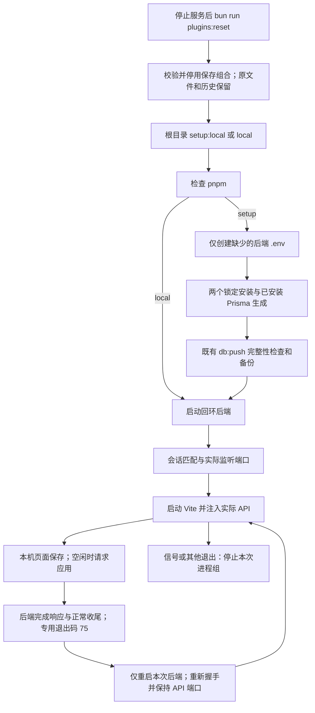

# 本地初始化与联合启动

让首次使用者从仓库根目录运行一个命令，获得可连接的前后端和无密钥示例体验。

## 功能定位

开发与体验入口，复用已有包脚本、安全数据库同步及 HTTP 工作台；是确定性脚本，不增加运行时 Agent 或插件。

## 实现流程图

## 能力边界

### 目标

- 初次配置不覆盖现有文件，安装或数据库步骤失败立即停止。
- 前端明确连接自己启动的后端；动态端口不串到旧服务。
- 信号和失败清理本次服务及继承进程组的后代。

### 非目标

- 不安装系统运行时、外部模型或文档转换器，不部署。
- 不提供后端代码监听或崩溃自动重试，不替代运行结果和外部连接诊断。
- 不管理第三方工具主动脱离本次进程组的后台守护进程。

## 核心规则与运行逻辑

1. 根 package.json 提供初始化、联合启动和保存组合恢复三个脚本，不声明 workspace 或依赖，保留后端 Bun 和前端 pnpm 锁。
2. --setup 以 wx/0600 创建缺少的 backend/.env。锁定安装后调用已安装的 Prisma generate 和既有 bun run db:push，不使用 accept-data-loss。
3. 本地启动前检查必要依赖，缺少时给出初始化提示。直接执行 backend/src/index.ts，避免包脚本包装层重复转发停止信号；固定 HOST=127.0.0.1；保留 PORT、DATA_DIR 与插件选择。
4. 仅监听成功后，后端在 LOCAL_DEV_SESSION 存在时输出 JSON 标记。前端启动要求 event/session/hostname 匹配、port 为 1–65535 整数；忽略其他日志和超过 8 KiB 的行。60 秒未确认则失败清理。
5. VITE_API_BASE 显式覆盖为本次后端实际端口，Vite 同样绑定回环；前端实际页面端口由 Vite 输出。
6. 除配置应用的专用退出码 75 外，任一服务结束均停止另一端；异常退出返回非零。SIGINT/SIGTERM 是正常停止。POSIX 为独立进程组，先 SIGTERM 等待最多 10 秒，再强制停止未结束组，不查杀其他端口。中断安装步骤同样受清理管理，停止信号只发一次；收尾完成前持续接收重复中断，避免提前退出丢失强制清理。
7. 本机页面保存连接/知识来源后可申请应用；空闲检查通过才响应 202，并在响应之后正常收尾。启动器仅对本次后端退出码 75 重新启动，清理原进程组并再次校验独立会话标记，保持首次实际 API 端口和原 Vite 进程。其他崩溃、重启失败或标记不符仍停止本次服务，不无限重试。后端代码与手写插件组合更新仍需手动重启；前端热更新保持。

## 用户能力与入口

| 入口 | 输入 | 输出 |
| --- | --- | --- |
| bun run setup:local | 既有环境和本地 .env | 初始化后前后端地址与日志 |
| bun run local | 已初始化环境 | 同一终端的服务与退出管理 |

## Agent、Tool 与服务边界

启动器仅管理本机进程。Agent Host 继续拥有 Run/Step/Artifact、预算及恢复；db:push 继续拥有数据库检查与备份。启动标记不等于外部服务健康或任务成功。

## 数据与状态

仅缺少时新增 backend/.env；依赖、Prisma 客户端、SQLite 及备份由既有命令写入。原连接、知识与历史不迁移、不覆盖；保留手动双终端开发方式。

## 失败、安全与降级

安装、Prisma 或数据库失败不进入服务启动。后端占用端口报错，不复用占用者。保留用户配置意味着已有真实凭据和插件仍可能按用户配置启动。信号不能撤销已发生的业务操作；长任务应先确认结束。Windows 使用 cmd/taskkill 兼容分支，尚未实际验证；macOS/Linux 测试验证标准进程组，主动脱离组的守护程序不在清理范围内。

## 代码地图与验证

- package.json：根目录初始化、启动与插件组合恢复命令。
- scripts/local/launcher.ts：配置初始化、锁定安装、实际端口握手、联合生命周期。
- backend/src/index.ts：可选的本次会话监听标记。
- backend/src/scripts/dbPush.ts：复用的安全数据库同步。
- backend/test/localLauncher.test.ts：标记边界、配置保留、动态端口、失败、中断、后代清理、重复中断与大于 300ms 的服务/前置命令收尾。
- backend/test/sqliteDeployment.test.ts：已有数据库安全契约。
- docs/LOCAL_DEVELOPMENT.md：使用与手动排障。

验证：后端类型与回归；干净归档副本实际 setup:local → 示例检索 → 退出 → local 重启并核对历史，前端既有门禁。外部模型效果与 Windows 待单独验证。

## 变更记录

| 日期 | 变更 | 验证 |
| --- | --- | --- |
| 2026-11-06 | 后端改为直接启动，减少停止信号包装层 | 生命周期专项与 Linux CI |
| 2026-11-06 | 新增根初始化与联合启动，保留原开发脚本 | 生命周期专项、类型/回归与干净副本实际体验 |

2026-11-06 首次体验复验：从公开 main 的 1267801 新克隆，无项目依赖/配置/数据库，实际执行根 setup:local，浏览器无密钥检索成功；正常停止后本次两个监听端口关闭，local 再启动保留同一 Run/Step/Artifact 与原 .env（0600）。使用普通包缓存，未复用工作目录的 node_modules；记录见 docs/PROJECT_EVIDENCE.md 的“公开 main 全新安装复验”。运行行为保持，验证继续由 backend/test/localLauncher.test.ts、workspaceComposition.test.ts、featureIndex.test.ts 覆盖。

2026-11-06 当前个人预设复验：从公开 main 的 166f98a 全新克隆，实际 setup:local 安装锁定依赖并完成无密钥检索；正常退出关闭本次两个端口，再用 local 重启，API 动态端口变化但前端仍连接本次服务，原 Run/Step/Artifact 和 .env（0600）保持。安装后只加入本批 KnowledgePage.tsx 模型入口提示，启动器与后端源代码保持该提交原样；复用普通包缓存。详见 docs/PROJECT_EVIDENCE.md 的“当前个人预设的全新安装与模型入口”，现有生命周期测试保持。

2026-11-06 配置应用：新增已保存配置的本地后端重载，保留前端进程、端口和现有数据；非启动器模式不提供此能力。代码新增入口为 platform/workspace/api.ts 的 POST /reload、AgentHost.isIdle、index.ts 的共享收尾 Promise 与退出 75。验证：localLauncher.test.ts 真实两次重载/稳定端口/普通崩溃清理，workspace.test.ts 空闲、Origin/输入、响应及重复写保护；前端 api.test.mjs 检查丢失回执、旧实例不能冒充生效和忙碌拒绝。浏览器与数据验收记录见 docs/PROJECT_EVIDENCE.md。

2026-11-06 已审查组合：页面保存后沿用既有空闲重载流程。所选服务若导致启动失败，启动器保持正常失败退出，不自动回滚；停止服务后可从根目录执行 bun run plugins:reset，再 bun run local。恢复命令 backend/src/scripts/resetPluginProfile.ts 复用 SavedPluginProfiles，只停用原记录，不删除历史或来源；显式文件仍优先，损坏文件只报错。backend/test/savedPluginProfiles.test.ts 覆盖实际命令子进程与默认装配恢复，原生命周期回归保持。
